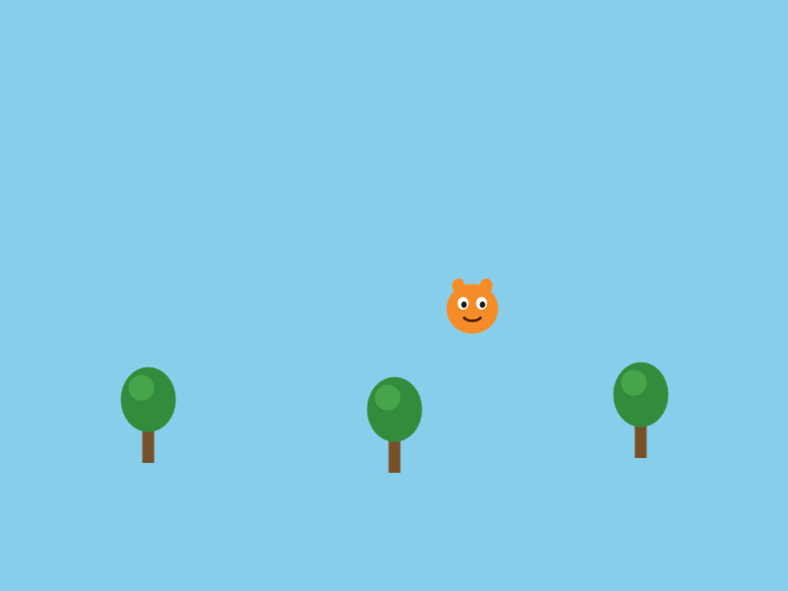
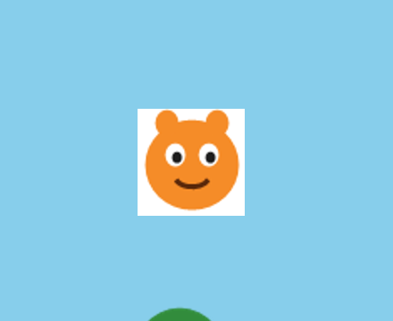
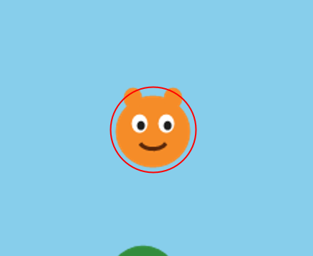
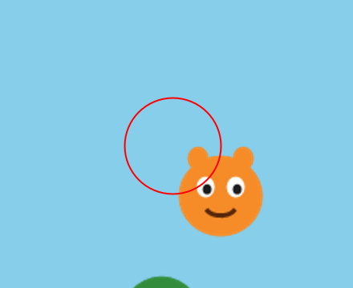
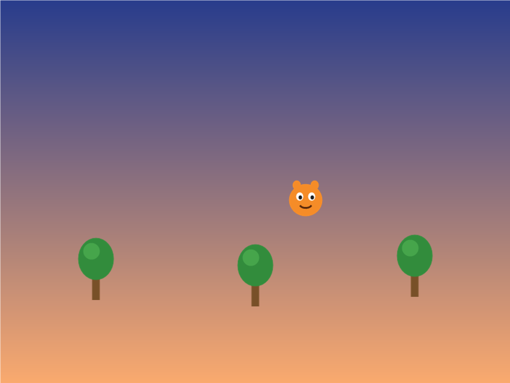

# Bonus A - Images

*Swap your shapes for actual pictures.*

---

So far, everything on your screen is made of shapes you drew in code:  circles,
rectangles, arcs.  This chapter puts real pictures in your game.  A character
you drew in a paint program, a tree you found online, a whole background.

You can take it any time after Chapter 4.  It works well between Chapters 4 and
5, or during Chapter 7, when you're making your world look finished.  It takes
one meeting.

This chapter does it in three moves.

| Part | The idea |
|---|---|
| One | **Pictures live in a folder.**  The `data` folder, and how a sketch finds a file. |
| Two | **Scenery:  `ImageSprite`.**  A sprite that's a picture. |
| Three | **Your character as a picture.**  Keep `extends Blob`, and draw a picture in `drawSprite()`. |

---

# Part One - Pictures live in a folder

## A.1  Your picture

**Your turn.**  Find or draw a small picture for your character.  PNG is the
kind of file you want.  A PNG can have a **transparent** background, so the
world shows through around your character.  You can draw a 32-by-32 character in
any paint program, or find free art at opengameart.org.

## A.2  The `data` folder

Processing looks for pictures in exactly one place:  a folder called `data`,
inside your sketch's folder.

**Build it.**

1. Open your sketch, and choose **Sketch → Show Sketch Folder**.
2. Make a new folder in there called `data`.  Exactly that, all lowercase.
3. Drag your picture into `data`.
4. Write down its name exactly, capitals and the ending (`.png`) included.

---

# Part Two - Scenery:  `ImageSprite`

## A.3  A sprite that's a picture

An **`ImageSprite`** is a sprite from the library that shows a picture.  It has
the sprite behaviors you know:  `move()`, `setVelocity()`, `followMouse()`,
`drawSprite()`.  It takes the sketch, where its **center** goes, the file's
name, and a size:

```java
new ImageSprite(this, x, y, "tree.png")            // 100 x 100 pixels
new ImageSprite(this, x, y, "tree.png", 80)        // 80 x 80 square
new ImageSprite(this, x, y, "tree.png", 120, 80)   // 120 wide, 80 tall
```

It has no `collidesWith()`.  An `ImageSprite` is a sprite, and it isn't a Blob,
so it can't collide.  Save it for scenery:  the things in the world your player
just looks at.

## Step 1 - A picture in the world

**Build it.**  Start with the easy one.  Add an `ImageSprite` to your sketch, in
the same three places as every object since Chapter 1.  Here are three trees,
from the Canvas page's sample sketch:

```java
ImageSprite tree1;
ImageSprite tree2;
ImageSprite tree3;
```

```java
  // in setup().  Replace "tree.png" with your own file name.
  tree1 = new ImageSprite(this, 150, 420, "tree.png", 60, 100);
  tree2 = new ImageSprite(this, 400, 430, "tree.png", 60, 100);
  tree3 = new ImageSprite(this, 650, 415, "tree.png", 60, 100);
```

```java
  // in draw(), before your player:  decorations go behind
  tree1.drawSprite();
  tree2.drawSprite();
  tree3.drawSprite();
```

Run it.

> **Check.**  Your pictures, in your world.

> **Screenshot:**  Three trees, and a picture character from Part Three.  The
> art is stand-in art.  Yours is yours.
>
> 

Change the size numbers until your picture looks the right shape.  A tall tree
squashed into a square looks wrong.

## Step 2 - When the picture doesn't show

Three things go wrong here, and each one looks different.

> **Watch out.**  **The name doesn't match.**  Ask for `"pine.png"` when the file
> is `tree.png`, and Processing prints this under your code, then stops:
>
> ```
> The file "pine.png" is missing or inaccessible, make sure the URL is valid or that the file has been added to your sketch and is readable.
> ```
>
> Check that the file is in `data`, and check the name, letter by letter.

> **Watch out.**  **The capitals don't match.**  Ask for `"Tree.PNG"` when the file
> is `tree.png`, and Processing stops and tells you exactly what's wrong:
>
> ```
> This file is named tree.png not Tree.PNG. Rename the file or change your code.
> ```
>
> Capitals count here too, the same as in your code.

> **Watch out.**  **A white box around your picture.**  The PNG was saved without a
> transparent background.  The picture really is a rectangle, and its background
> just happens to be white.  Your code is fine.  Find or make a PNG with a
> transparent background.  Free tools like remove.bg can take a background out
> for you.

> **Screenshot:**  The same character, saved on a white background.
>
> 

---

# Part Three - Your character as a picture

## A.4  Keep the Blob

Your player needs to collide with things, and an `ImageSprite` can't.  So for
your character, keep `extends Blob`, exactly as you wrote it in Chapter 2, and
change `drawSprite()` to draw a picture in place of shapes.

## Step 3 - `MyImageCharacter`

**Build it.**  Make a new tab called `MyImageCharacter`, and paste this in:

```java
// MyImageCharacter - like MyCharacter, but draws a picture instead of shapes.
// extends Blob means it still has collidesWith() for collision detection.
class MyImageCharacter extends Blob {

  PImage img;

  MyImageCharacter(PApplet p, float x, float y, String fileName) {
    super(p, x, y, 30, color(0));  // radius 30 - the invisible collision circle
    img = p.loadImage(fileName);
  }

  void drawSprite() {
    parent.pushStyle();
    parent.imageMode(CENTER);
    parent.image(img, pos.x, pos.y, 60, 60);  // drawn centered on the sprite's position
    parent.popStyle();
  }
}
```

Read it against your `MyCharacter` tab.  The class line, the handshake, and a
`drawSprite()`.  Three things are new.

> **Aside:  `PImage` and `loadImage()`**
>
> A **`PImage`** is Processing's kind of variable for a picture.  `PImage img;`
> makes a box for one.  `loadImage(fileName)` reads the file out of your `data`
> folder and puts it in the box.  The constructor does that once, when the
> character is made.  `String` is the kind of thing a piece of text is, like
> `"hero.png"`.

> **Aside:  `imageMode(CENTER)`, and `pushStyle()`**
>
> `image(img, pos.x, pos.y, 60, 60)` draws the picture, 60 by 60.  Normally a
> picture is placed by its top-left corner, like a `Block`.
> `imageMode(CENTER)` places it by its middle, so it sits on the belly button
> like every other part of your character.  `pushStyle()` and `popStyle()` save
> and put back Processing's settings around it, so `imageMode` only changes
> your character's drawing.

**Build it.**  In your main tab, make your player a `MyImageCharacter` in place
of a `MyCharacter`, in the declaration at the top and in `setup()`:

```java
  player = new MyImageCharacter(this, width/2, height/2, "hero.png");
```

Use your own file's name.  Run it, and move your character around.

> **Check.**  Your picture, moving and colliding the way your shape character
> did.

## Step 4 - See your hitbox

The radius in `super(...)` is **still** your hitbox.  The picture doesn't change
that.  So it helps to see where the hitbox is while you tune it.

**Build it.**  At the end of `drawSprite()`, after `popStyle()`, draw the hitbox
as a ring:

```java
    parent.noFill();
    parent.stroke(255, 0, 0);
    parent.ellipse(pos.x, pos.y, 2 * radius, 2 * radius);   // the hitbox
```

> **Check.**  A red ring around your picture.  That's exactly the circle
> `collidesWith()` uses.

> **Screenshot:**  The hitbox, drawn as a ring.
>
> 

Tune the `30` in `super(...)` until the ring fits.  A ring slightly smaller than
the picture usually feels fairest.  Then take the three ring lines out, before
anybody else plays.

> **Watch out.**  Leave out `imageMode(CENTER)`, and the picture is placed by its
> corner.  It sits down and to the right of your hitbox, and collisions feel
> broken, because they're happening where your character isn't drawn.

> **Screenshot:**  No `imageMode(CENTER)`.  The hitbox is where the character
> is, and the picture is somewhere else.
>
> 

> **Watch out.**  `player.collidesWith(tree1)` stops the sketch with:
>
> ```
> The method collidesWith(Blob) in the type Blob is not applicable for the arguments (ImageSprite)
> ```
>
> That's Processing's way of saying a tree is an `ImageSprite`, and
> `collidesWith()` only works with Blobs.  If your player has to touch it, make it
> a Blob with a picture inside, the way `MyImageCharacter` is.

The rule, side by side:

| It needs to | Use |
|---|---|
| **collide** (your player, coins, hazards) | `extends Blob`, with a `PImage` inside |
| just **look nice** (trees, clouds, a background) | `ImageSprite` |

---

## A.5  Make it yours

**Your turn.**  Your own character picture.  A PNG with a transparent background
looks best by a mile.

**Your turn.**  Fix the size, the `60, 60` in `image()`, so it matches your art's
real shape.

**Your turn.**  **Optional:**  any of these.

- A **background picture**, as big as the window, drawn first in `draw()`, right
  after `background()`:

```java
  bg = new ImageSprite(this, width/2, height/2, "background.png", width, height);
```

> **Screenshot:**  A background picture, behind the trees.
>
> 

- A decoration that drifts:  give an `ImageSprite` a velocity, and `move()` it.
- A tilted one:  `tree3.setRotation(PI/6);` tips it a little.  `PI` is half a
  turn, so `PI/6` is a twelfth of one.
- Coins and hazards as pictures.  They have to collide, so they need
  `extends Blob` with a picture inside, the same as `MyImageCharacter`.
- Fake an animation.  Load **two** `PImage`s and swap between them every few
  frames.  That's the whole idea behind Bonus C.

> **Watch out.**  When you hand in your sketch, zip the whole folder, `data` and
> all.  Without the `data` folder, nothing runs.

---

## Chapter summary

| You built | It's an example of |
|---|---|
| a `data` folder | where Processing looks for files |
| `new ImageSprite(this, x, y, "tree.png", 60, 100)` | a sprite that's a picture, for scenery |
| `MyImageCharacter extends Blob` | a picture inside a Blob, so it still collides |
| `imageMode(CENTER)` | placing a picture by its middle |
| the red ring | seeing your hitbox while you tune it |

### New syntax in this chapter

| Syntax | Where you met it |
|---|---|
| `ImageSprite` | A.3, Step 1 |
| `PImage`, `loadImage()`, `String` | Step 3 |
| `image()`, `imageMode(CENTER)` | Step 3 |
| `pushStyle()`, `popStyle()` | Step 3 |
| `radius` | Step 4 |
| `setRotation()` | A.5 |

### Vocabulary

**`data` folder** -- a folder inside your sketch's folder, where Processing
looks for pictures and sounds.  (A.2)

**`ImageSprite`** -- a sprite from the library that shows a picture.  It can't
collide.  (A.3)

**`PImage`** -- Processing's kind of variable for a picture.  (Step 3)

**transparent** -- a part of a picture with no color at all, so whatever's
behind it shows through.  (A.1)

### Check your understanding

1. Where does Processing look for your picture?
2. Why can't you use `collidesWith()` on an `ImageSprite`?  What do you do when
   a picture has to collide?
3. Your character has a white box around it.  What's wrong, and is it your code?
4. What does `imageMode(CENTER)` change?
5. Why does a picture character still need `extends Blob`?
