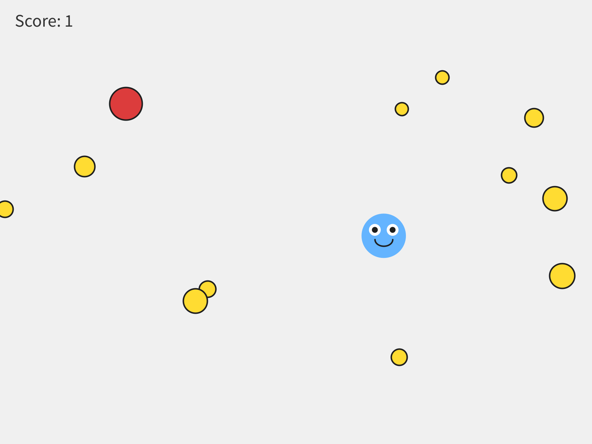
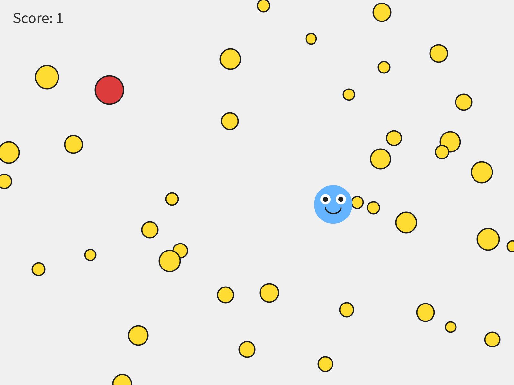

# Bonus D - Lists and Loops

*One coin is a variable.  Twenty coins is a list.*

---

Look at your game from Chapter 6 or 7.  Each coin is a variable, a
`new Blob(...)` line, a `move()`, a `drawSprite()`, and an `if`.  Adding one more
coin takes five pieces in four places.  Twenty coins is about a hundred lines,
and every one of them is a chance to type `coin13` where you meant `coin14`.

This chapter fixes that with a **list**:  one variable that holds as many coins
as you give it, and loops that do the same thing to every one of them.

It's for the student who wants lots of coins.  Take it during Chapter 7, or any
time after Chapter 6.  It takes one meeting.  If you're working on your Chapter 7
game, save a copy first, and do this chapter on the copy.

This chapter does it in three moves.

| Part | The idea |
|---|---|
| One | **A bag.**  An `ArrayList`, one variable for many things. |
| Two | **Two loops that both say `for`.**  One counts, to make things.  One visits, to move and draw them. |
| Three | **Taking things out.**  Removing a coin you collected, safely. |

---

# Part One - A bag

## D.1  `ArrayList`

Think of a list as a **bag**.  You keep putting things in, and it holds as many
as you give it.  There are three things you do with a list:

```java
ArrayList<Blob> coins;                 // 1. declare it (what kind of bag)
coins = new ArrayList<Blob>();         // 2. create it (get an empty bag)
coins.add(new Blob(...));              // 3. add to it (put something in)
```

> **Aside:  `ArrayList<Blob>`**
>
> An **`ArrayList`** is a list that grows as you add to it.  The `<Blob>` says
> what kind of bag it is:  a bag of Blobs.  `coins.add(...)` puts one more thing
> in the bag.

## Step 1 - An empty bag

**Build it.**  Open your Chapter 6 sketch.  At the top, replace `Blob coin;` with:

```java
ArrayList<Blob> coins;      // a list that holds Blobs
```

In `setup()`, replace the line that makes your coin with:

```java
  coins = new ArrayList<Blob>();   // an empty list
```

> **Watch out.**  Forget that line, and there's no bag.  The sketch stops with
> `NullPointerException` the first time you try to put something in it.

---

# Part Two - Two loops that both say `for`

Java uses the same word, `for`, for two loops that feel completely different.
One **counts**, and you use it to make things.  The other **visits**, and you use
it to do something to everything already in the list.  Keeping them straight is
the real skill in this chapter.

## Step 2 - Fill it:  the counting loop

**Build it.**  In `setup()`, right after the empty list, fill it:

```java
  // Counting loop - runs 12 times to create 12 coins
  for (int i = 0; i < 12; i++) {
    coins.add(new Blob(
      this,
      random(width),          // random x position
      random(height),         // random y position
      random(8, 18),          // random radius
      random(-2, 2),          // random horizontal speed
      random(-2, 2),          // random vertical speed
      color(255, 220, 50)     // gold
    ));
  }
```

> **Aside:  the counting loop**
>
> `for (int i = 0; i < 12; i++)` says *do this 12 times*.  `int i = 0` starts a
> counter at zero.  `i < 12` keeps going while the counter is under 12.  `i++`
> adds one to the counter each time around.  So the braces run with `i` at 0, 1,
> 2, and on up to 11:  twelve times.

Run it.

> **Check.**  Nothing new on the screen.

The bag has twelve coins in it now.  Nothing draws them.

## Step 3 - Draw them:  the for-each loop

**Build it.**  Where you used to move and draw your coin, **visit** every coin in
the bag.  Delete your old coin's collision `if` for now.

```java
  for (Blob c : coins) {
    c.move();
    c.drawSprite();
  }
```

> **Aside:  the for-each loop**
>
> `for (Blob c : coins)` reads *for each Blob `c` in `coins`*.  It hands you the
> coins one at a time, calling each one `c` while it's your turn with it, and
> runs the braces once for every coin in the list.

Run it.

> **Check.**  The world is full of coins.

> **Screenshot:**  Twelve coins, from one loop.
>
> 

> **Watch out.**  The bag is a bag.  It can't draw itself.  `coins.drawSprite();`
> stops the sketch with:
>
> ```
> The function drawSprite() does not exist.
> ```
>
> Reach into the bag and ask each coin, with the for-each loop.

> **Watch out.**  Mix the two loops up, and the messages get strange.
> `for (int i = 0; i < coins; i++)` gets
> `The operator < is undefined for the argument type(s) int, ArrayList<Blob>`,
> because you can't count up to a bag.  `for (Blob c : 12)` gets
> `Can only iterate over an array or an instance of java.lang.Iterable`, because
> you can't visit a number.  One counts.  One visits.

## Step 4 - How many?

**Build it.**  Change the `12` in the counting loop to `40`, and run.  Then try
`3`.  How many feels right?

> **Screenshot:**  Forty.  Same five lines of code.
>
> 

> **Watch out.**  Put the counting loop in `draw()` by mistake, and it adds twelve
> coins every frame.  After one second there are about 700, and the sketch grinds
> to a halt.  Making things goes in `setup()`.

---

# Part Three - Taking things out

## D.5  The problem with removing

With a list, collecting a coin means taking it **out** of the list.  Removing
something from a list *while you're walking through it* causes a real problem.

Picture five coins in a row.  You're standing on coin 2, and you take it out.
Every coin after it shifts back one place to fill the gap.  Then the loop steps
you forward to place 3, and the coin that *was* at 3 is at 2 now, behind you.
You just skipped it.

It's not just a picture.  Put three coins right on top of your player and walk
the list forward, removing each one you touch:  you collect two of them, and one
gets skipped.

The fix is to walk **backwards**, from the end of the list toward the front.
Taking a coin out then only shifts coins you've already passed, so every coin
gets its turn.  You don't have to work out why.  Recognize it as *the safe way to
remove things while looping*, and copy it when you need it.

## Step 5 - Walk backwards

**Build it.**  Replace your for-each loop with the backwards loop, with no
collision check yet:

```java
  // Backwards loop - the safe way to remove things while looping
  for (int i = coins.size() - 1; i >= 0; i--) {
    Blob c = coins.get(i);       // grab the coin at position i
    c.move();
    c.drawSprite();
  }
```

Run it.

> **Check.**  Nothing looks different.  The two loops do the same thing until you
> take something out.

> **Aside:  `size()`, `get()`, and counting from 0**
>
> `coins.size()` is how many things are in the list right now.  Every item has a
> number for its place, called its **index**, and a list starts counting at
> **0**.  So twelve coins are numbered 0 to 11, and the last one is
> `coins.size() - 1`.  `coins.get(i)` hands you the coin at place `i`.  And `i--`
> counts **down**, one at a time.

## Step 6 - Collect

**Build it.**  Inside the backwards loop, after the coin is drawn, add the
collision:

```java
    if (player.collidesWith(c)) {
      coins.remove(i);           // take it out of the list
      score = score + 1;
    }
```

Run it, and collect a few.

> **Check.**  Touch a coin, it's gone, and the score goes up.

> **Watch out.**  Take a coin out inside a **for-each** loop, and the sketch stops
> with `ConcurrentModificationException`.  That's a big word for *you changed the
> list while you were walking through it*.  The backwards loop is the fix.

> **Watch out.**  Start the backwards loop at `coins.size()`, without the `- 1`,
> or count up with `i++` where `i--` belongs, and the sketch stops with:
>
> ```
> IndexOutOfBoundsException: Index 12 out of bounds for length 12
> ```
>
> Twelve coins are numbered 0 to 11, so there's no coin 12 to get.

## Step 7 - A new wave

`coins.size()` shrinks every time you collect one.  When it hits zero, the board
is clear, and you get to decide what that means.

**Build it.**  After the backwards loop, send a fresh wave:

```java
  // An empty list means the board is clear:  send a new wave
  if (coins.size() == 0) {
    for (int i = 0; i < 12; i++) {
      coins.add(new Blob(this, random(width), random(height),
                         random(8, 18), random(-2, 2), random(-2, 2),
                         color(255, 220, 50)));
    }
  }
```

Clear the board, and watch it fill up again.  Or set `playerWon = true;` in
there, and the game ends.  Your call.

## Step 8 - A coin on a click

**Build it.**  Add a coin wherever you click:

```java
void mousePressed() {
  coins.add(new Blob(this, mouseX, mouseY,
                     random(8, 18), random(-2, 2), random(-2, 2),
                     color(255, 220, 50)));
}
```

## Step 9 - A second list

**Your turn.**  Make your hazards a list too:  `ArrayList<Blob> hazards;`, filled
with a counting loop, and visited with a **for-each** loop.  You never take a
hazard out, so the for-each loop is all you need.

---

## D.7  Make it yours

**Your turn.**  Change how many coins are in a wave, how big they are, and how
fast.

**Your turn.**  **Optional:**  any of these.

- Make each wave bigger than the last, with a variable that counts waves, used in
  the counting loop.
- Add one more hazard to the hazards list every time a wave clears.
- Put a list into your Chapter 7 game.  Convert your coins, and keep the
  hazards as they are.  In `restartGame()`, `coins = new ArrayList<Blob>();` and
  then the counting loop give you a fresh, full board every restart:  the same
  rebuild-from-scratch idea as the rest of `restartGame()`.
- Make a collected coin **split** into two smaller coins, added to the list.

---

## Chapter summary

| You built | It's an example of |
|---|---|
| `ArrayList<Blob> coins;` | a list:  one variable for many things |
| `coins = new ArrayList<Blob>();` | an empty bag |
| `for (int i = 0; i < 12; i++) { coins.add(...); }` | the **counting** loop, to make things |
| `for (Blob c : coins) { ... }` | the **for-each** loop, to visit things |
| the backwards loop, with `coins.remove(i)` | the safe way to take things out while looping |
| `if (coins.size() == 0)` | an empty list, and a new wave |

### New syntax in this chapter

| Syntax | Where you met it |
|---|---|
| `ArrayList<Blob>`, `new ArrayList<Blob>()` | D.1, Step 1 |
| `add()` | D.1, Step 2 |
| `for (int i = 0; i < 12; i++) { }`, `i++` | Step 2 |
| `for (Blob c : coins) { }` | Step 3 |
| `size()`, `get(i)`, `i--` | Step 5 |
| `remove(i)` | Step 6 |

### Vocabulary

**`ArrayList`** -- a list that holds many objects of the same kind, and grows as
you add more.  (D.1)

**counting loop** -- a loop that repeats a set number of times.  Used to
**make** things.  (Step 2)

**for-each loop** -- a loop that visits every item already in a list, one at a
time.  Used to **visit** things.  (Step 3)

**index** -- an item's place in a list.  Lists start counting at 0.  (Step 5)

**`size()`** -- how many items are in the list right now.  (Step 5)

### Check your understanding

1. What's the difference between the counting loop and the for-each loop?  When
   do you use each one?
2. Why doesn't `coins.drawSprite();` work?
3. Twelve coins.  What's the index of the last one?
4. Why do we loop backwards when we take things out?
5. Your sketch stops with `ConcurrentModificationException`.  What did you do?
