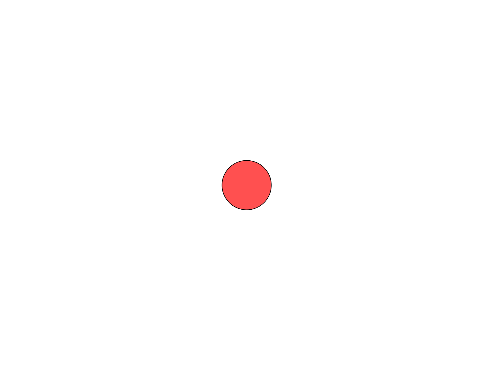
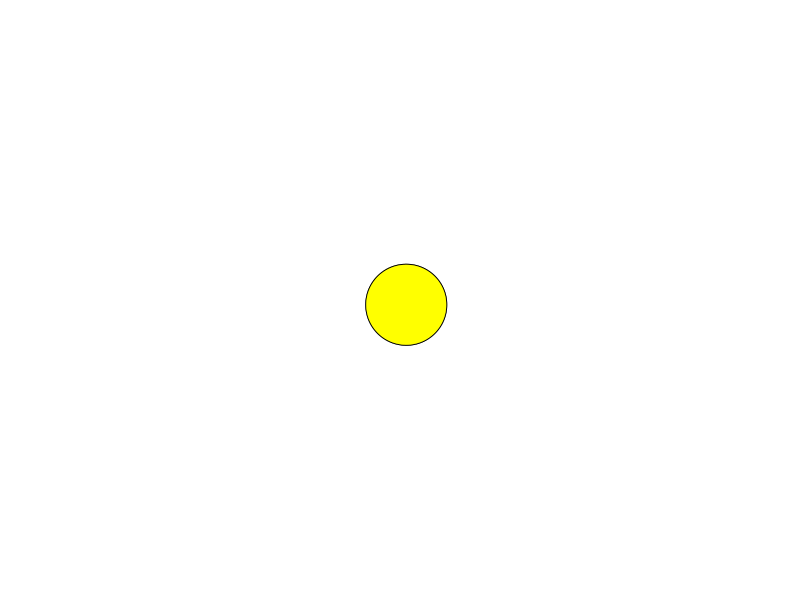
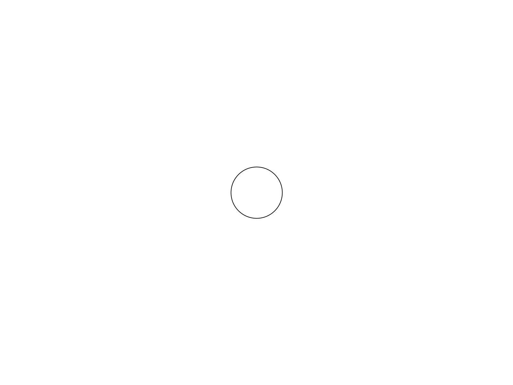
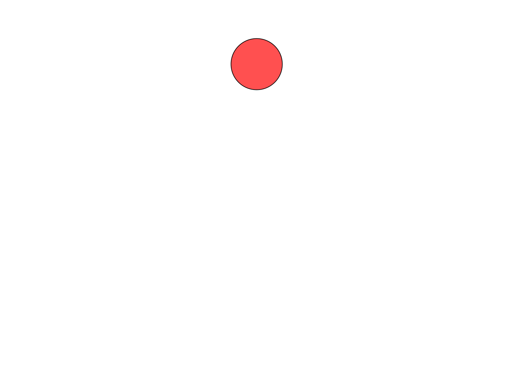
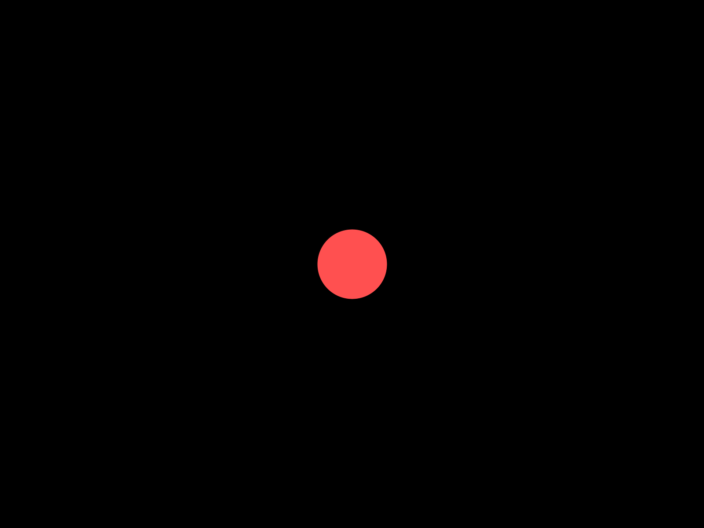
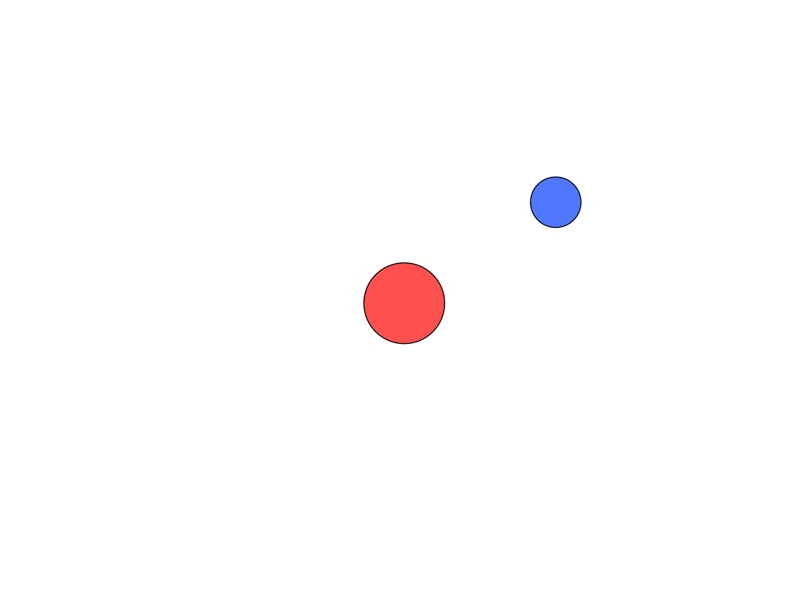

# Chapter 1 - Hello, Blob!

*Run your first program and put something alive on the screen.*

---

By the end of today there's something on your screen, and you put it there.
It's a circle.  The library we're using calls it a **Blob**, and it's the first
object you'll make in this course.  Every chapter after this one gives you more
say over what's on the screen, and by Chapter 7 it's a game.

The program that makes the circle is ten lines of code.  You'll type all ten.
Then you'll run it, break it on purpose, and change it until the blob is yours.

This chapter does it in three moves.

| Part | The idea |
|---|---|
| One | **A Blob is an object.**  Type the sketch, run it, and read every line. |
| Two | **Once, and over and over.**  `setup()` runs one time, and `draw()` runs about sixty times a second.  Moving one line proves it. |
| Three | **Make it yours.**  Its color, where it sits, how big it is, what's behind it, and maybe a friend. |

Part One is mostly reading.  Parts Two and Three are five small steps, and the
sketch runs at the end of every one.

---

# Part One - A Blob is an object

## 1.1  Type it, then run it

Open Processing.  You get a window with a big space for code, a **▶ Run**
button, and a **■ Stop** button.  A program in Processing is called a
**sketch**.

Save before you type anything:  **File → Save As**, and name it `HelloBlob`.
Saving first means you'll know where your sketch lives when you come back to it.

**Build it.**  Type this in.  Type it by hand.  Your fingers learn the code
faster than your eyes do.

```java
// Lesson 1 - Hello, Blob!
import coxprogramming.processing.sprites.*;

Blob myBlob;

void setup() {
  size(800, 600);
  myBlob = new Blob(this, 400, 300, 40, color(255, 80, 80));
}

void draw() {
  background(255);       // white background erases the previous frame
  myBlob.drawSprite();   // draw the blob at its position
}
```

Get it exactly right.  One missing semicolon is enough to stop the whole thing.
Then press **▶ Run**.

> **Check.**  A new window opens with a red circle in the middle.  Look closely
> and the circle has a thin black outline.  Remember the outline, because it
> comes back in Step 3.  Press **■ Stop** to close the window.

> **Screenshot:**  Your first sketch.  The red circle is a Blob.
>
> 

If you get an error instead, look at the line Processing highlights, and check
it letter by letter against the code above.  Step 2 shows you the three most
common mistakes, on purpose.

## 1.2  Objects have properties and behaviors

The red circle is an **object**.  An object is a thing in your program that has
its own information and knows how to do things.

Programmers have a word for each of those.  **Properties** are the things that
describe an object:  where it is, how big it is, what color it is.
**Behaviors** are the things an object can do.  A Blob can draw itself on the
screen.

You'll find both in the code.  The properties are the numbers you hand a Blob
when you make it.  The behavior is `drawSprite()`.

## 1.3  Reading it, line by line

Ten lines of code, and one note at the top.  Here's what each one does.

```java
// Lesson 1 - Hello, Blob!
```

> **Aside:  comments**
>
> A line that starts with `//` is a **comment**, a note for people.  Processing
> skips it.  A comment can also sit at the end of a line, like the two in
> `draw()`.

```java
import coxprogramming.processing.sprites.*;
```

This tells Processing you want to use the library's tools.  A **library** is a
set of tools somebody else built, so you can use them.  `Blob` is one of them.
This line goes first, always.

```java
Blob myBlob;
```

This makes a **variable**:  a box with a name on it.  The box is called
`myBlob`, and the word in front of it, `Blob`, says what kind of thing the box
holds.  Right now the box is empty.  The next part of the sketch puts a blob in
it.

```java
void setup() {
  size(800, 600);
  myBlob = new Blob(this, 400, 300, 40, color(255, 80, 80));
}
```

`setup()` is a **function**:  a set of instructions with a name.  Its
instructions go between the curly braces, `{` and `}`.  Processing runs
`setup()` one time, when your sketch starts.  Part Two is about exactly that.

> **Aside:  the semicolon**
>
> Every instruction ends in a semicolon, `;`.  That's how Processing knows where
> one instruction stops and the next one starts, the way a period ends a
> sentence.  Lines that end in a brace, like `void setup() {`, are the
> exception.

`size(800, 600)` makes the window 800 pixels wide and 600 pixels tall.  A
**pixel** is one tiny dot of your screen.

> **Aside:  x and y**
>
> Every spot in the window has two numbers.  **x** is how far across it is from
> the left edge.  **y** is how far down it is from the top.  The top-left corner
> is `(0, 0)`, and in this window the bottom-right corner is `(800, 600)`.
>
> Watch the y.  In math class, up is bigger.  On a screen, down is bigger.

Then the line that makes the blob:

```java
myBlob = new Blob(this, 400, 300, 40, color(255, 80, 80));
```

`new Blob(...)` makes a brand-new Blob, and the `=` puts it in the `myBlob`
box.  The five things inside the parentheses are what a Blob needs to know about
itself, always in this order:

| | What it is |
|---|---|
| `this` | the sketch the blob belongs to.  Copy it exactly, every time. |
| `400` | x:  how far across the blob's center is |
| `300` | y:  how far down the blob's center is |
| `40` | the **radius**:  how far it is from the center to the edge.  A radius of 40 makes a circle 80 pixels across. |
| `color(255, 80, 80)` | its color.  Section 1.4 is about these three numbers. |

Those are its properties.  `(400, 300)` is the exact middle of an 800-by-600
window, which is why your blob sits in the middle.

```java
void draw() {
  background(255);       // white background erases the previous frame
  myBlob.drawSprite();   // draw the blob at its position
}
```

`draw()` is the other function.  `background(255)` paints the whole window
white.  Then `myBlob.drawSprite()` asks your blob to draw itself.

> **Aside:  the dot**
>
> `myBlob.drawSprite()` reads left to right:  *myBlob, draw yourself.*  First
> the object's name, then a dot, then the behavior you want.  The parentheses on
> the end mean *do it now*.
>
> A behavior written in code is called a **method**.  `drawSprite()` is your
> blob's method for drawing itself.

---

# Part Two - Once, and over and over

Every sketch in this course has these two functions.

`setup()` is like setting up an art table.  It happens once, before anything
else.  You put out your paper and your paints, and you're done setting up.

`draw()` is like drawing one page of a flipbook.  Processing runs it again, and
again, and again, about **60 times a second**.  Flip the pages fast enough and
it looks like motion.  Each page is called a **frame**.

- Something that happens one time goes in `setup()`.
- Something that has to keep happening goes in `draw()`.

Your blob sits perfectly still, though.  So how would you know `draw()` is
running sixty times a second?

## Step 1 - Move one line

**Build it.**  Cut the whole line `myBlob.drawSprite();` out of `draw()`,
comment and all.  Paste it at the end of `setup()`, under the line that makes
the blob:

```java
void setup() {
  size(800, 600);
  myBlob = new Blob(this, 400, 300, 40, color(255, 80, 80));
  myBlob.drawSprite();
}

void draw() {
  background(255);       // white background erases the previous frame
}
```

Run it.

> **Check.**  A white window, empty.

> **Screenshot:**  The blob's somewhere in this picture.
>
> 

Where did the blob go?  Make a guess before you read on.

The blob got drawn.  `setup()` drew it, once, right at the start.  Then
`draw()` ran, and its first instruction is `background(255)`, which paints the
whole window white, right over the blob.  Then `draw()` ran again, and again,
sixty times a second, painting white each time.  The blob's under the paint.

That's why `drawSprite()` belongs in `draw()`.  Anything you want to see has to
be drawn again on every frame, after the background.

**Build it.**  Put the line back at the end of `draw()`, where it started, and
run.

> **Check.**  The red blob is back in the middle of a white window.

## Step 2 - Break it on purpose

Sooner or later, every sketch you write stops with an error.  The quickest way
to get good at errors is to make a few on purpose, while you know exactly what
you broke.

> **Aside:  reading an error**
>
> When Processing can't run your sketch, it highlights a line and shows a
> message under your code.  The message says what went wrong, as well as
> Processing can tell.  The highlighted line is where it noticed.  Those can be
> two different lines.

Make each break, run, read the message, and then fix it before the next one.

**Build it.**  Delete the `import` line, and run.

> **Check.**  The sketch stops, and the message reads:
>
> ```
> Cannot find a class or type named “Blob”
> ```

Processing can't find Blob, because the line that tells it where to look is
gone.  This is the most common mistake in the course.  The message only names
`Blob`, so when you see it, check the import line first.  Put it back.

**Build it.**  Delete the semicolon at the end of `size(800, 600);`, and run.

> **Check.**  The message reads `Syntax Error - Missing ';'?`, and the
> highlighted line is the one *after* `size`, the `myBlob = new Blob(...)` line.

Processing noticed the problem when it got to the next instruction.  When an
error points at a line that looks fine, look at the line above it.  Put the
semicolon back.

**Build it.**  Change `drawSprite` to `drawsprite`, with a small `s`, and run.

> **Check.**  The message reads `The function drawsprite() does not exist.`

To Processing, `drawsprite` and `drawSprite` are two different words.  Capital
letters count, everywhere.  Fix it, run, and make sure your red blob is back.

---

# Part Three - Make it yours

## 1.4  Color is three numbers

`color(255, 80, 80)` means a lot of red, a little green, and a little blue.
Each number goes from **0**, none of that color, up to **255**, as much as the
screen can make.  These are **RGB** numbers:  Red, Green, Blue, always in that
order.

| You write | You get |
|---|---|
| `color(0, 0, 0)` | black |
| `color(255, 255, 255)` | white |
| `color(255, 0, 0)` | red |
| `color(255, 80, 80)` | the starter's pink-red |

Now predict one.  Red all the way up, green all the way up, and blue at zero:
`color(255, 255, 0)`.  Mix red paint and green paint and you get a muddy brown.
Write down what you think the screen will make.

## Step 3 - Your color

**Build it.**  Change `color(255, 80, 80)` to `color(255, 255, 0)`, and run.

> **Check.**  A yellow blob.

> **Screenshot:**  Red light and green light make yellow.
>
> 

Your screen makes every color out of light, and paint and light mix by
different rules.

The Color Selector saves you the guessing.  Open **Tools → Color Selector**, click
around until you find a color you like, and read the R, G, and B numbers right
off the panel.

**Your turn.**  Find a color you actually like in the Color Selector, and put
its three numbers in your blob's `color( , , )`.  "Because I like green" is a
perfectly good reason.

One more, for that outline from 1.1.  Try `color(255, 255, 255)`, a white blob
on a white background.

> **Check.**  You can still see it, as a thin black ring.

> **Screenshot:**  A white blob on white.  The outline gives it away.
>
> 

Processing draws an outline around every shape until you tell it to stop.  In
Chapter 2 you will.  Put your own color back.

## Step 4 - Where, and how big

**Build it.**  In the `new Blob` line, change `400, 300` to `400, 100`, and run.
The blob moves up, because a smaller y is closer to the top.

> **Screenshot:**  y is 100:  near the top.
>
> 

Now predict where `(0, 0)` will put it, and try it.

> **Check.**  A quarter of a blob, tucked into the top-left corner.

> **Screenshot:**  The blob's center is on the corner.
>
> 

`x` and `y` are where the blob's **center** goes.  At `(0, 0)` the center sits
right on the corner, and three quarters of the blob hang off the edges of the
window.

Then the size.  Change the radius, the `40`, to `80` and run.  Then try `15`.

**Your turn.**  Put your blob where you want it, at the size you want.

## Step 5 - What's behind it

`background()` takes the same kind of numbers as `color()`.  Give it one number
for a grey, from `0` for black up to `255` for white, or three for any color at
all.

**Build it.**  Change `background(255)` to `background(0)`, and run.

> **Check.**  Your blob on a black window, with its outline gone.  The outline
> is black too.

> **Screenshot:**  `background(0)`.
>
> 

**Your turn.**  Give your blob a background you chose.  The Color Selector's
three numbers work here too:  `background(30, 40, 90)` is a night sky.

## 1.5  A friend

**Your turn.**  **Optional:**  give your blob a friend, a second Blob with its
own color and its own spot.  A second blob takes three lines, one in each of the
three places your first blob uses:

1. At the top, a second box:  `Blob friend;`
2. In `setup()`, a second `new Blob(...)`, to put a blob in that box.
3. In `draw()`, a second `drawSprite()`, after the background.

You pick its name, and all five of its numbers.

> **Check.**  Two blobs.  Here's one friend.  Yours will be wherever you put
> it.

> **Screenshot:**  `myBlob`, and a friend at `(550, 200)`.
>
> 

> **Watch out.**  Skip the second of those three lines, and the sketch starts,
> then stops with `NullPointerException`, on your friend's `drawSprite()` line.
> The box at the top is still empty when `draw()` asks it to draw.

If one friend goes well, keep going:  four or five blobs make a small scene.  A
face, a snowman, a planet with moons, whatever you see in them.

---

## Chapter summary

You started with an empty window and ten lines to type.  You end with a blob
that's yours:  your color, in your spot, at your size, on a background you
chose.

| You built | It's an example of |
|---|---|
| `Blob myBlob;` | a **variable**, a box with a name |
| `new Blob(this, 400, 300, 40, color(255, 80, 80))` | making an **object**, and handing it its **properties** |
| `myBlob.drawSprite()` | asking an object for a **behavior**, called a **method** |
| `drawSprite()` moved into `setup()`, and back | `setup()` runs once, and `draw()` runs every **frame** |
| three errors, made on purpose | reading an error:  what it says, and where it noticed |
| your own `color( , , )` | **RGB**, three numbers mixed as light |
| a friend, if you made one | the same three places, a second time |

### New syntax in this chapter

| Syntax | Where you met it |
|---|---|
| `//` comments | 1.3 |
| `import` | 1.3 |
| a variable:  `Blob myBlob;` | 1.3 |
| `void setup() { }` and `void draw() { }` | 1.3, Part Two |
| the semicolon | 1.3 |
| `size(800, 600)` | 1.3 |
| x and y | 1.3 |
| `new Blob(this, x, y, radius, color)` | 1.3 |
| the dot:  `myBlob.drawSprite()` | 1.3 |
| `background()` | 1.3, Step 5 |
| `color(r, g, b)` | 1.4 |

### Vocabulary

**behavior** -- a verb:  something an object can do.  A Blob can draw itself.
(1.2)

**comment** -- a note for people, after `//`.  Processing skips it.  (1.3)

**frame** -- one page of the flipbook.  `draw()` makes one frame each time it
runs, about 60 a second.  (Part Two)

**function** -- a set of instructions with a name, like `setup()` and
`draw()`.  (1.3)

**library** -- a set of tools somebody else built, so you can use them.
SpriteGame is the library that has `Blob`.  (1.3)

**method** -- a behavior, written in code.  You ask for one with a dot:
`myBlob.drawSprite()`.  (1.3)

**object** -- a thing in your program that has its own information and knows
how to do things.  (1.2)

**pixel** -- one tiny dot of your screen.  (1.3)

**property** -- a noun:  something that describes an object.  Where it is, how
big, what color.  (1.2)

**radius** -- how far it is from the center of a circle to its edge.  Half the
circle's width.  (1.3)

**RGB** -- the three numbers, Red, Green, and Blue, that make a color.  Each
goes from 0 to 255.  (1.4)

**sketch** -- a program in Processing.  (1.1)

**variable** -- a box with a name on it.  `Blob myBlob;` makes one.  (1.3)

### Check your understanding

1. Name three properties of your blob, and one behavior.
2. Which function runs once, and which runs over and over?  About how many
   times a second?
3. In Step 1 the blob disappeared.  Where was it?
4. Your sketch stops with `Cannot find a class or type named “Blob”`.  What do
   you check first?
5. What does `color(0, 0, 255)` make?  What about `color(0, 0, 0)`?
6. Where in the window is `(800, 0)`?

## What's next

Your blob's a circle, and a circle is all a Blob knows how to look like.  In
Chapter 2 you make your own kind of object:  a character you draw yourself, out
of as many shapes as you want, that still knows everything a Blob knows.

And yes, it's going to move.  That's Chapter 3.
