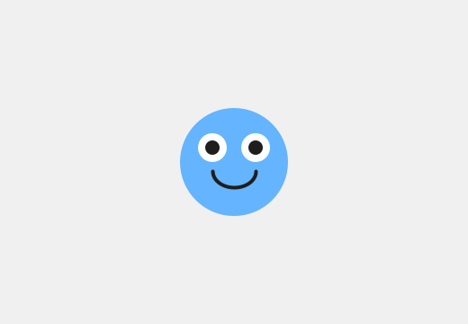
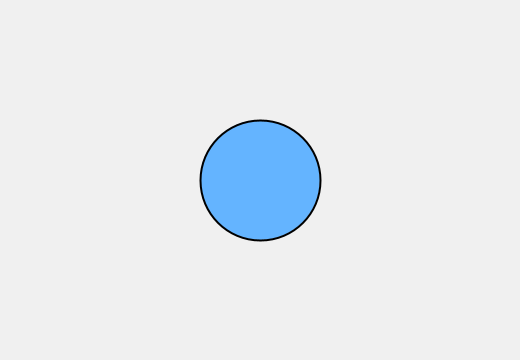
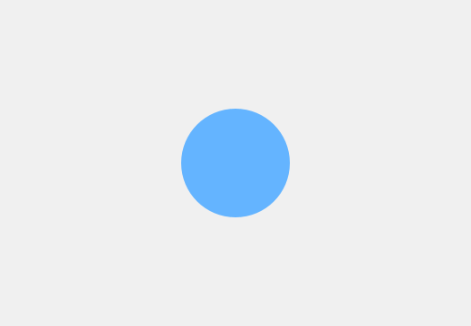
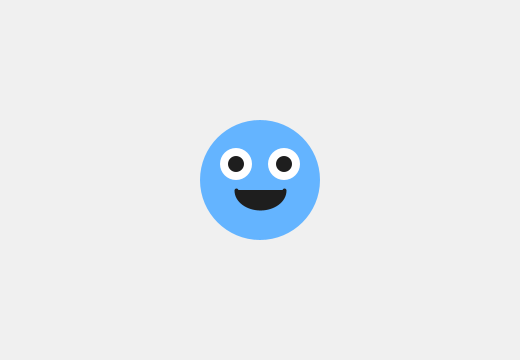
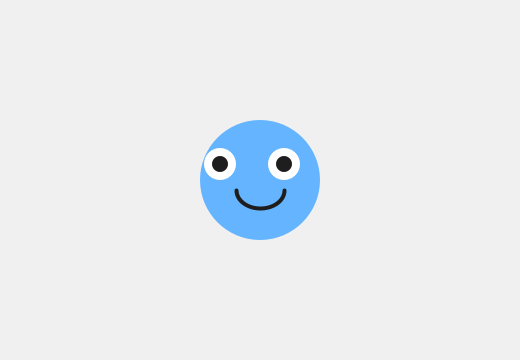
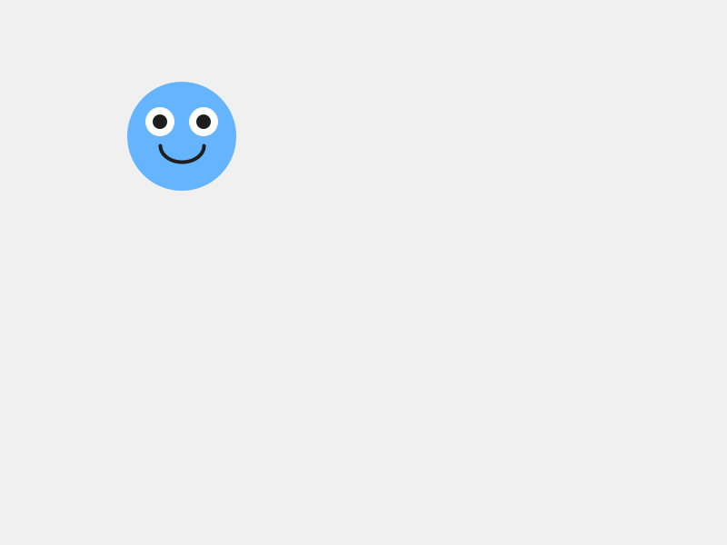
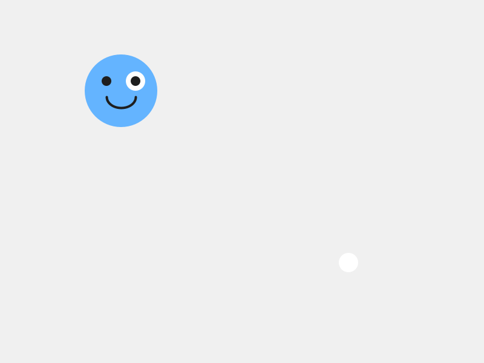

# Chapter 2 - Draw Your Character

*Build the character that will star in everything you make from here on.*

---

Chapter 1 ended with a blob that was yours:  your color, your spot, your size.
It's still a circle, though.  A circle is the only way a Blob knows how to look.

A plain Blob already knows a lot.  It has a position, it can move, it can wrap
around the screen, and later it can tell when it's touching something.  What
it's missing is a face you care about.

So today you build a character **on top of** Blob.  It keeps everything a Blob
knows, and you decide what it looks like.  This is the character you'll use for
the rest of the course, so make it one you actually want to look at.

This chapter does it in three moves.

| Part | The idea |
|---|---|
| One | **A Blob with a new face.**  Make a new tab, put a character in it, and read every line. |
| Two | **Your drawing replaces Blob's.**  Break it two ways, and see the plain Blob underneath. |
| Three | **Measure from the belly button.**  Every shape goes where it goes because of `pos.x` and `pos.y`.  Moving the character proves it, and then you make it yours. |

---

# Part One - A Blob with a new face

## 2.1  Two tabs

Open your sketch from Chapter 1.  Or start a new one, and save it as
`MyCharacter` before you type anything.

Your character gets a tab of its own.

> **Aside:  tabs**
>
> A **tab** is a separate file inside your sketch.  They sit in a row along the
> top of your code, and the first one is the main tab.  Big sketches are easier
> to read when each kind of object lives in its own tab.

**Build it.**  Click the small **arrow at the far right of the tab bar**, and
choose **New Tab**.  Name it `MyCharacter`.  Processing adds the `.pde` on the
end for you.

The arrow is small, and it's all the way at the right edge.  Look for it twice.

**Build it.**  Paste this into the new `MyCharacter` tab:

```java
/**
 * MyCharacter - this is YOUR character. Change everything!
 */
class MyCharacter extends Blob {

  /**
   * The constructor: called once when you create the character.
   * "super" connects your character to the Blob it's built on.
   * The radius (30) is the invisible collision circle - make it match your art.
   */
  MyCharacter(PApplet p, float x, float y) {
    super(p, x, y, 30, color(100, 180, 255));
  }

  /**
   * drawSprite: called every frame to draw your character on screen.
   * Use pos.x and pos.y as the center - all other shapes are measured from there.
   */
  void drawSprite() {
    // Body
    fill(100, 180, 255);
    noStroke();
    ellipse(pos.x, pos.y, 60, 60);

    // Eyes
    fill(255);
    ellipse(pos.x - 12, pos.y - 8, 16, 16);
    ellipse(pos.x + 12, pos.y - 8, 16, 16);
    fill(30);
    ellipse(pos.x - 12, pos.y - 8, 8, 8);
    ellipse(pos.x + 12, pos.y - 8, 8, 8);

    // Smile
    stroke(30);
    strokeWeight(2);
    noFill();
    arc(pos.x, pos.y + 5, 24, 18, 0, PI);
  }
}
```

**Build it.**  Click back to your first tab.  Replace everything in it with
this:

```java
// Lesson 2 - Draw Your Character
import coxprogramming.processing.sprites.*;

MyCharacter player;

void setup() {
  size(800, 600);
  player = new MyCharacter(this, width/2, height/2);
}

void draw() {
  background(240);
  player.drawSprite();
}
```

Run it.

> **Check.**  A friendly blue face in the middle of a light grey window, with two
> eyes and a smile.

> **Screenshot:**  The starter character.  It won't look like this for long.
>
> 

## 2.2  The main tab

The main tab is Chapter 1's sketch with three changes.

`MyCharacter player;` makes a box called `player`, for holding a
`MyCharacter`.  In Chapter 1 the box was for a `Blob`.  `MyCharacter` is a kind
of thing you just invented, in the new tab.

`new MyCharacter(this, width/2, height/2)` makes your character and puts it in
the box.  It takes three things:  the sketch, then x, then y.

> **Aside:  `width` and `height`**
>
> Processing remembers the size of your window.  `width` is 800 here, and
> `height` is 600, because that's what `size(800, 600)` asked for.  The `/`
> means divide, so `width/2` is 400:  halfway across.  `(width/2, height/2)` is
> the middle of the window, whatever size the window is.

`background(240)` is a light grey.  And `player.drawSprite()` is the same dot as
Chapter 1:  *player, draw yourself.*

## 2.3  The class, and the handshake

Now the `MyCharacter` tab.  It starts with the line that does the work:

```java
class MyCharacter extends Blob {
```

A **class** is a blueprint for making a new kind of object.  This one says
how to make a `MyCharacter`, and everything about it goes between this brace and
the last one in the tab.

`extends Blob` means your character is built on top of Blob.  It already knows
how to move, wrap around the screen, and detect collisions.  All you add is
what it looks like.

Your character gets all of Blob's properties and behaviors, for free.  It has a
position, a radius, and a color, and it can do everything a Blob can do.  In a
minute you'll swap out one behavior, `drawSprite()`, for your own.

Next is the **constructor**, the part that runs once, when
`new MyCharacter(...)` makes your character:

```java
MyCharacter(PApplet p, float x, float y) {
  super(p, x, y, 30, color(100, 180, 255));
}
```

The three things in the first line catch the three things the main tab sent.
`p` is the sketch, which was `this`.  `x` and `y` are where to start.

> **Aside:  `float`**
>
> `float` is the kind of number that can have a decimal point, like `2.5`.
> Positions are floats, because a character can sit partway between two pixels.
> `PApplet` is the kind of thing a sketch is.  Every character class you write
> has both words, right in this spot.

The line starting with `super` is the **handshake**.  It connects your character
to the library.  Copy it exactly.

Look at what's inside it, though:  the sketch, x, y, a radius, and a color.
That's the five things a Blob needs, from Chapter 1.  The handshake hands them
to the Blob your character is built on.

- The `30` is your character's radius:  an invisible circle the library uses
  later, for collisions.  Keep it about the size of your character's body.
- The color is a backup.  You're about to draw over it.

> **Watch out.**  Delete the `super` line, and the sketch stops with this:
>
> ```
> Implicit super constructor Blob() is undefined. Must explicitly invoke another constructor
> ```
>
> All of that means the handshake is missing.  Put it back exactly as it was.

## 2.4  `drawSprite()`, yours

The rest of the tab is one method:

```java
void drawSprite() {
```

You met `drawSprite()` in Chapter 1.  A Blob already has one, and it draws a
circle.  When you write your own `drawSprite()` in your class, yours replaces
Blob's.  Programmers call that **overriding** a method.  Every frame,
`player.drawSprite()` runs your drawing.

> **Aside:  `void`**
>
> `void` at the start says the method just does its job.  It draws, and that's
> the end of it.  Every method you write for a while starts with `void`.

Inside are three groups of shapes.

**The body.**

```java
fill(100, 180, 255);
noStroke();
ellipse(pos.x, pos.y, 60, 60);
```

`fill()` picks the color for the shapes that come after it.  `noStroke()` turns
off the outline you saw on the white blob in Chapter 1.  `ellipse()` draws an
oval:  where its center goes, then how wide, then how tall.  Sixty wide and
sixty tall is a circle.

**The eyes.**  White ovals first, then dark pupils on top of them.

```java
fill(255);
ellipse(pos.x - 12, pos.y - 8, 16, 16);
ellipse(pos.x + 12, pos.y - 8, 16, 16);
fill(30);
ellipse(pos.x - 12, pos.y - 8, 8, 8);
ellipse(pos.x + 12, pos.y - 8, 8, 8);
```

Shapes stack.  Whatever you draw **later** sits on top of what you drew
earlier.  The pupils come after the whites, so they sit on top.

**The smile.**

```java
stroke(30);
strokeWeight(2);
noFill();
arc(pos.x, pos.y + 5, 24, 18, 0, PI);
```

`stroke()` turns the outline back on, in a dark grey, and `strokeWeight(2)`
makes it two pixels thick.  `noFill()` means the next shape is only an outline.

> **Aside:  `arc`**
>
> `arc()` draws part of an oval.  The first four numbers are the same as an
> `ellipse`.  The last two say where to start and where to stop, measured so that
> `PI` is half a turn.  `0` to `PI` is the bottom half of the oval, which is a
> smile.

---

# Part Two - Your drawing replaces Blob's

## Step 1 - Misspell it

In Chapter 1, `drawsprite` with a small `s` stopped your sketch with an error.
Try it here, on the method in your class.

**Build it.**  In the `MyCharacter` tab, change `void drawSprite()` to
`void drawsprite()`.  Predict what happens, then run.

> **Check.**  It runs fine.  The face is gone, and in its place is a plain blue
> circle with a thin black outline.

> **Screenshot:**  The Blob under your character.
>
> 

`drawsprite` is a brand-new method, with a name of its own.  The main tab calls
`drawSprite()`, with a capital `S`, and now the only `drawSprite()` your
character has is Blob's.  Blob's draws a plain circle, at the radius and in the backup color from
your handshake, with Processing's outline.  That circle was under your face the
whole time.  Your `drawSprite()` was covering it up.

**Build it.**  Put the capital `S` back, and run.  The face is back.

## Step 2 - Draw the body last

**Build it.**  In your `drawSprite()`, cut the three body lines, from `// Body`
to the body's `ellipse`.  Paste them at the bottom of the method, after the
`arc`.  Run.

> **Check.**  A plain blue circle again, and this time the outline's gone too.

> **Screenshot:**  The body, painted over the face.
>
> 

The face is still there, under the body.  Shapes stack, so the body you drew
last covered everything you drew before it.  The outline is missing because the
body's own `noStroke()` comes right before it.

**Build it.**  Put the body lines back at the top, and run.

> **Watch out.**  Leave out `noFill()` before the `arc`, and the smile fills in
> with the pupils' dark grey.  You get an open mouth.  Maybe you wanted one.

> **Screenshot:**  The smile without `noFill()`.
>
> 

---

# Part Three - Measure from the belly button

Every shape in your character is placed from `pos.x` and `pos.y`.  `pos` is your
character's position, one of the properties it got from Blob, and it's the
center of your character.

Think of `pos.x, pos.y` as your character's belly button.  Every shape you draw
is measured from there.

- **Minus x** moves a shape left.  **Plus x** moves it right.
- **Minus y** moves a shape up.  **Plus y** moves it down.

Yes, up is minus.  Screens are strange that way.

So `ellipse(pos.x - 12, pos.y - 8, 16, 16)` is an eye 12 pixels left of the
belly button and 8 pixels up.

## Step 3 - A new body color

**Build it.**  Find `fill(100, 180, 255)`, right above the body's `ellipse`, and
put in a color of your own.  The Color Selector works the same as in Chapter 1.
Run.

> **Check.**  The body changes color.  The eyes and the smile have their own
> `fill` and `stroke`, so they look just as they did.

## Step 4 - Slide an eye

**Build it.**  The left eye is the two lines with `pos.x - 12`:  its white and
its pupil.  Change both to `pos.x - 20`, and run.

> **Check.**  The left eye slides out toward the edge of the face.

> **Screenshot:**  The left eye, 20 pixels left of center.
>
> 

Put it wherever you like it.

## Step 5 - Start somewhere else

**Build it.**  In the main tab, change `width/2, height/2` to `200, 150`, and
run.

> **Check.**  The whole face is up near the top-left now, all in one piece.

> **Screenshot:**  Your character, starting at `(200, 150)`.
>
> 

Every shape moved, because every shape is measured from the belly button, and
the belly button moved.

## Step 6 - The eye at fixed numbers

Here's an eye written another way.  Before you moved it, the character's belly
button was at `(400, 300)`.  So the left eye's white was at `400 - 12` and
`300 - 8`, which is `(388, 292)`.

**Build it.**  First, put the main tab back to `width/2, height/2`.  Then, in the
`MyCharacter` tab, change the left eye's white, the first `ellipse` under
`fill(255)`, to plain numbers:

```java
ellipse(388, 292, 16, 16);
```

Run it.

> **Check.**  Your character looks exactly the same as before.

Now change the main tab to `200, 150` again, and run.

> **Check.**  The face moves up to the top-left.  One white eye stays behind in
> the middle of the window.

> **Screenshot:**  One eye didn't get the message.
>
> 

Why did that eye stay behind, when every other part of the face moved?  Make a
guess before you read on.

Plain numbers nail a shape to one spot in the window.  It looks fine as long as
the character sits still, and today it does.  In Chapter 3 your character starts
moving, and a shape at plain numbers gets left behind.  So measure **every**
shape from `pos.x` and `pos.y`.

**Build it.**  Put the eye back to `pos.x - 12, pos.y - 8`.  Put the main tab
back to `width/2, height/2`, or anywhere you like.

## 2.5  Make it yours

This chapter **is** the make-it-yours.  Spend the rest of your time here.

The shapes you can use, all measured from the belly button:

| You write | You get |
|---|---|
| `ellipse(x, y, w, h)` | an oval, centered at `x, y` |
| `rect(x, y, w, h)` | a rectangle.  Its `x, y` is the **top-left corner**, so `rect(pos.x - 20, pos.y - 20, 40, 40)` is a square centered on the belly button. |
| `triangle(x1, y1, x2, y2, x3, y3)` | a triangle, from its three corners |
| `line(x1, y1, x2, y2)` | a line, from one end to the other.  Its color is the `stroke`. |
| `arc(x, y, w, h, start, stop)` | part of an oval |

**Your turn.**  Make your character yours.  Some places to start:

- Change the **body shape**.  `rect()`, `triangle()`, or several overlapping
  `ellipse()` calls all work.
- Add hair, a hat, wings, antennae, a tail, ears, a beak, horns.  Anything.
- Change every color, with the Color Selector.
- Add detail.  Eyebrows change the whole mood.  So do freckles, a nose, or a
  mouth with teeth.
- Give it an expression.  Angry eyebrows are two short `line()` calls.

Order matters as you go.  Draw the body first, then what sits on it.

You can keep adding detail in every chapter from here on.  Today's job is to
get a character on the screen that's recognizably yours.  Goodbye, starter
blob~

**Your turn.**  When your character is done, check the `30` in the `super(...)`
line.  If your character came out much bigger or smaller than the starter, change
the `30` to about half your character's width.

Try a big change first, like `100`, and run.  The screen looks exactly the same.
The radius is invisible.  In Chapter 6 it's the circle the library uses to decide
whether your character is touching something, so set it to fit your character's
body now.

**Your turn.**  **Optional:**  make a **second** character class in another new
tab:  a sidekick, a pet, a rival.  Same pattern, different art.  Give the class
its own name, like `class Sidekick extends Blob`, and use that name everywhere
`MyCharacter` appears in the copy.

---

## Chapter summary

You started with a Blob that could only be a circle.  You end with a character
of your own, built on top of Blob:  it knows everything a Blob knows, and it
looks the way you drew it.

| You built | It's an example of |
|---|---|
| the `MyCharacter` tab | a **class**, a blueprint for a new kind of object, in a **tab** of its own |
| `class MyCharacter extends Blob` | a new kind of object **built on top of** another |
| `super(p, x, y, 30, color(...))` | the **handshake**, handing Blob the five things it needs |
| your own `void drawSprite()` | **overriding** a method:  your drawing replaces Blob's |
| `drawsprite`, misspelled | the plain Blob that was underneath all along |
| the body drawn last | shapes stack, and later shapes sit on top |
| every shape at `pos.x` and `pos.y` plus or minus | measuring from the belly button, so the whole face moves together |

### New syntax in this chapter

| Syntax | Where you met it |
|---|---|
| tabs | 2.1 |
| `width`, `height`, and `/` | 2.2 |
| `class MyCharacter extends Blob { }` | 2.3 |
| the constructor, `PApplet`, `float` | 2.3 |
| `super(...)` | 2.3 |
| `void drawSprite() { }` | 2.4 |
| `fill()`, `noFill()`, `stroke()`, `noStroke()`, `strokeWeight()` | 2.4 |
| `ellipse()`, `arc()`, `PI` | 2.4 |
| `pos.x`, `pos.y` | 2.4, Part Three |
| `rect()`, `triangle()`, `line()` | 2.5 |

### Vocabulary

**class** -- a blueprint for making a new kind of object.  (2.3)

**constructor** -- the part of a class that runs once, when `new` makes an
object.  (2.3)

**`extends`** -- *built on top of*.  `class MyCharacter extends Blob` means
everything a Blob can do, your character can do too.  (2.3)

**handshake** -- the `super(...)` line.  It connects your character to the
library.  Copy it exactly, and change only the radius.  (2.3)

**overriding** -- writing your own version of a method your object already
had.  Yours replaces the old one.  (2.4)

**`pos.x`, `pos.y`** -- your character's position, its belly button.  Measure
every shape from there.  (Part Three)

**tab** -- a separate file inside your sketch.  (2.1)

### Check your understanding

1. What does `extends Blob` give your character?  Say it in one sentence.
2. What are the five things inside the `super(...)` handshake, and where have
   you seen those five before?
3. Why did misspelling `drawSprite` give you a plain circle, and why that color?
4. Your eyes vanished after you added a new shape.  What's the first thing you
   check?
5. An ear is at `pos.x + 30, pos.y - 25`.  Is it on the left or the right?
   Above the belly button, or below?
6. Why is `ellipse(388, 292, 16, 16)` going to cause trouble in Chapter 3?

## What's next

Your character can move.  It always could:  it's a Blob, and moving is one of
the things a Blob knows how to do.  All it needs is for your sketch to ask.

In Chapter 3 you give it a speed and a direction, and it slides across the
screen and off the edge, and comes back around the other side.  Every shape you
measured from the belly button goes with it.
