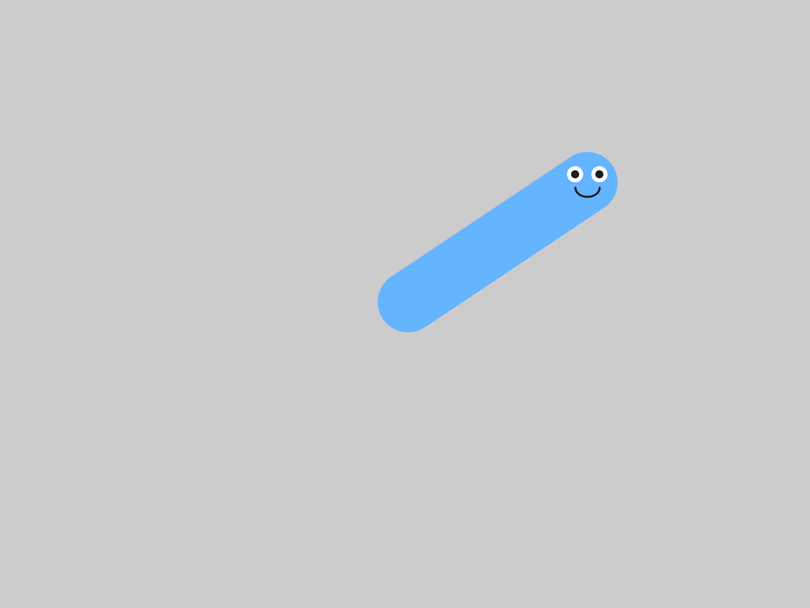
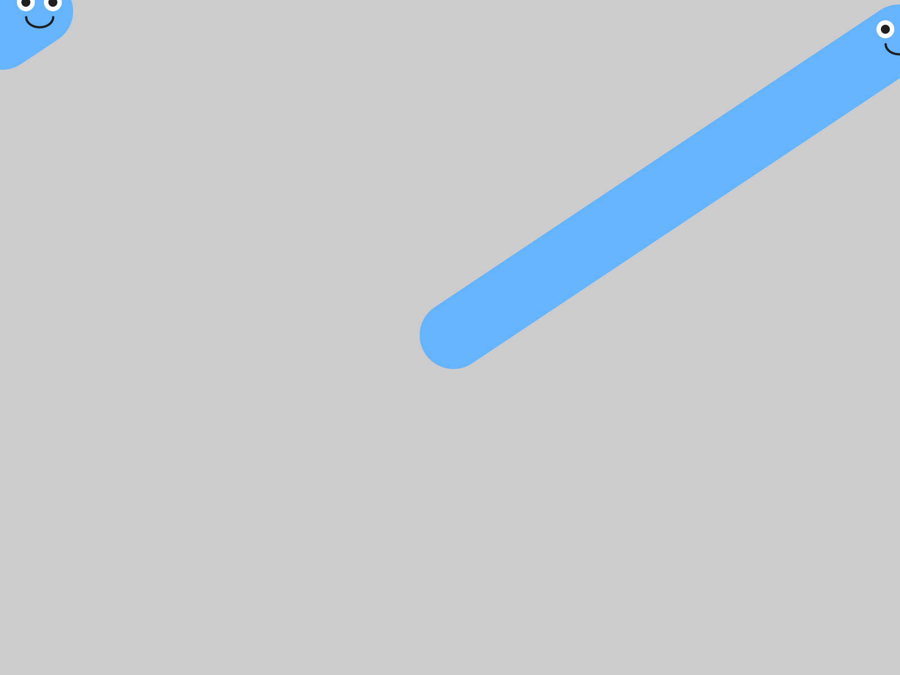
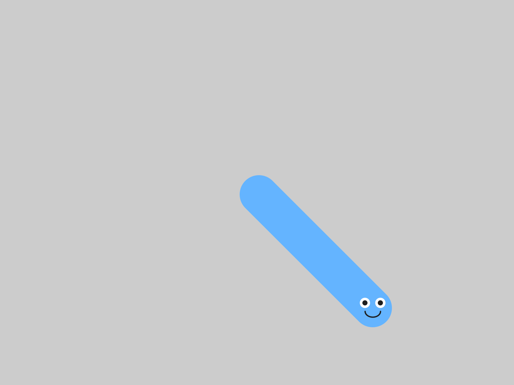
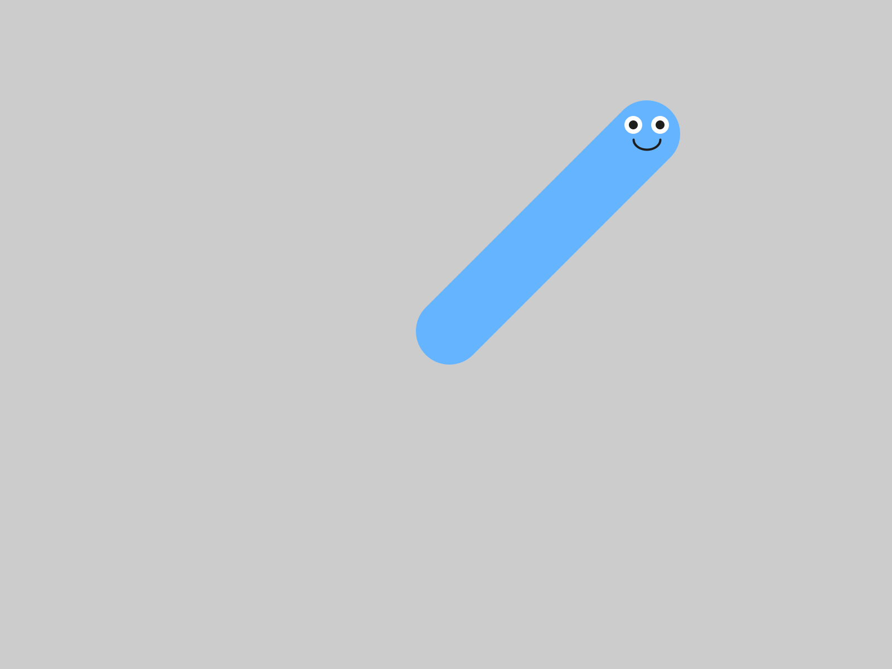
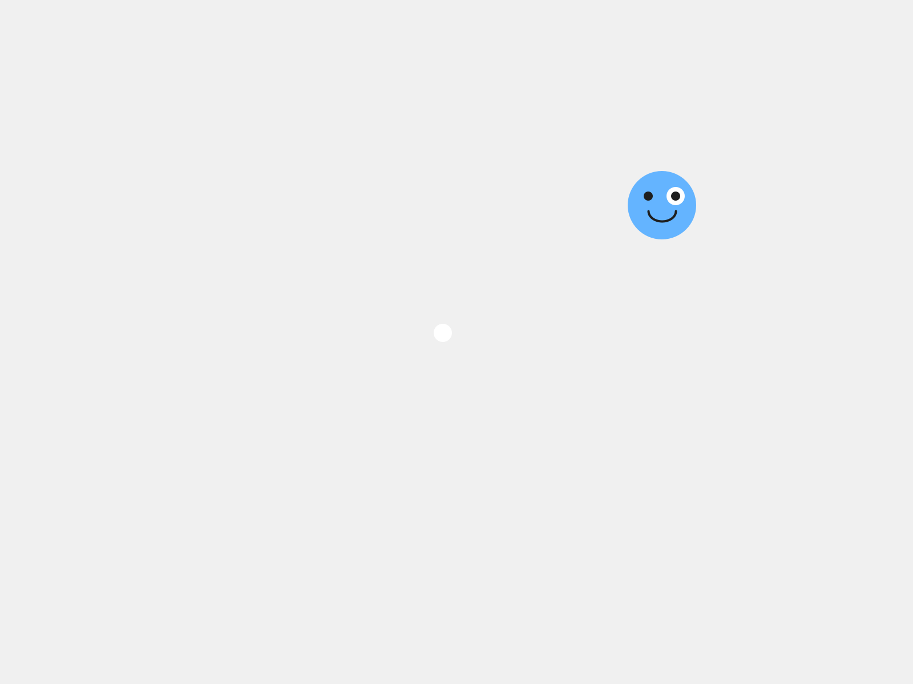
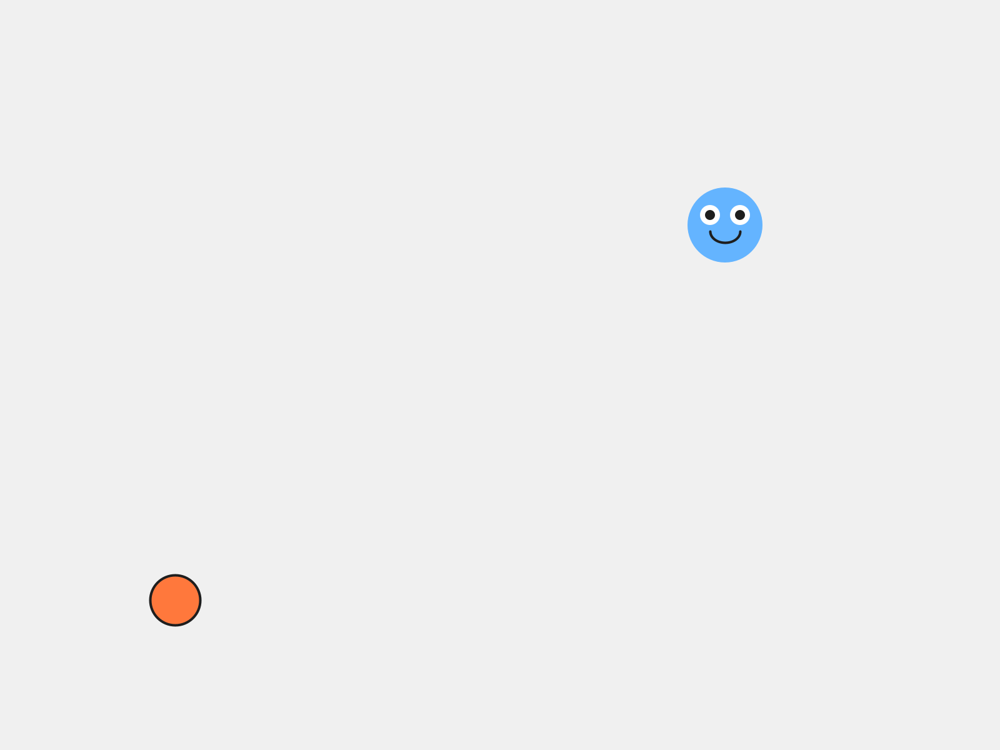

# Chapter 3 - Bring It to Life

*Your character stops sitting there and starts moving on its own.*

---

Chapter 2 ended with a character of your own, sitting in the middle of the
window.  It can move.  It always could, because it's built on top of Blob, and
moving is one of the things a Blob knows how to do.  All it needed was for
your sketch to ask.

Today it asks.  It takes two lines, one in `setup()` and one in `draw()`, and
you leave your `MyCharacter` tab exactly as it is.

This chapter does it in three moves.

| Part | The idea |
|---|---|
| One | **Velocity is two numbers.**  How fast across, and how fast up or down. |
| Two | **`move()` is the step.**  Give your character a velocity, watch nothing happen, then make it go:  off the edge and back. |
| Three | **Make it yours.**  A speed and a direction that suit your character, and a world with a mood. |

Part One is reading.  Part Two is six small steps, and the sketch runs at the
end of every one.

---

# Part One - Two numbers and a step

## 3.1  Velocity is two numbers

"Speed" in a game is really two questions.  How fast am I going sideways?  And
how fast am I going up or down?  So a character's **velocity** is two numbers.

- `vx` is left and right.  **Positive** goes right.  **Negative** goes left.
- `vy` is up and down.  **Positive** goes **down**.  **Negative** goes up.

```
                -vy  up
                  |
   -vx  left  ----+----  right  +vx
                  |
                +vy  down
```

You met this in Chapter 1:  on a screen, y counts down from the top.  So a
positive `vy` moves your character down the screen, and that surprises nearly
everybody.

The line that sets a velocity looks like this:

```java
player.setVelocity(3, -2);  // 3 pixels right, 2 pixels up per frame
```

That's 3 pixels to the right and 2 pixels up, **every frame**.  At sixty frames
a second, it adds up fast.

Velocity is one more of your character's properties.  Blob gave it one when it
was made, set to zero across and zero down.  That's why your character has been
sitting still.

## 3.2  `move()` is the step

Setting a velocity is like telling someone how fast to walk.  Until they take a
step, they stay right where they are.

```java
player.move();
```

`move()` is the step.  It takes the velocity and adds it to the position, once.
So it goes in `draw()`, where it happens sixty times a second.

---

# Part Two - Make it go

## Step 1 - A velocity, and nothing else

Open your sketch from Chapter 2.  Leave the `MyCharacter` tab alone today.
Everything happens in the main tab.

**Build it.**  In `setup()`, right after the line that makes your character, add
the velocity:

```java
void setup() {
  size(800, 600);
  player = new MyCharacter(this, width/2, height/2);
  player.setVelocity(3, -2);  // 3 pixels right, 2 pixels up per frame
}
```

Run it.

> **Check.**  Your character sits in the middle of the window, exactly the way it
> did in Chapter 2.

You told it how fast to go.  Taking the step is a separate instruction, and
that's Step 2.

## Step 2 - Take the step

**Build it.**  In `draw()`, add `player.move();` on the line **before**
`player.drawSprite();`:

```java
void draw() {
  background(240);
  player.move();        // update position (do this BEFORE drawing)
  player.drawSprite();  // draw at new position
}
```

Run it, and watch.

> **Check.**  Your character drifts up and to the right.

> **Screenshot:**  One second in:  60 frames, 180 pixels right and 120 up.
>
> 

> **Watch out.**  A character with a velocity and no `move()` sits perfectly still.  This
> is the most common mistake in the chapter.  When your character is frozen,
> look for `move()` in `draw()` first.

## Step 3 - See every frame

`background(240)` paints over the whole window at the start of every frame.
Here's what your character looks like without it.

**Build it.**  Put `//` at the front of the `background` line, so it reads:

```java
  //background(240);
```

> **Aside:  commenting out**
>
> `//` turns a whole line into a comment, so Processing skips it.  That's called
> **commenting out** a line.  It's the quickest way to switch something off and
> keep it handy:  take the `//` away, and the line is back.

Run it.

> **Check.**  A long blue stripe, with your character's face at the front end.

> **Screenshot:**  Every frame, still on the screen.
>
> 

That stripe is every frame of the flipbook from Chapter 1, at once.  Each frame
drew your character one step further along, and with nothing painting over the
old ones, they're all still there.  The grey is the color Processing starts a
window with.

Leave the `//` there for one more step.

## Step 4 - Off the edge

Let it run, and keep watching when your character reaches the edge of the
window.

> **Check.**  It slides off one edge and comes back in on the opposite side.

> **Screenshot:**  Off the right edge, back in on the left.  The stripe starts
> over on the other side.
>
> 

That's called **wrapping**.  Off the right, back in on the left.  Off the top,
back in at the bottom.  You didn't write that.  The library does it for you,
inside `move()`.

## Step 5 - Faster, slower, and which way

Keep the `//` in front of `background` for this step, so each try draws its
own path.

**Build it.**  Change the velocity to `(8, 0)` and run.  Then `(0.5, 0)` and run.
Fast, and slow.

Now predict before you run.  Which way does `setVelocity(3, 3)` go?  Which way
does `setVelocity(3, -3)` go?

> **Check.**  `(3, 3)` heads down and to the right.  `(3, -3)` heads up and to the
> right.

> **Screenshot:**  `setVelocity(3, 3)`:  positive y, so down.
>
> 

> **Screenshot:**  `setVelocity(3, -3)`:  negative y, so up.
>
> 

When `vx` and `vy` are the same size, the path is an exact diagonal.

**Build it.**  Take the `//` off `background(240)`, and run.  The stripes are
gone, and your character is one face again.

## Step 6 - A different direction every run

**Build it.**  Replace both numbers in `setVelocity()` with `random(-5, 5)`:

```java
player.setVelocity(random(-5, 5), random(-5, 5));
```

Press **▶ Run** five times in a row.

> **Check.**  Your character takes off in a different direction, at a different
> speed, every time.

> **Aside:  `random(a, b)`**
>
> `random(-5, 5)` picks a surprise number between `-5` and `5`, fresh every time
> it runs.  It's usually not a whole number:  it might be `2.7`, or `-0.4`.
> That's fine, because velocities are floats, like positions.  Put `random()`
> anywhere a number goes, and you get a different number every run.

## 3.3  Move first, then draw

Here's a question to think about.  What happens if you call `drawSprite()`
**before** `move()`?

```java
void draw() {
  background(240);
  player.drawSprite();
  player.move();
}
```

Make a guess before you read on.

Each frame, that version draws your character, and only then moves it.  So it's
always drawing your character where it *used to be*:  one frame behind, forever.

Try it, and you'll see it looks the same.  It is the same, one frame late.  At
sixty frames a second, one frame is too short to see.  It's still a habit worth
getting right now:  **move, then draw**.

> **Watch out.**  If part of your character gets left behind when it starts
> moving, look at Chapter 2's Step 6.  A shape drawn at plain numbers, like
> `ellipse(388, 292, 16, 16)`, sits still while the rest of the face moves.
> Measure it from `pos.x` and `pos.y`, and it comes along.

> **Screenshot:**  An eye at plain numbers, left behind in the middle of the
> window.
>
> 

---

# Part Three - Make it yours

## 3.4  A speed that fits

**Your turn.**  Tune your character's velocity until it feels right for **your**
character.  A heavy monster lumbers.  A bug darts.  A ghost might drift slowly
up.  Pick numbers, or keep `random()`, and run it until it looks like your
character moving.

**Your turn.**  Change the background color to set a mood.  A character drifting
across dark blue looks completely different from the same character on white.
Three numbers from the Color Selector work here, just as in Chapter 1.

## 3.5  Something else alive

**Your turn.**  **Optional:**  add a second blob with a velocity of its own, so
there's something else moving on the screen.  It goes in the same three places
as the friend in Chapter 1, plus the two new lines from today:

1. At the top:  `Blob friend;`
2. In `setup()`:  a `new Blob(...)`, and then `friend.setVelocity(...)`.
3. In `draw()`:  `friend.move();`, then `friend.drawSprite();`.

> **Check.**  Two things moving, each at its own speed.  Here's one friend, slow,
> drifting left and a little down.

> **Screenshot:**  Your character, and a friend with `setVelocity(-1, 0.5)`.
>
> 

**Your turn.**  **Optional:**  put the `//` back in front of `background()`, on
purpose.  Some of the best-looking sketches leave their trails on the screen.

---

## Chapter summary

You started with a character that could move, waiting to be asked.  You end
with one that slides across the screen at a speed you chose, and wraps around
the edges on its own.

| You built | It's an example of |
|---|---|
| `player.setVelocity(3, -2)` | a **velocity**:  two numbers, across and down, per frame |
| a velocity and no `move()` | a velocity is a plan, and `move()` carries it out |
| `player.move()` in `draw()` | taking one step every frame |
| `//background(240);` | **commenting out** a line, and every frame on the screen at once |
| your character, off the edge and back | **wrapping**, which the library does inside `move()` |
| `setVelocity(random(-5, 5), random(-5, 5))` | **`random()`**, a different number every run |
| `move()` before `drawSprite()` | move, then draw |

### New syntax in this chapter

| Syntax | Where you met it |
|---|---|
| `setVelocity(vx, vy)` | 3.1, Step 1 |
| `move()` | 3.2, Step 2 |
| `//` in front of a line of code | Step 3 |
| `random(a, b)` | Step 6 |

### Vocabulary

**commenting out** -- putting `//` in front of a line of code, so Processing
skips it.  Take the `//` away to switch it back on.  (Step 3)

**`move()`** -- the step.  It adds your character's velocity to its position,
once.  It goes in `draw()`.  (3.2)

**`random(a, b)`** -- a surprise number between `a` and `b`, fresh every time
it runs.  (Step 6)

**velocity** -- how fast something moves, and which way.  Two numbers:  `vx`,
left and right, and `vy`, up and down.  (3.1)

**wrapping** -- going off one edge of the window and coming back in on the
opposite edge.  (Step 4)

### Check your understanding

1. `setVelocity(0, 4)`.  Which way does your character go?
2. Your character has a velocity, and it won't move.  What's missing?
3. Why does `move()` go in `draw()`, and `setVelocity()` go in `setup()`?
4. Where did the blue stripe in Step 3 come from?
5. What does `random(1, 3)` give you?  Will it give you the same number next
   time?
6. You call `drawSprite()` before `move()`.  What's different, and can you see
   it?

## What's next

Your character moves now, all on its own, in whatever direction you gave it at
the start.  Once it's going, it goes where you pointed it.

In Chapter 4 you take the controls.  Your character follows your mouse, or goes
where the arrow keys send it, and your game gets its player.
