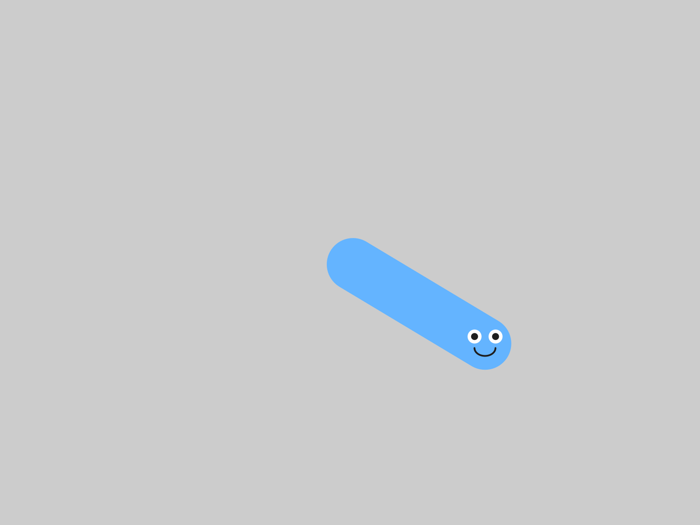
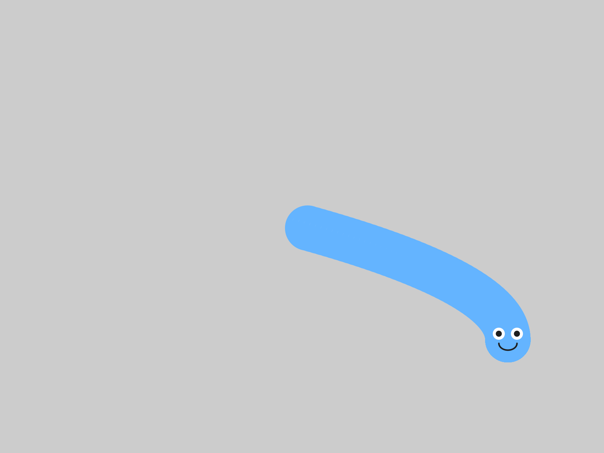
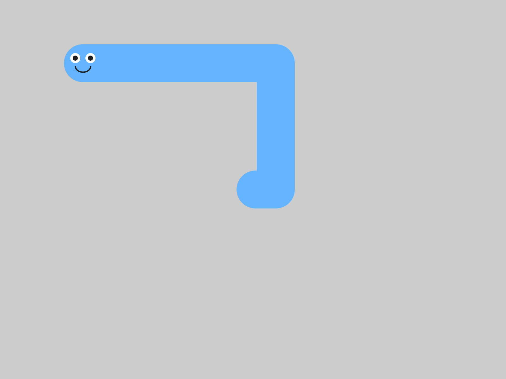
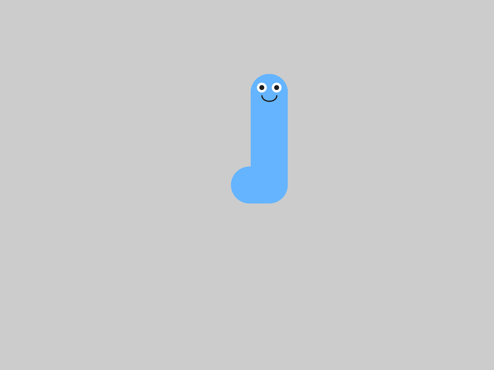
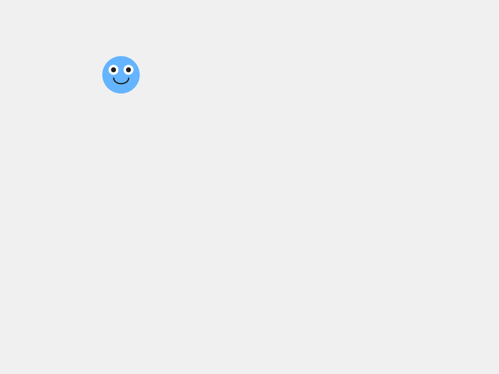
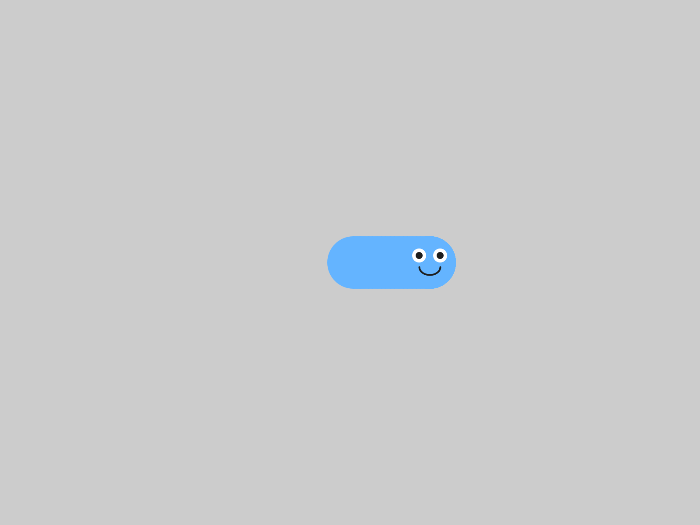

# Chapter 4 - You're in Control

*Your character stops doing its own thing and starts doing what you tell it.*

---

Chapter 3 ended with a character that moves on its own, in whatever direction
you gave it at the start.  Once it's going, it goes where you pointed it.

Today you take the controls.  There are two ways to do it, and you'll try both:
your character can chase your mouse, or go where the arrow keys send it.  Then
you pick the one that fits your game.

This chapter does it in four moves.

| Part | The idea |
|---|---|
| One | **Two kinds of input.**  Some things you can ask about every frame.  Some things happen once. |
| Two | **Option A:  follow the mouse.**  One line in `draw()`, and a speed in `setup()`. |
| Three | **Option B:  the arrow keys.**  A new kind of function, one Processing calls for you when a key goes down. |
| Four | **Make it yours.**  Pick one, tune it, and add a click. |

Leave your `MyCharacter` tab exactly as it is.  Everything happens in the main
tab.

---

# Part One - Two kinds of input

## 4.1  All the time, or once

**Input** is information coming into your program from you:  the mouse, the
keyboard.  There are two very different kinds, and telling them apart is the
real idea of this chapter.

Some questions have an answer **all the time**.  "Where is the mouse right
now?"  You can ask that on every frame, and there's always an answer.  That's
**continuous** input, and it belongs in `draw()`.

Other things happen **once**.  "Did a key just go down?"  That's an **event**.
It has an answer only at the instant it happens, so Processing comes and tells
you, by running a function you wrote for it.

Option A uses the first kind.  Option B uses the second.

---

# Part Two - Option A:  follow the mouse

## Step 1 - Chase the cursor

**Build it.**  Open your sketch from Chapter 3.  In `setup()`, set the velocity
to `(4, 0)`.  In `draw()`, replace `player.move();` with `player.followMouse();`:

```java
void setup() {
  size(800, 600);
  player = new MyCharacter(this, width/2, height/2);
  player.setVelocity(4, 0);   // REQUIRED - this is the speed it chases at
}

void draw() {
  background(240);
  player.followMouse();
  player.drawSprite();
}
```

Run it, and move your mouse around the window.

> **Check.**  Your character chases the mouse.  When you hold the mouse still,
> your character slides straight to it.

> **Screenshot:**  The mouse held still at `(650, 450)`, with `background()`
> switched off, as in Chapter 3, to show the path.
>
> 

`followMouse()` pulls your character a little way toward the cursor, every
frame.  Since it happens every frame, it goes in `draw()`.

> **Aside:  `mouseX` and `mouseY`**
>
> Processing always knows where your mouse is.  `mouseX` is how far across the
> window it is, and `mouseY` is how far down, measured the same way as
> everything else since Chapter 1.  `followMouse()` reads them every frame.
> You'll use them yourself in 4.5.

## Step 2 - The chase speed

**Build it.**  Change the `4` in `setVelocity` to `1`, and run.  Then try `12`.

> **Check.**  At `1` your character creeps after the mouse.  At `12` it jumps to
> it.

`followMouse()` uses the **size** of your velocity as its chase speed, and
ignores which way the velocity points.  `setVelocity(5, 0)` and
`setVelocity(0, 5)` chase at exactly the same speed.

> **Watch out.**  With a velocity of `(0, 0)`, or no `setVelocity()` at all,
> `followMouse()` moves your character zero pixels, and it looks broken.  When
> your character ignores the mouse, check `setup()` for a velocity first.

> **Watch out.**  Use `followMouse()` *or* `move()`, one or the other.
> `followMouse()` moves the character itself.  With both, `followMouse()` pulls
> it toward the mouse, and `move()` pushes it to the right by its velocity, every
> frame.  Your character curves over and parks just to the right of the mouse,
> where the pull and the push cancel out.

> **Screenshot:**  `followMouse()` and `move()` together.  It never quite gets
> to the mouse at `(650, 450)`.
>
> 

---

# Part Three - Option B:  the arrow keys

## Step 3 - Back to `move()`

**Build it.**  Comment out the `followMouse()` line, and put `player.move();`
back, above `drawSprite()`:

```java
void draw() {
  background(240);
  // player.followMouse();
  player.move();
  player.drawSprite();
}
```

Keep the `setVelocity(4, 0)` in `setup()`.

## Step 4 - A function for when a key goes down

**Build it.**  At the very bottom of your sketch, after the closing brace of
`draw()`, add a new function:

```java
// Arrow keys control the character
void keyPressed() {
  player.keyboardControl();
}
```

> **Aside:  event functions**
>
> `keyPressed()` is an **event function**.  You write it, and Processing calls
> it for you, every time a key goes down.  Its name has to be exactly
> `keyPressed`, the same way `setup` and `draw` have to be spelled exactly.
> There's one for the mouse, too:  `mousePressed()` runs once, each time you
> click.

> **Watch out.**  Click inside the sketch window before you press any keys.  Until
> you do, the keys go to the code editor.

Run it, and wait a second before you touch anything.

> **Check.**  Your character drifts slowly to the right on its own.

> **Screenshot:**  One second in, before any key.
>
> 

That's the `setVelocity(4, 0)` from Step 1, and `move()` is using it, the same
as in Chapter 3.  Now click in the window and use the arrow keys.

> **Check.**  Each arrow sends your character that way.

> **Screenshot:**  Up, then left.  A trail, as before.
>
> 

## Step 5 - Let go

**Build it.**  Press an arrow key, and let go.

> **Check.**  Your character keeps going.

That's how it's meant to work.  `keyboardControl()` **sets** your character's
velocity, and letting go of the key leaves the velocity just as it was.  So your
character coasts, like it's on ice.  Some games want exactly that.

Now press the space bar.

> **Check.**  Your character stops dead.

> **Screenshot:**  Up, and then the space bar.
>
> 

`keyboardControl()` looks at which key went down.  An arrow sets a speed of 5
in that direction.  Any other key sets the velocity to zero.  So every key that
isn't an arrow is a brake:  the space bar, a letter, anything.

That 5 is fixed.  Changing the numbers in `setVelocity()` changes how your
character drifts before the first key.  After that, it's always 5.

## 4.4  The two halves

Option B has two halves, and they're the two kinds of input from 4.1.

- `keyboardControl()`, in `keyPressed()`, runs once per key press.  It
  **changes** the velocity.  That's an event.
- `move()`, in `draw()`, runs every frame.  It **uses** the velocity, to take
  a step.

> **Watch out.**  Switch to the keys and forget to put `move()` back, and your
> character sits still.  Every key press sets a velocity, and only `move()` takes
> the step.

---

# Part Four - Make it yours

## 4.5  Pick one

> **Argue it.**  Mouse or keys, for your game?  `followMouse()` is easier and more
> forgiving.  `keyboardControl()` feels more like a real game.  Each one gives you
> something the other one gives up, and that's a **trade-off**.  Pick one, and be
> ready to say why it fits the game you want to make.

**Your turn.**  Keep the control style you picked, and comment out or delete the
other one.  Then tune it:  the chase speed for the mouse, or how you feel about
the coasting for the keys.  Whatever you choose today, you can change it later.

## 4.6  Something extra

**Your turn.**  **Optional:**  add a click ability.  Put this at the bottom of
your sketch:

```java
void mousePressed() {
  player.moveTo(mouseX, mouseY);   // teleport to wherever you clicked
}
```

> **Check.**  Click anywhere, and your character jumps straight there.

> **Screenshot:**  A click at `(150, 120)`.
>
> 

`moveTo()` picks your character up and puts it down at the spot you give it.
It works with either control style.  With the keys, it gives you a teleport.

**Your turn.**  **Optional:**  make the character stop when you let go of the key.
Add one more event function:

```java
void keyReleased() {
  player.setVelocity(0, 0);
}
```

> **Check.**  Press an arrow and let go.  Your character goes, then stops.

> **Screenshot:**  Right, and then let go.
>
> 

Try it both ways, coasting and stopping.  Which one suits your character?

**Your turn.**  **Optional:**  add a second blob that moves on its own, the way you
did in Chapter 3, so there's something else on the screen while you steer.

---

## Chapter summary

You started with a character that went where you pointed it, once.  You end with
one you steer, with the mouse or the keys, and a reason for the one you picked.

| You built | It's an example of |
|---|---|
| `player.followMouse()` in `draw()` | **continuous** input, asked about every frame |
| `setVelocity(4, 0)` for the chase | `followMouse()` uses the size of the velocity as its speed |
| `void keyPressed() { player.keyboardControl(); }` | an **event function**, run once per key press |
| `move()` in `draw()`, with the keys | one half changes the velocity, the other half uses it |
| letting go, and the space bar | coasting, and a brake on every other key |
| `mousePressed()` and `moveTo(mouseX, mouseY)` | a second event function, and the mouse's position |
| mouse or keys, picked | a **trade-off** |

### New syntax in this chapter

| Syntax | Where you met it |
|---|---|
| `followMouse()` | Step 1 |
| `mouseX`, `mouseY` | Step 1 |
| `void keyPressed() { }` | Step 4 |
| `keyboardControl()` | Step 4 |
| `void mousePressed() { }` | Step 4, 4.6 |
| `moveTo(x, y)` | 4.6 |
| `void keyReleased() { }` | 4.6 |

### Vocabulary

**continuous input** -- something your program can ask about every frame,
like where the mouse is.  It goes in `draw()`.  (4.1)

**event** -- something that happens once, at one instant, like a key going down
or a click.  (4.1)

**event function** -- a function you write and Processing calls for you when
an event happens:  `keyPressed()`, `mousePressed()`, `keyReleased()`.  (Step 4)

**input** -- information coming into your program from you:  the mouse, the
keyboard.  (4.1)

**trade-off** -- a choice where each option gives you something the other one
gives up.  (4.5)

### Check your understanding

1. Why does `followMouse()` go in `draw()`, and `keyboardControl()` go in
   `keyPressed()`?
2. Your character won't chase the mouse.  What do you check first?
3. With the arrow keys, what does `keyboardControl()` change, and what does
   `move()` do every frame?
4. Why does your character keep going after you let go of the key?
5. What happens when you press the space bar, and why?
6. You chose mouse or keys.  What does your choice give you, and what does it
   give up?

## What's next

Your character goes where you tell it now, across an empty grey window.

In Chapter 5 you build it a world:  ground, scenery that drifts past, and a coin
floating through it, waiting for Chapter 6.
