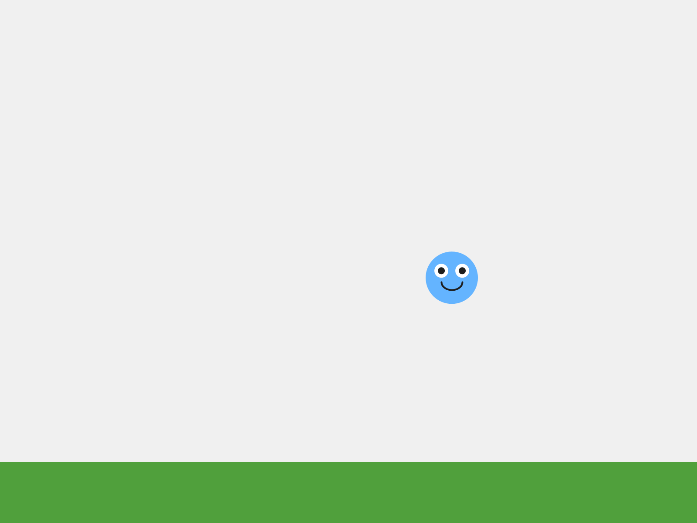
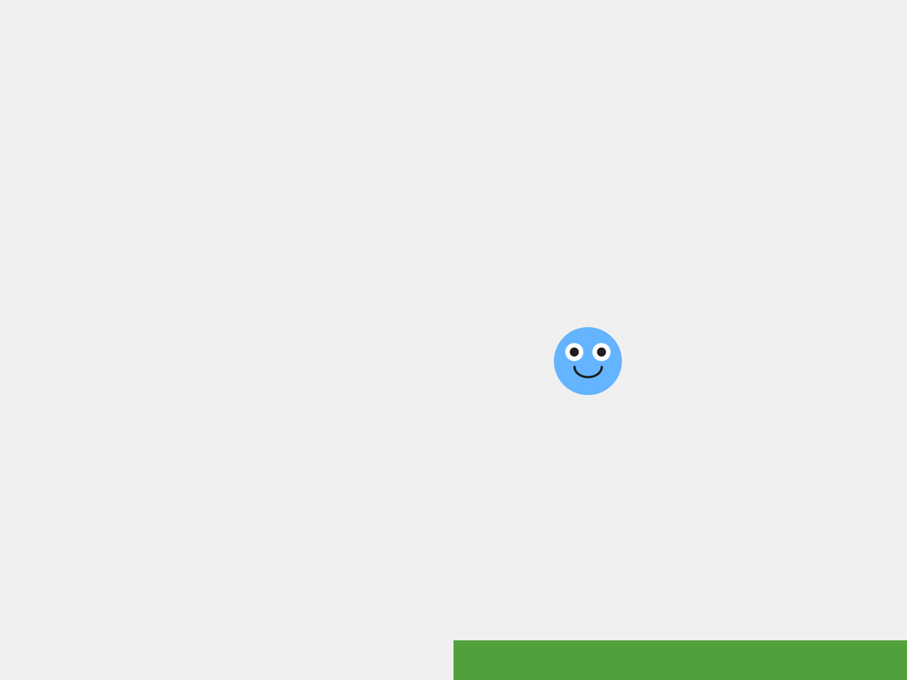
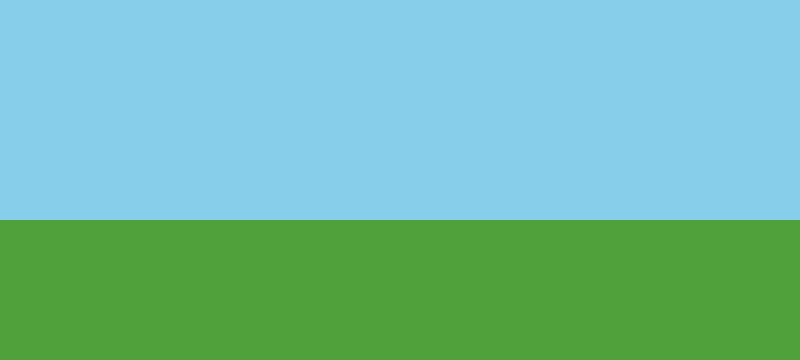
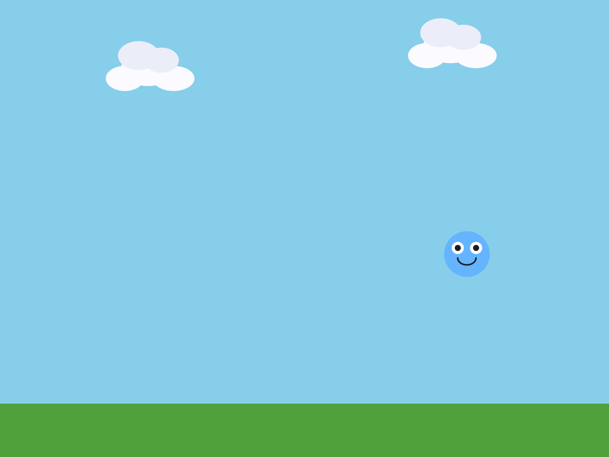
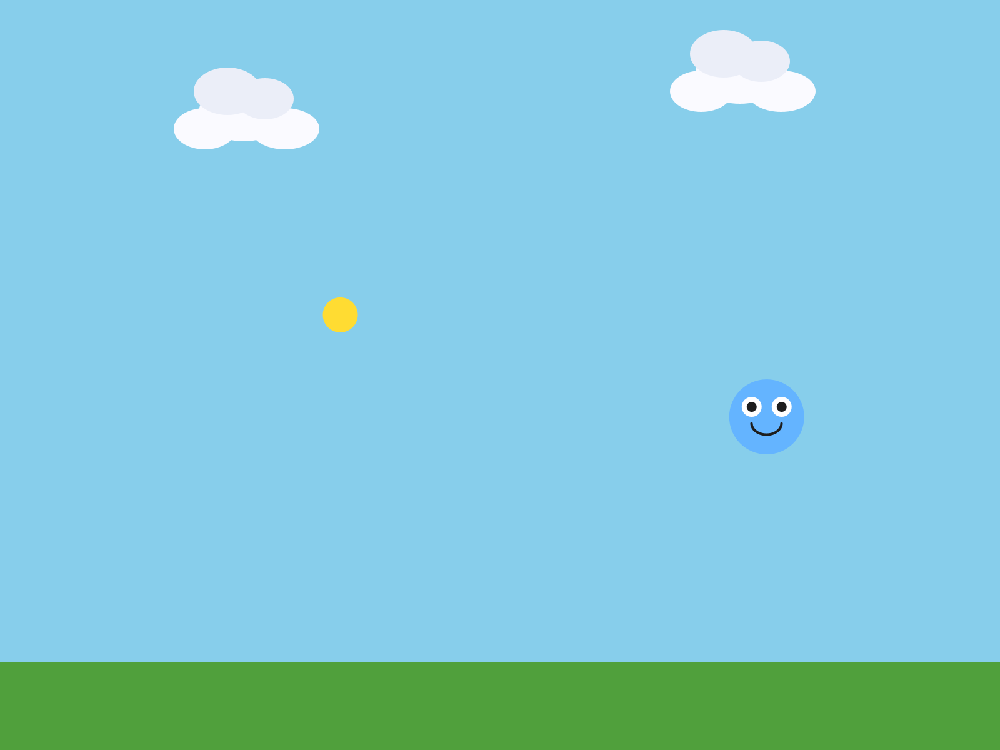
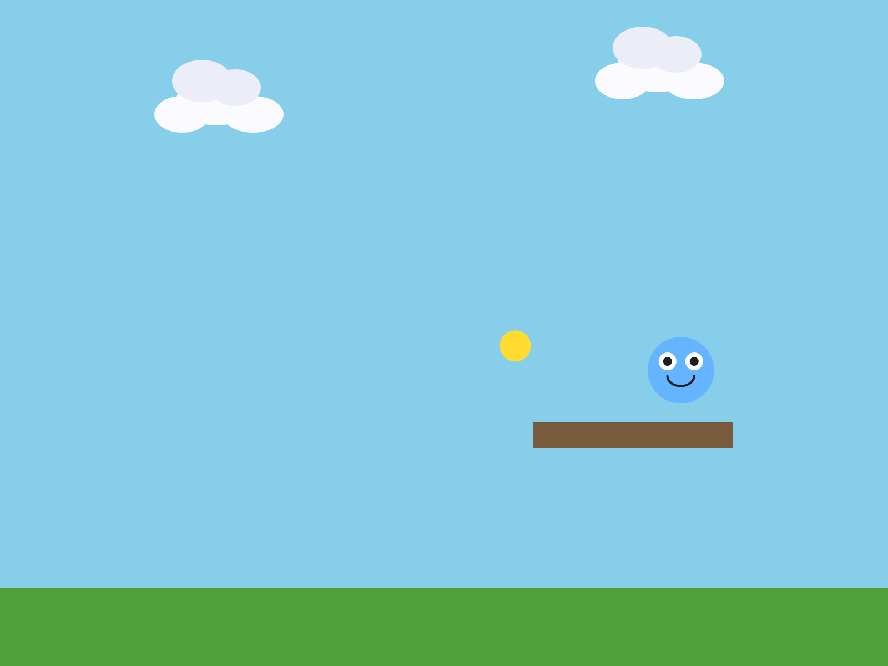
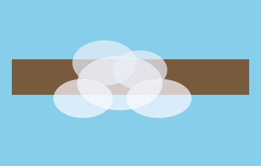

# Chapter 5 - Build Your World

*Your character needs somewhere to be.  Today you build the place your game happens in.*

---

Chapter 4 ended with a character you can steer, across an empty grey window.

Today it gets a world:  ground to stand on, a sky, clouds drifting past, and a
coin floating through, waiting for Chapter 6.  There's very little new code
today.  Most of the chapter is you, deciding what your world looks like.

The one new idea is **draw order**:  the order of your lines decides what
appears in front.

This chapter does it in four moves.

| Part | The idea |
|---|---|
| One | **Sketch it first.**  Three minutes on paper, and the one new kind of sprite. |
| Two | **Ground, and the order you draw in.**  A `Block` for the ground, and the rule:  background first, player last. |
| Three | **Things in the world.**  Clouds in a tab of their own, and a coin. |
| Four | **Make it yours.**  A world with a theme that's yours. |

You keep everything from Chapters 1 to 4, and you leave your `MyCharacter` tab
exactly as it is.

---

# Part One - Sketch it first

## 5.1  On paper

**Your turn.**  Before any code, sketch the world your game takes place in, on
paper.  What's in the background?  Is there ground?  Sky?  What drifts past?
Three minutes, then show a neighbor.

It earns its three minutes.  You'll build a better world with the picture in
front of you.

## 5.2  `Block`, the rectangle sprite

Your character is a Blob, and so far everything in your sketch has been one.
The library has another kind of sprite for scenery:  a **`Block`**, a rectangle.

A `Block` starts with zero velocity, so it sits exactly where you put it.  That
makes it good for ground, walls, a platform, a ceiling.

```java
ground = new Block(this, 0, height - 70, width, 70, color(80, 160, 60));
```

Six things, in this order:

| | What it is |
|---|---|
| `this` | the sketch, the same as a Blob |
| `0` | x of the **top-left corner**:  the left edge |
| `height - 70` | y of the **top-left corner**:  70 pixels up from the bottom |
| `width` | how wide:  the whole window |
| `70` | how tall |
| `color(80, 160, 60)` | its color, a grassy green |

So this one fills the bottom 70 pixels of the window, edge to edge.

> **Watch out.**  For a `Block`, `x` and `y` are the **top-left corner**.  For a
> Blob they were the **center**.  This catches everyone once.

A `Block` is scenery.  Your character passes straight through it, the same as
it passes through everything else in your world right now.

---

# Part Two - Ground, and the order you draw in

## Step 1 - Ground

**Build it.**  Open your sketch from Chapter 4.  Add the ground in three places,
the same three as every object since Chapter 1:

```java
Block ground;                    // at the top, with player
```

```java
// in setup():  x, y is the TOP-LEFT corner
ground = new Block(this, 0, height - 70, width, 70, color(80, 160, 60));
```

```java
// in draw(), right after background()
ground.drawSprite();
```

Run it.

> **Check.**  A strip of green along the bottom of the window.

> **Screenshot:**  Ground, on Chapter 4's grey.
>
> 

> **Watch out.**  Use the ground's center for its `x` and `y`, the way you would
> for a Blob, and the ground lands in the wrong spot.  Here it is with
> `width/2, height - 35`, the middle of where the ground should be.

> **Screenshot:**  The corner, put where the center should be.  Half the ground
> hangs off the window.
>
> 

## Step 2 - A sky

**Build it.**  Change `background(240)` to a color that fits your world.  The
Canvas starter uses a sky blue, `background(135, 206, 235)`.  Deep space black,
ocean teal, or lava red work too.

## Step 3 - Draw order, on purpose

**Build it.**  Move `ground.drawSprite();` to the very last line of `draw()`,
after your player.  Run it, and steer your player down to the ground.

> **Check.**  Your player disappears underneath the ground.

> **Screenshot:**  Ground drawn first, and the player is in front.
>
> 

> **Screenshot:**  Ground drawn last, and the player is behind it.  Same spot.
>
> 

Move the line back, right after `background()`, and say out loud what happened.

Processing draws like paint on a canvas.  Whatever you draw **later** covers
whatever you drew earlier.  You saw it inside your character in Chapter 2, when
the body drawn last painted over the face.  Now it's the whole world.  The order
of the calls in `draw()` *is* the layering.

**Rule of thumb:  background first, player last.**

> **Watch out.**  `background()` paints over the whole window, so it goes at the
> **top** of `draw()`.  Call it halfway down, and it erases everything you drew
> above it that frame.  Move it below your clouds, in Step 4, and the frame comes
> out exactly like one with no clouds in it at all.

---

# Part Three - Things in the world

## Step 4 - Clouds, in a tab of their own

**Build it.**  Make a new tab called `Cloud`, the way you made `MyCharacter` in
Chapter 2.  Paste this in:

```java
// Cloud - a second sprite class.  Redesign it to fit your world!
class Cloud extends Blob {

  Cloud(PApplet p, float x, float y, float speed) {
    super(p, x, y, 40, color(255));  // radius 40 used for collision if ever needed
    setVelocity(speed, 0);           // drift slowly to the right; no vertical movement
  }

  void drawSprite() {
    noStroke();

    // Bottom puffs - the wide base of the cloud
    fill(250, 250, 255);
    ellipse(pos.x,      pos.y,      72, 46);
    ellipse(pos.x - 31, pos.y + 13, 50, 33);
    ellipse(pos.x + 33, pos.y + 13, 55, 33);

    // Top puffs - slightly greyer for a sense of depth
    fill(235, 238, 248);
    ellipse(pos.x - 13, pos.y - 17, 54, 38);
    ellipse(pos.x + 17, pos.y - 11, 46, 33);
  }
}
```

Read it against your `MyCharacter` tab.  A class line with `extends Blob`, a
`super(...)` handshake, and a `drawSprite()` full of shapes measured from
`pos.x` and `pos.y`.  You've written every piece of this already.

Two things are new, both in the constructor.

> **Aside:  a constructor with a number of its own**
>
> `Cloud(PApplet p, float x, float y, float speed)` takes a fourth thing, the
> cloud's speed.  Then the constructor uses it:  `setVelocity(speed, 0)`.  So
> every cloud sets its own velocity when it's made, right in its own
> constructor.

**Build it.**  In the main tab, add two clouds, in the same three places:

```java
Cloud cloud1;                              // 1. declare it at the top
Cloud cloud2;
```

```java
cloud1 = new Cloud(this, 150, 90, 0.5);    // 2. create it in setup()
cloud2 = new Cloud(this, 520, 60, 0.8);
```

```java
cloud1.move();                             // 3. move and draw it in draw()
cloud1.drawSprite();
cloud2.move();
cloud2.drawSprite();
```

The move-and-draw lines go **right after** `background()`, before the ground.
Clouds are far away, so they're drawn first.

Run it.

> **Check.**  Two clouds drift slowly to the right, each at its own speed, and
> wrap around like everything else.

> **Screenshot:**  Sky, two clouds, ground, and your player.
>
> 

> **Watch out.**  Make a cloud in `draw()` by mistake, and it freezes.  The
> `new Cloud(...)` line runs every frame, so the cloud is built again at its
> starting spot sixty times a second.  Making things goes in `setup()`.

Each cloud is its own variable.  Want a third?  Declare `cloud3`, create it,
move it, draw it.  If you find yourself wanting fifty of something, ask your
teacher about Bonus D.

## Step 5 - A coin

**Build it.**  Add a coin.  Declare `Blob coin;` at the top.  Create it in
`setup()`:

```java
// A coin drifting through the world.  You collect it in Lesson 6.
coin = new Blob(this, random(width), random(100, height - 150),
                14, random(1, 2.5), random(-1.5, 1.5),
                color(255, 220, 50));
```

> **Aside:  a Blob with seven numbers**
>
> This Blob gets seven things where Chapter 1's got five:  the sketch, x, y, the
> radius, then **two more**, its velocity, and then its color.  It's the same as
> making a Blob and calling `setVelocity()` on it, in one line.  Every number
> here except the radius and color is `random()`, so the coin starts somewhere
> different, going a different way, every run.

Move and draw it in `draw()`, **after** the ground and **before** the player.
Run it.

> **Check.**  A gold coin drifting through your world.  Steer your player into
> it.  Nothing happens.  That's Chapter 6.

> **Screenshot:**  The finished world, as the Canvas starter builds it.  Your
> coin will be somewhere else.
>
> {width=3in}

Here's the whole `draw()`, back to front:

```java
void draw() {
  background(135, 206, 235);   // 1. sky - furthest back

  cloud1.move();               // 2. clouds drift behind everything
  cloud1.drawSprite();
  cloud2.move();
  cloud2.drawSprite();

  ground.drawSprite();         // 3. ground in front of the sky

  coin.move();                 // 4. things in the world
  coin.drawSprite();

  player.followMouse();        // 5. player last, so it is always in front
  player.drawSprite();
}
```

If you drive with the arrow keys, your step 5 is `player.move();` instead.

---

# Part Four - Make it yours

## 5.5  A place

The rest of the time is yours.  Play your world as you go.  Does it look like a
place?  Keep going until it does.

**Your turn.**  Give your world a theme.  Space?  Underwater?  Lava?  A cave?  A
candy world?  Start with the background.

**Your turn.**  Make everything belong together.  A gold coin in a space world
looks wrong.  Make it a star, or a gem, or an asteroid.

**Your turn.**  Redesign the `Cloud` tab completely:  a star, a bubble, a bird, a
fish.  Rename the class if you like.  Or write a brand-new decoration in a new
tab, a `Tree`, a `Rock`, with the same `extends Blob` pattern as your character.

**Your turn.**  Add more `Block`s:  a platform, a wall, a border around your
scene.  Pick where each one goes in `draw()`.

> **Screenshot:**  A platform, `new Block(this, 480, 380, 180, 24, color(120, 90, 60))`.
>
> 

**Your turn.**  Make far-away things look far away.  `fill()` and `color()` take a
fourth number, **alpha**, for how see-through something is:  `0` is invisible,
and `255` is solid.  In your `Cloud` tab, try `fill(250, 250, 255, 180)`.

> **Screenshot:**  A solid cloud in front of a block.
>
> 

> **Screenshot:**  The same cloud with an alpha of `180`.  You can see the block
> through it.
>
> 

Speed does the same work.  A world feels deep when the far-away things move
slowly and the close things move fast.  Ground sits still.  Clouds drift.  The
coin darts.  Your player goes wherever you send it.

**Your turn.**  **Optional:**  build a real parallax effect.  Three clouds at three
different speeds:  the slowest one faintest and drawn first, the fastest one
solid and drawn last.  It's the oldest trick in 2D games, and it still works.

---

## Chapter summary

You started with a character in an empty window.  You end with a world:  a sky,
ground, things drifting past, and a coin, all in the order you chose to draw
them.

| You built | It's an example of |
|---|---|
| `new Block(this, 0, height - 70, width, 70, ...)` | a `Block`:  a rectangle, placed by its **top-left corner** |
| the ground drawn last | **draw order**:  later covers earlier |
| background first, player last | the order of `draw()` is the layering |
| the `Cloud` tab | a second class, built exactly like your character |
| `Cloud(PApplet p, float x, float y, float speed)` | a constructor with a number of its own |
| `new Blob(this, x, y, 14, vx, vy, color)` | a Blob made with its velocity |
| `fill(250, 250, 255, 180)` | **alpha**, how see-through |

### New syntax in this chapter

| Syntax | Where you met it |
|---|---|
| `Block`, `new Block(this, x, y, w, h, color)` | 5.2, Step 1 |
| `height - 70` | 5.2 |
| a constructor's own extra number, and `setVelocity()` inside it | Step 4 |
| `new Blob(this, x, y, radius, vx, vy, color)` | Step 5 |
| `fill(r, g, b, alpha)` | 5.5 |

### Vocabulary

**alpha** -- a fourth number in `fill()` or `color()` for how see-through
something is.  `0` is invisible, `255` is solid.  (5.5)

**`Block`** -- the library's rectangle sprite.  Good for ground, walls, and
platforms.  Its `x` and `y` are its top-left corner.  (5.2)

**draw order** -- the order you draw things in.  Whatever is drawn later
appears in front.  (Step 3)

### Check your understanding

1. A `Block` at `new Block(this, 100, 100, 50, 50, ...)`.  Where is its
   top-left corner?  Where is its middle?
2. Your player disappears when it walks onto the ground.  What do you check?
3. Why do the clouds get drawn before the ground?
4. Your cloud won't move.  It's in the right place in `draw()`.  Where else do
   you look?
5. What do the seven numbers in the coin's `new Blob(...)` mean?
6. Name one draw-order decision you made in your world, and what it changed.

## What's next

There's a coin drifting through your world, and touching it does nothing.  What
*should* happen?

Chapter 6 is where your game starts paying attention.  Touch the coin and score
a point.  Touch something dangerous, and the game ends.
