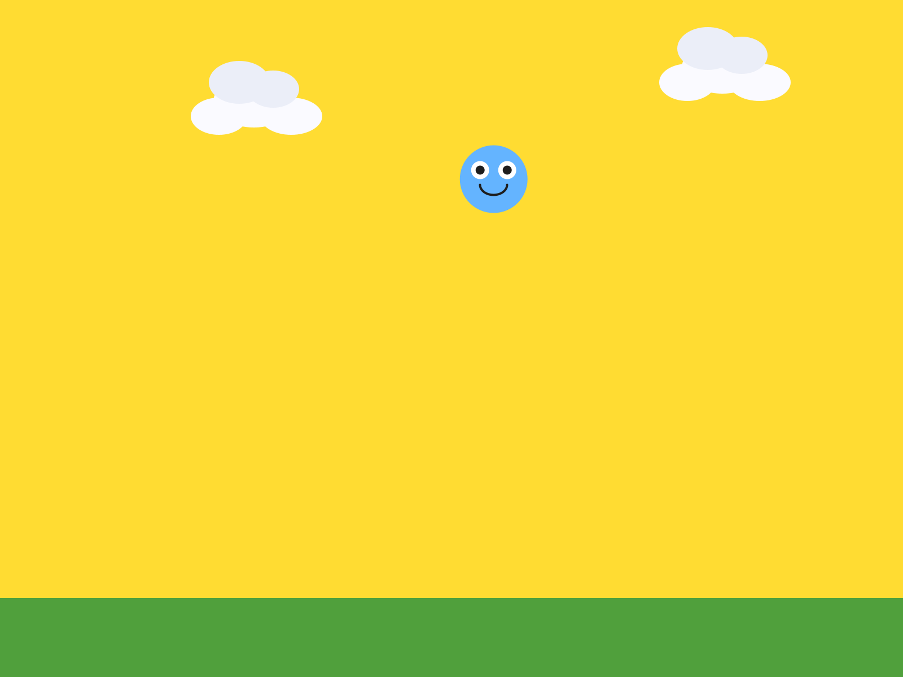
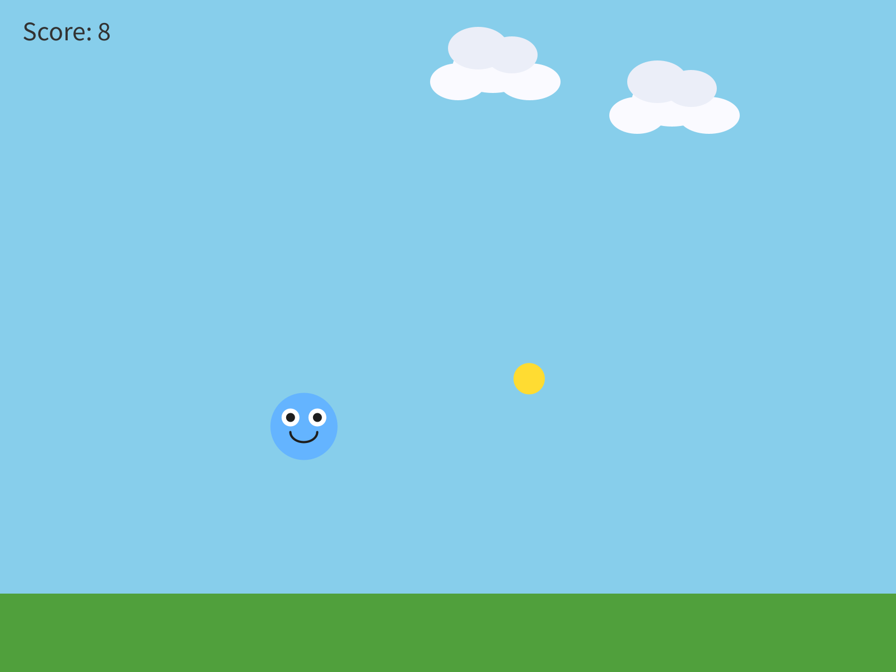
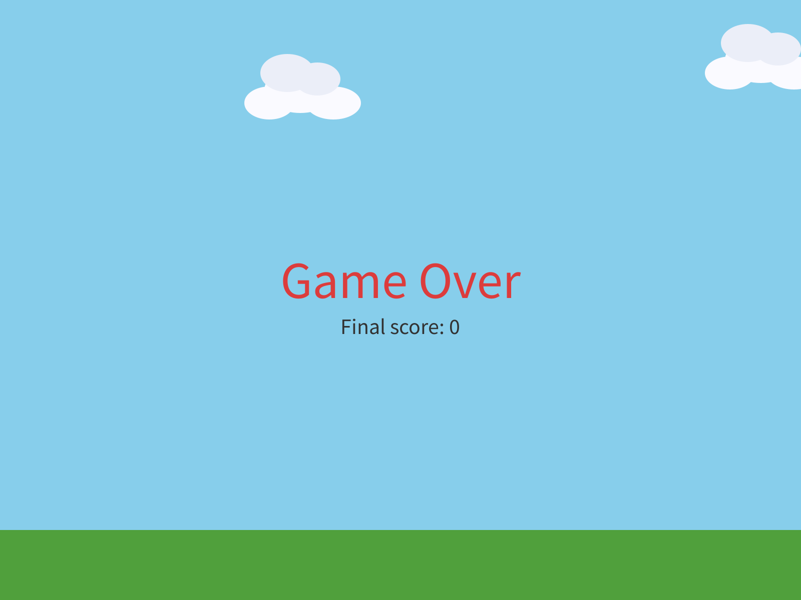

# Chapter 6 - Collisions:  If This, Then That

*Things finally touch each other, and your program decides what happens next.  This is where it becomes a game.*

---

Chapter 5 ended with a coin drifting through your world, and touching it does
nothing.  What *should* happen?

Today your sketch starts paying attention.  Touch the coin, and you score a
point.  Touch something dangerous, and the game ends.

The new idea is **`if`**:  making something happen only when it's true.  The
library can tell when two things are touching, and that gives `if` something to
be true about.

This chapter takes two meetings, and does it in four moves.

| Part | The idea |
|---|---|
| One | **Are they touching?**  A yes-or-no question, and an `if` to act on the answer. |
| Two | **Keep score.**  A number that remembers, on the screen, one point per touch. |
| Three | **A game that can end.**  A hazard, a true-or-false, and two screens. |
| Four | **Make it yours.**  Harder, easier, and yours. |

Parts One and Two are the first meeting.  Parts Three and Four are the second.

---

# Part One - Are they touching?

## 6.1  A yes-or-no question

```java
player.collidesWith(coin)
```

`collidesWith()` asks one question:  *are these two touching?*  The library
checks whether their circles overlap, and hands back `true` or `false`.

Your character has `collidesWith()` because you wrote `class MyCharacter extends
Blob` back in Chapter 2.  It's one of the things a Blob can do, so your
character got it for free, and you never had to write it.

Remember the `30` in your `super(...)` line?  In Chapter 2 you changed it, and
nothing on the screen changed.  This is what it's for.  That number is the
radius of an invisible circle around your character, called its **hitbox**, and
`collidesWith()` uses that circle and only that circle.  Your drawing can be any
size you like.

## 6.2  `if`

An `if` makes something happen only when a question's answer is yes:

```java
if (player.collidesWith(coin)) {
  background(255, 220, 50);   // only happens while they are touching
}
```

- The part in the parentheses is the **condition**, the yes-or-no question.
- The part in the braces is what happens when the condition is true.
- When it's false, Processing skips straight past the braces.

## Step 1 - The gold flash

**Build it.**  Open your sketch from Chapter 5.  In `draw()`, right after your
`background()` line, add the `if` above.  Run it, and touch the coin.

> **Check.**  The sky flashes gold while you touch the coin, and goes back to
> blue when you let go.

> **Screenshot:**  Touching the coin.
>
> 

`draw()` runs sixty times a second, so it asks *are they touching?* sixty times
a second.  On every frame the answer is yes, the sky is gold.

## Step 2 - Generous or precise

**Your turn.**  If touching the coin feels too hard or too easy, open your
`MyCharacter` tab and change the radius in the `super(...)` line.  A bigger
radius touches things from further away, which feels generous.  A smaller one
means you have to be right on top of something, which feels precise.  Which do
you want your game to be?

---

# Part Two - Keep score

## Step 3 - A number that remembers

**Build it.**  Delete the gold flash.  Then, at the very top of your sketch, next
to your other variables, add:

```java
int score = 0;     // a whole number, starts at zero
```

> **Aside:  `int`**
>
> `int` is the kind of variable that holds a whole number:  `0`, `7`, `-3`.  No
> decimal point.  `int score = 0;` makes a box called `score` and puts a `0` in
> it, on the same line.

A score has to remember something from one frame to the next.  So it goes at the
very **top** of your sketch, outside `setup()` and outside `draw()`.  Up there,
every function in your sketch can see it.

> **Watch out.**  Put `int score = 0;` inside `setup()`, and the box only exists
> while `setup()` runs.  `draw()` can't see it, and the sketch stops with:
>
> ```
> score cannot be resolved to a variable
> ```
>
> Move it back to the top.

## Step 4 - The score on the screen

**Build it.**  At the bottom of `draw()`, add three lines:

```java
fill(50);                          // the text color
textSize(24);                      // how big
text("Score: " + score, 20, 36);   // what, then x, then y
```

Run it.

> **Check.**  `Score: 0` in the top-left corner.

> **Screenshot:**  The score.
>
> 

> **Aside:  `text()`**
>
> `text()` draws words on the screen.  You give it what to say, then where:  x,
> then y.  The `+` glues the words `"Score: "` and the number in `score`
> together into one piece of text.  Set `fill()` **before** `text()`, or your
> words come out in whatever color the last shape used.

**Build it.**  Test it by cheating.  Change `int score = 0;` to `int score = 7;`,
and run.

> **Check.**  `Score: 7`.

> **Screenshot:**  The cheat.
>
> 

Setting a value by hand to check that the display works is a real technique.
Programmers do it all the time.  Set it back to `0`.

## Step 5 - A point per touch

**Build it.**  Above the three score lines, add the collision `if` again, this
time with a point inside:

```java
if (player.collidesWith(coin)) {
  score = score + 1;   // add a point
}
```

> **Aside:  `score = score + 1`**
>
> Read it right to left.  Take what's in `score`, add one, and put the answer
> back in `score`.  The `=` means *make this equal to that*.

Run it, and sit your player on the coin.  Watch the score.

> **Check.**  The score races upward, as long as you're touching the coin.

> **Screenshot:**  A few seconds of touching.
>
> 

Why is it doing that?  Make a guess before you read on.

`draw()` asks *are they touching?* every frame.  For as long as you sit on the
coin, the answer is yes, and every yes is a point.  That's a point for every
frame:  sixty a second, if you sit right on it.

## Step 6 - One touch, one point

The fix is to end the touch the moment you count it.  Move the coin somewhere
else.

**Build it.**  Inside the same `if`, after the point, add:

```java
coin.moveTo(random(width), random(100, height - 150));  // coin jumps somewhere new
```

Run it.

> **Check.**  Touch the coin, and you score one point, and the coin jumps
> somewhere new.

> **Screenshot:**  Eight coins in fifteen seconds.
>
> 

You met `moveTo()` in Chapter 4, teleporting your character to a click.  Here
it teleports the coin, and `random()` picks the spot, so it lands somewhere new
every time.

**Your turn.**  Change the coin's speed and size, and style the score so it fits
your world.  The score's `fill()` and `textSize()` are yours.

---

# Part Three - A game that can end

Last meeting your character started scoring points.  Today it gets something to
avoid, and your game gets a way to end.

If your sketch from last time is broken, the Canvas page has a Day 1 checkpoint.
Paste it into your main tab, keep your own `MyCharacter` and `Cloud` tabs, and
you're caught up.

## Step 7 - A hazard

**Build it.**  Add one more Blob, in the same three places as everything else.
Declare `Blob hazard;` at the top.  Create it in `setup()`:

```java
// The hazard starts in the top-left corner, away from the player
hazard = new Blob(this, 80, 80, 22, 3, 2, color(220, 60, 60));
```

In `draw()`, move and draw it, right after the coin.

It starts in a corner on purpose.  A hazard made right on top of your player
would end the game the instant it started.

## Step 8 - True or false

**Build it.**  At the top of your sketch, add:

```java
boolean gameOver = false;   // true or false, starts false
```

> **Aside:  `boolean`**
>
> A **`boolean`** is the simplest variable there is.  It's `true`, or it's
> `false`, and that's all.  Here it remembers one thing:  is the game over?

Then, after the coin's `if`, add one for the hazard:

```java
if (player.collidesWith(hazard)) {
  gameOver = true;
}
```

Run it, and touch the hazard.

> **Check.**  Nothing seems to happen.  The game keeps going.

The variable changed.  `gameOver` is `true` now, and nothing in your sketch
reads it yet.  The next two Steps give it a reader.

## Step 9 - A function of your own

`draw()` is getting long.  Before it gets longer, you're going to give the game
part of it a name of its own.

**Build it.**  Below the closing brace of `draw()`, make a new function called
`playGame()`.  Move into it your coin, your hazard, your player, both collision
`if`s, and the score display.  Leave the sky, clouds, and ground in `draw()`.

```java
void playGame() {
  coin.move();
  coin.drawSprite();

  hazard.move();
  hazard.drawSprite();

  player.followMouse();
  player.drawSprite();

  // Touching the coin:  score a point, and the coin jumps somewhere new
  if (player.collidesWith(coin)) {
    score = score + 1;
    coin.moveTo(random(width), random(100, height - 150));
  }

  // Touching the hazard:  the game is over
  if (player.collidesWith(hazard)) {
    gameOver = true;
  }

  fill(50);
  textSize(24);
  text("Score: " + score, 20, 36);
}
```

In `draw()`, after the scenery, call it:

```java
  playGame();
```

> **Aside:  writing your own function**
>
> `void playGame() { ... }` makes a function, the same shape as `setup()` and
> `draw()`.  The difference is who calls it.  Processing calls `setup()` and
> `draw()` for you.  This one runs when your sketch says its name:
> `playGame();`.  You can name a
> function anything, so name it what it does.

Run it.

> **Check.**  Everything looks exactly the same as before.

That means it worked.  Moving code into a function of its own is called
**refactoring**, and a refactor that leaves the screen exactly the same is a
success.

## Step 10 - Two screens

**Build it.**  Below `playGame()`, add a second function, for the end of the
game:

```java
void showGameOver() {
  textAlign(CENTER, CENTER);
  fill(220, 60, 60);
  textSize(52);
  text("Game Over", width/2, height/2 - 20);
  fill(50);
  textSize(22);
  text("Final score: " + score, width/2, height/2 + 26);
  textAlign(LEFT, BASELINE);   // put text alignment back to normal
}
```

Then, in `draw()`, replace `playGame();` with this:

```java
  if (!gameOver) {
    playGame();       // still playing
  } else {
    showGameOver();   // it's over
  }
```

> **Aside:  `!` and `else`**
>
> `!` means **not**.  So `!gameOver` reads *not game over*:  still playing.
> `else` is the other half of an `if`.  When the condition is true, the first
> braces run.  When it's false, the braces after `else` run instead.  Exactly
> one of the two runs, every frame.

Run it, and touch the hazard.

> **Check.**  The game stops, and *Game Over* comes up with your final score.

> **Screenshot:**  Game over.  The sky, clouds, and ground are still there,
> because they're still in `draw()`.
>
> 

This is the big idea of today.  Your game is always in a **mode**.  Right now
there are two:  playing, and game over.  The `boolean` remembers which mode
you're in, and the `if` / `else` in `draw()` picks which one to run.

**Build it.**  Test the other branch by cheating.  Change
`boolean gameOver = false;` to `true`, and run.

> **Check.**  The game opens straight onto the game over screen, with a score of
> 0.

Set it back to `false`.

## 6.5  Comparing numbers

A condition can compare numbers, too:

```java
if (score >= 10) {
  background(255, 0, 0);   // only happens once score is 10 or more
}
```

| You write | It asks |
|---|---|
| `score > 10` | greater than 10? |
| `score < 10` | less than 10? |
| `score >= 10` | 10 or more? |
| `score <= 10` | 10 or less? |
| `score == 10` | exactly 10? |

> **Watch out.**  `==` is a question:  *are these equal?*  A single `=` is a
> command:  *make this equal to that*.  Write `if (score = 10)` by mistake, and
> the sketch stops with:
>
> ```
> Type mismatch: cannot convert from int to boolean
> ```
>
> An `if` needs a yes or a no, and `score = 10` is a command.  Make it `==`.

---

# Part Four - Make it yours

**Your turn.**  Rewrite the game over screen so it sounds like your game:
different words, different colors.

> **Watch out.**  Keep the last line, `textAlign(LEFT, BASELINE);`.  It puts text
> back to normal after the centered game over text, and without it every `text()`
> after it comes out centered too.

**Your turn.**  Tune the hazard:  its speed, its size, where it starts.  A harder
game, or an easier one?

**Your turn.**  **Optional:**  any of these.

- A second hazard, `hazard2`, with its own `if`.  Give it a different speed or
  size.
- A second coin, `coin2`, worth more:  `score = score + 5;`
- Change what ends the game.  A hazard?  Reaching a score of 20?  Both?
- A background that changes as the score goes up.  Stack a few `if`s right
  after the sky, one for each score, so the later ones paint over the earlier:

```java
  if (score >= 5) {
    background(255, 170, 80);    // sunset
  }
  if (score >= 10) {
    background(30, 30, 70);      // night
  }
```

**Your turn.**  **Optional:**  give your player lives.  Start with
`int lives = 3;` at the top.  When the hazard hits, take one away, and move the
hazard somewhere else, exactly like the coin.  Set `gameOver` to `true` only
when `lives` reaches `0`.  Show the lives on the screen, under the score.

Then play your game.  This is where it becomes one, so leave time to play it.

---

## Chapter summary

You started with a coin that did nothing when you touched it.  You end with a
game:  a score that counts, something to avoid, and a screen that says it's
over.

| You built | It's an example of |
|---|---|
| `player.collidesWith(coin)` | a yes-or-no question, using the **hitbox** from Chapter 2 |
| `if (...) { ... }` | doing something only when a **condition** is true |
| `int score = 0;` at the top | a variable every function can see |
| `text("Score: " + score, 20, 36)` | words and a number, glued together, on the screen |
| `score = 7`, then back | testing by cheating |
| the racing score, and `moveTo()` | `draw()` asks every frame, so the fix is to end the touch |
| `boolean gameOver` | a `true` or `false` that remembers which mode you're in |
| `playGame()` | **refactoring** into a function of your own |
| `if (!gameOver) { ... } else { ... }` | two modes, and `draw()` picking one |

### New syntax in this chapter

| Syntax | Where you met it |
|---|---|
| `collidesWith()` | 6.1 |
| `if (condition) { }` | 6.2 |
| `int` | Step 3 |
| `fill()`, `textSize()`, `text()` for words | Step 4 |
| `+` between text and a number | Step 4 |
| `score = score + 1` | Step 5 |
| `boolean`, `true`, `false` | Step 8 |
| `void playGame() { }`, and calling it | Step 9 |
| `!`, `else` | Step 10 |
| `textAlign()` | Step 10 |
| `>`, `<`, `>=`, `<=`, `==` | 6.5 |

### Vocabulary

**`boolean`** -- a variable that's only ever `true` or `false`.  (Step 8)

**condition** -- the yes-or-no question in the parentheses of an `if`.  (6.2)

**hitbox** -- the invisible circle that decides whether something is touching.
For your character, it's the radius in the `super(...)` line.  (6.1)

**`if` statement** -- "if this is true, do this block of code."  (6.2)

**`int`** -- a variable that holds a whole number.  (Step 3)

**mode** -- which part of the game your program is in right now:  playing, or
game over.  (Step 10)

**refactoring** -- moving code around so it's easier to read, while it does
exactly the same thing.  (Step 9)

### Check your understanding

1. What does `collidesWith()` hand back?  What decides whether two things are
   touching?
2. Why does `int score = 0;` go at the very top of the sketch?
3. Before you added `moveTo()`, why did the score race upward?
4. What's the difference between an `int` and a `boolean`?  Give an example of
   each from your own game.
5. Why did touching the hazard in Step 8 seem to do nothing?
6. `=` and `==`.  Which one asks a question?

## What's next

Your game can end.  Once it's over, though, the only way to play again is to
press Stop and Run.

In Chapter 7 you finish it.  A way to win as well as lose, a click to play
again, and three meetings to make it a game somebody else wants to play.
