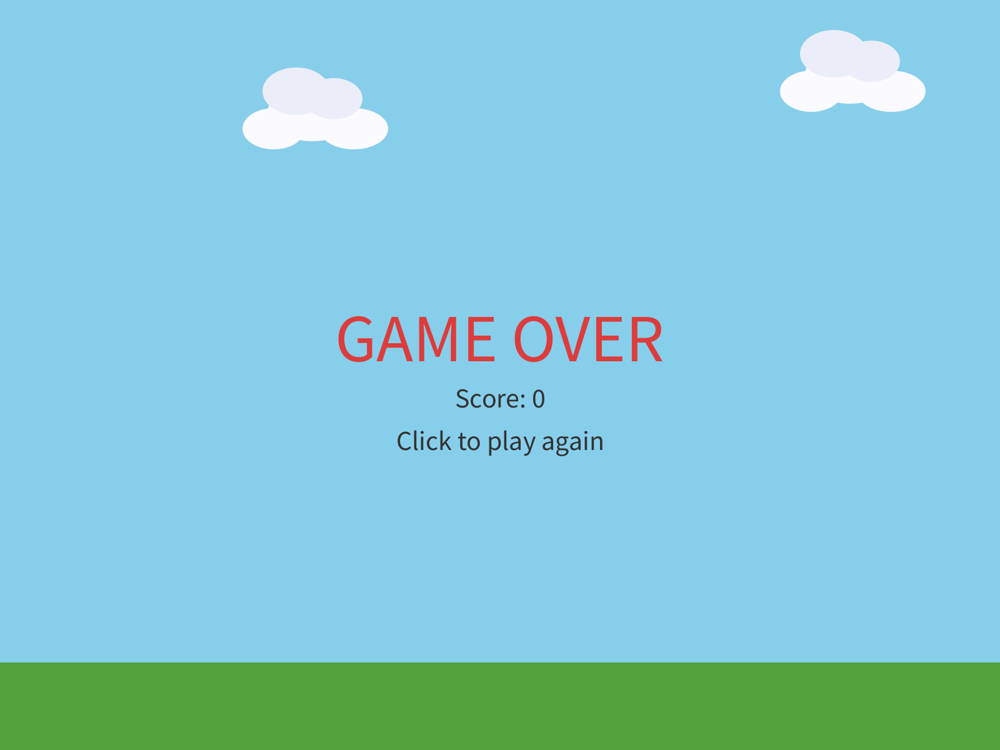
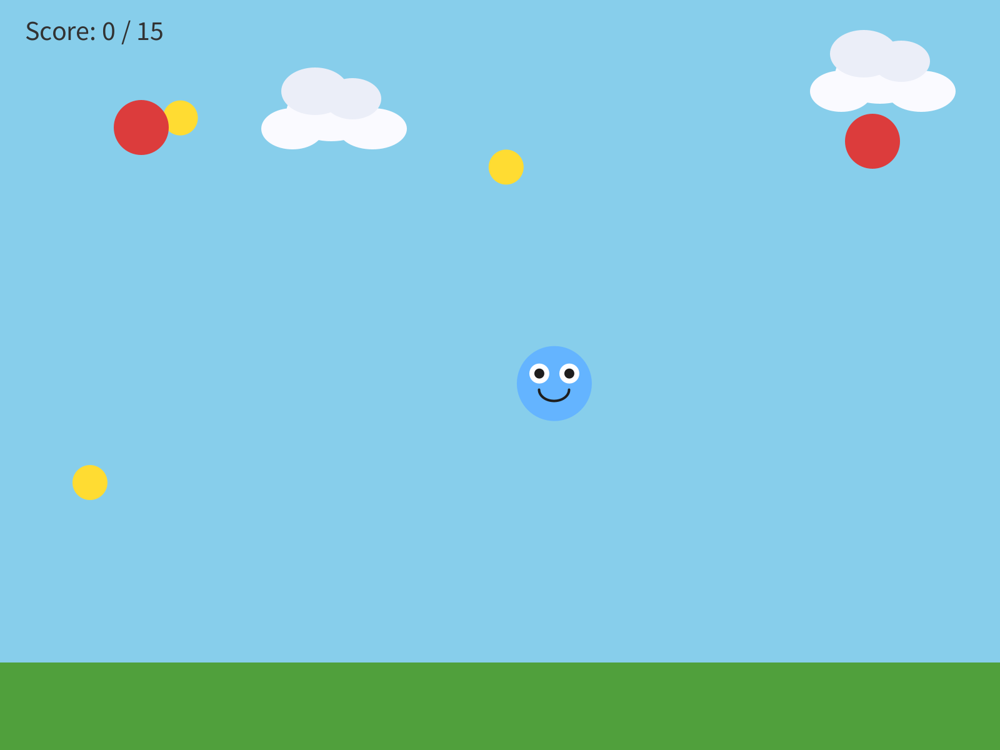
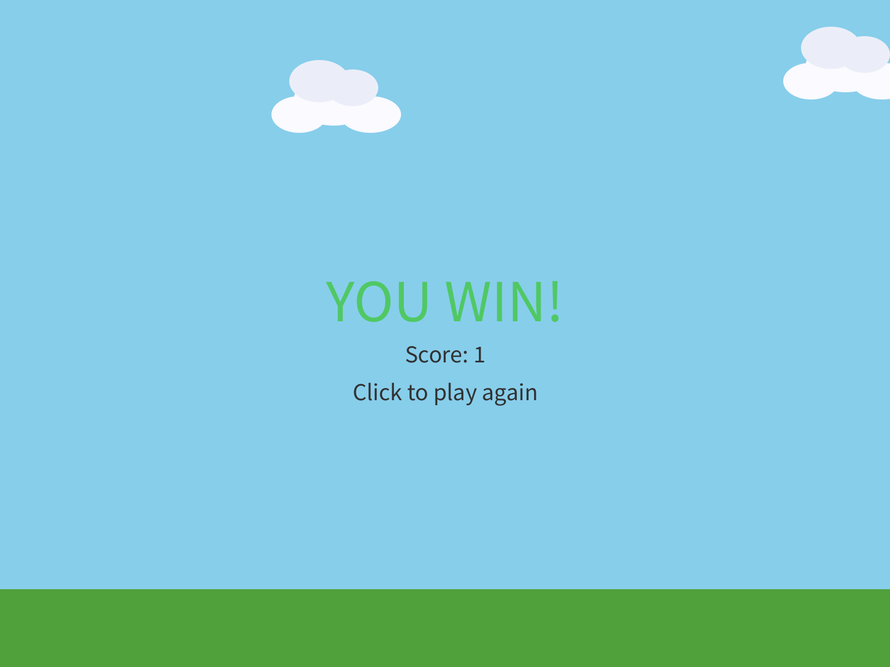
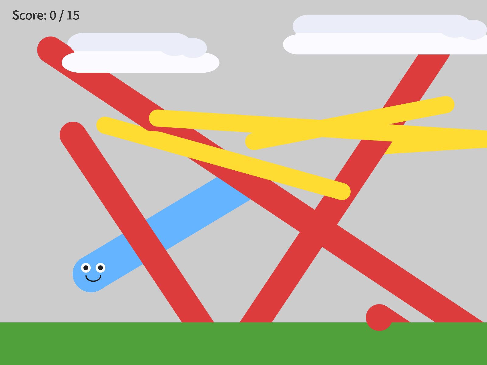

# Chapter 7 - Build Your Game

*Everything you have learned, in one game that is yours.  This is the one you show people.*

---

Chapter 6 ended with a game that can end.  Once it's over, though, the only way
to play again is to press Stop and Run.

Today you finish it.  A way to win as well as lose, a click to play again, and
then the rest of the time to make it a game somebody else wants to play.

There's exactly **one** new idea in this chapter:  restarting.  Everything else
you've already built.

This chapter takes three meetings, and does it in four moves.

| Part | The idea |
|---|---|
| One | **You already know all of this.**  Read the starter, and find every piece. |
| Two | **One full loop.**  Win, lose, click, and play again, before you change anything. |
| Three | **Make it yours.**  Your character, your world, your rules. |
| Four | **Play-test, and show it.**  Somebody else plays your game. |

Parts One and Two are the first meeting.  Part Three is the second.  Part Four
is the third.

---

# Part One - You already know all of this

## 7.1  One sentence first

**Your turn.**  Before any code, write one sentence describing your game.  Who's
your character?  What are they collecting, and what are they avoiding?  Two
minutes.

If you can say what your game is, you'll build a much better one.

## 7.2  The starter

You can start from your Chapter 6 sketch, or from the starter below, whichever is
closer to what you want.  Either way, keep your own `MyCharacter` and `Cloud`
tabs.

**Build it.**  Paste this into your main tab:

```java
// Lesson 7 - Build Your Game.  Replace everything marked CHANGE with your own choices!
import coxprogramming.processing.sprites.*;

MyCharacter player;
Cloud cloud1;
Cloud cloud2;
Block ground;

Blob coin1;      // things to collect
Blob coin2;
Blob coin3;
Blob hazard1;    // things to avoid
Blob hazard2;

int score = 0;
int goal = 15;               // CHANGE: the score you need to win
boolean gameOver = false;
boolean playerWon = false;

void setup() {
  size(800, 600);

  // Scenery never changes during play, so it is built once, here.
  ground = new Block(this, 0, height - 70, width, 70, color(80, 160, 60));  // CHANGE: your ground
  cloud1 = new Cloud(this, 150, 90, 0.5);
  cloud2 = new Cloud(this, 520, 60, 0.8);

  restartGame();
}

void draw() {
  background(135, 206, 235);  // CHANGE: your sky / background color

  cloud1.move();
  cloud1.drawSprite();
  cloud2.move();
  cloud2.drawSprite();

  ground.drawSprite();

  if (!gameOver && !playerWon) {
    playGame();
  } else if (playerWon) {
    showWin();
  } else {
    showGameOver();
  }
}

void playGame() {
  // --- Collectibles ---
  coin1.move();
  coin1.drawSprite();
  coin2.move();
  coin2.drawSprite();
  coin3.move();
  coin3.drawSprite();

  // --- Hazards ---
  hazard1.move();
  hazard1.drawSprite();
  hazard2.move();
  hazard2.drawSprite();

  // --- Player ---
  player.followMouse();  // or keyboardControl() in keyPressed()
  player.drawSprite();

  // --- Collecting:  score a point, and the coin jumps somewhere new ---
  if (player.collidesWith(coin1)) {
    score = score + 1;
    coin1.moveTo(random(width), random(80, height - 150));
  }
  if (player.collidesWith(coin2)) {
    score = score + 1;
    coin2.moveTo(random(width), random(80, height - 150));
  }
  if (player.collidesWith(coin3)) {
    score = score + 1;
    coin3.moveTo(random(width), random(80, height - 150));
  }

  // --- Lose condition ---
  if (player.collidesWith(hazard1)) {
    gameOver = true;
  }
  if (player.collidesWith(hazard2)) {
    gameOver = true;
  }

  // --- Win condition ---
  if (score >= goal) {
    playerWon = true;
  }

  // --- Score display ---
  fill(50);
  textSize(22);
  text("Score: " + score + " / " + goal, 20, 32);
}

void showWin() {
  textAlign(CENTER, CENTER);
  fill(80, 200, 100);
  textSize(54);
  text("YOU WIN!", width/2, height/2 - 30);
  fill(50);
  textSize(22);
  text("Score: " + score, width/2, height/2 + 18);
  text("Click to play again", width/2, height/2 + 52);
  textAlign(LEFT, BASELINE);
}

void showGameOver() {
  textAlign(CENTER, CENTER);
  fill(220, 60, 60);
  textSize(54);
  text("GAME OVER", width/2, height/2 - 30);
  fill(50);
  textSize(22);
  text("Score: " + score, width/2, height/2 + 18);
  text("Click to play again", width/2, height/2 + 52);
  textAlign(LEFT, BASELINE);
}

void mousePressed() {
  if (gameOver || playerWon) {
    restartGame();
  }
}

void restartGame() {
  score = 0;
  gameOver = false;
  playerWon = false;

  // CHANGE: your player's starting position
  player = new MyCharacter(this, width/2, height/2);
  player.setVelocity(4, 0);

  // Collectibles - CHANGE: color, size, speed
  coin1 = new Blob(this, random(width), random(80, height - 150), 14, random(1, 2.5), random(-1.5, 1.5), color(255, 220, 50));
  coin2 = new Blob(this, random(width), random(80, height - 150), 14, random(1, 2.5), random(-1.5, 1.5), color(255, 220, 50));
  coin3 = new Blob(this, random(width), random(80, height - 150), 14, random(1, 2.5), random(-1.5, 1.5), color(255, 220, 50));

  // Hazards - CHANGE: color, size, speed.  They start in the top corners, away from the player.
  hazard1 = new Blob(this, 80, 80, 22, 3, 2, color(220, 60, 60));
  hazard2 = new Blob(this, width - 80, 80, 22, -2, 3, color(220, 60, 60));
}
```

Look through it.  Every piece of it is something you've written before:

| Piece | What it does | You met it in |
|---|---|---|
| `setup()` | builds the scenery once, then calls `restartGame()` | Chapter 1 |
| `draw()` | the sky, clouds, and ground, then picks a screen | Chapters 1 and 5 |
| `MyCharacter`, `Cloud` | your character, and your scenery | Chapters 2 and 5 |
| `setVelocity()`, `followMouse()` | a speed, and the mouse | Chapters 3 and 4 |
| `playGame()` | three coins, two hazards, your player, and the score | Chapter 6 |
| `showWin()`, `showGameOver()` | the two end screens | Chapter 6 |
| `mousePressed()` | a click | Chapter 4 |
| `restartGame()` | **new** | today |

The coins and hazards are plain colored blobs.  They're placeholders, there so
the code runs.  Replacing them with things that belong in your world is the
assignment.

If you drive with the arrow keys, put your `keyPressed()` from Chapter 4 at the
bottom, and change `player.followMouse();` in `playGame()` to `player.move();`.

## 7.3  Three modes

Chapter 6 had two modes:  playing, and game over.  This game has three, because
winning and losing should look different.  `playerWon` joins `gameOver`, and
`draw()` picks one of three screens:

```java
  if (!gameOver && !playerWon) {
    playGame();
  } else if (playerWon) {
    showWin();
  } else {
    showGameOver();
  }
```

> **Aside:  `&&` and `else if`**
>
> `&&` means **and**.  `!gameOver && !playerWon` reads *not lost, and not won*:
> still playing.  `else if` adds another question to an `if`:  if the first one
> was false, try this one.  Processing goes down the list, and the first one
> that's true wins.  The last `else` catches whatever's left.

You win when `score >= goal`.  The `goal` is at the top, `15` to start.  Change
it to make the game longer or shorter.

## 7.4  Restarting

To restart a game, you might think you need to undo everything that happened.
That's much harder than it sounds, and it's easy to miss something.

You just run the starting steps again.  Make a new player, make new coins and
hazards, set the score back to `0`, and set the modes back to `false`.  That's
`restartGame()`:

```java
void restartGame() {
  score = 0;
  gameOver = false;
  playerWon = false;

  player = new MyCharacter(this, width/2, height/2);
  // ... brand-new coins, and brand-new hazards
}
```

Look at `setup()`.  It builds the ground and the clouds, and then it calls
`restartGame()`.  Starting the game and restarting it are the same thing, so
they're the same code.  The ground and clouds are built once, in `setup()`
alone, because nothing in the game ever changes them.

The restart happens on a click:

```java
void mousePressed() {
  if (gameOver || playerWon) {
    restartGame();
  }
}
```

> **Aside:  `||`**
>
> `||` means **or**.  `gameOver || playerWon` is *we lost, or we won*.  The `if`
> guards the restart, so a click while you're playing leaves your game alone.

---

# Part Two - One full loop

## Step 1 - Lose, and play again

**Build it.**  Run the starter.  Play it until you lose.

> **Check.**  *GAME OVER*, your score, and *Click to play again*.

> **Screenshot:**  Lost.
>
> 

Now click.

> **Check.**  A fresh game:  the score is `0`, your player is back in the middle,
> and the hazards are back in the top corners.

> **Screenshot:**  Ten frames after the click.
>
> 

Make sure that works before you change anything.

## Step 2 - Win it, by cheating

Winning takes 15 coins, which is a lot of playing just to check one screen.
So test it by cheating, the way you did in Chapter 6.

**Build it.**  Change `int goal = 15;` to `int goal = 1;`, and run.  Touch one
coin.

> **Check.**  *YOU WIN!*

> **Screenshot:**  One coin, and a win.
>
> 

Click to play again, and make sure the win restarts too.  Then set the goal back.

> **Watch out.**  `restartGame()` has to put back **every** variable that the game
> changes.  Leave one out, and the restart misses it.  Take out
> `gameOver = false;`, lose, and click:  the game rebuilds everything else, and
> you're still on the game over screen.  Check every variable at the top of your
> sketch against `restartGame()`, one at a time.

## Step 3 - One full loop, in your world

**Build it.**  Bring in your own world from Chapter 5:  your ground, your
background, your decorations.  Then replace the first placeholder coin with
something that belongs there.

**Get one full loop working first:**  your player, your coins, and one way to
win or lose.  Play it, properly, before you add anything else.  The games that go
wrong in this chapter are almost always the ones with five new features and no
loop that plays.

---

# Part Three - Make it yours

Last meeting you got one full loop playing.  Today it becomes yours.

Start with five minutes of play-testing.  Let a neighbor play your game, and
keep your hands off the keyboard.  Watching somebody else play is the fastest way
to find out what's broken.

## Step 4 - Replace the placeholders

**Your turn.**  Your character, your collectibles, your hazards, your world.
Every color, every name, every shape the starter marks `CHANGE`.  Space, ocean,
forest, city, a dream.  Whatever your sentence from 7.1 said.

## Step 5 - Your screens, in your words

**Your turn.**  Rewrite the win and lose screens.  *"YOU WIN!"* is the starter
talking.  Make it sound like you, and like your game.

Keep the `textAlign(LEFT, BASELINE);` at the end of each one, as in Chapter 6.

## Step 6 - Tune it

**Your turn.**  Play it.  Too easy?  Faster hazards, or a higher `goal`.  Too
hard?  Slower hazards, or a bigger hitbox in your `super(...)` line.

You built your game, so you're the best player it'll ever have.  That means it's
probably too hard for everybody else.  Your neighbor is the one to tune it for.

## 7.5  Three coins, three `if`s

The starter has three coins and two hazards.  Each one has its own variable and
its own `if`.  Yes, that's repetitive.  It's also code you can read from top to
bottom and change one piece at a time.  That's a trade-off, and for a first game
it's the right one.

Want a fourth coin?  It goes in four places:  declare `coin4`, create it in
`restartGame()`, move and draw it in `playGame()`, and give it an `if`.

> **Watch out.**  Copy the `coin3` block to make `coin4`, and every `coin3` in the
> copy has to become `coin4`.  Miss the one in `moveTo()`, and touching `coin4`
> moves `coin3` away.  `coin4` sits still under your player, scoring a point every
> frame, and you win the whole game in under a second.  Read the copied lines out
> loud, name by name.

Want twenty coins?  That's what Bonus D is for.

## Step 7 - One thing that's your idea

**Your turn.**  Add one thing that's your idea.  Some places to start:

- **Lives**, from Chapter 6, in place of instant game over.
- **Hazards that speed up** as the score climbs.
- **A special ability** on a key:  a speed burst, a shield, a teleport.  It goes
  in `keyPressed()`.
- **A custom hazard**, in its own `extends Blob` tab:  a shark, a storm cloud, a
  meteor.
- **A title screen** before the game starts.  That's a fourth mode.
- **Bouncing.**  One line in `setup()`, right before `restartGame()`:

```java
  Sprite.screenBehavior = ScreenBehavior.BouncyWalls;   // everything bounces off the edges
```

> **Screenshot:**  `BouncyWalls`, with `background()` switched off to show the
> paths.  The hazards bounce off the bottom edge, behind the ground, and the
> coins bounce off the right.
>
> 

It changes every sprite in your game at once.  That's why the clouds bounce too.

- **A bonus chapter.**  Pictures for your character (Bonus A), sounds (Bonus B),
  an animated character (Bonus C), or lots of coins (Bonus D).  They're at the
  back of the book.

**Your turn.**  **Optional:**  a second level.  When the player wins, rebuild the
world harder, with faster hazards, a different background, and a higher goal,
and keep the score.  That's `restartGame()` with a level number, and it turns a
demo into a game people want to keep playing.

---

# Part Four - Play-test, and show it

Today somebody else plays your game.

## 7.6  Play-testing

Spend the first half of the meeting on what your play-testers found.  Watch them
play, with your hands off the keyboard.  Whatever confuses them is a real
problem.  Go fix it, then watch somebody play it again.

That cycle, build, test, change, test again, is what **play-testing** is.

## 7.7  Show it

Play a neighbor's game.  Tell them one thing you liked, and one thing you would
add.

Then be ready to say two things about your own game:  what it is, in one
sentence, and one decision you made on purpose.

---

## Chapter summary

You started with a game that could end, once.  You end with one that can be
won, lost, and played again, that's yours from the character to the rules, and
that somebody else has played.

| You built | It's an example of |
|---|---|
| `playerWon`, and three screens | three **modes**, and `draw()` picking one |
| `!gameOver && !playerWon` | `&&`, **and** |
| `else if` | a list of questions, and the first true one wins |
| `restartGame()`, called from `setup()` | **restarting** by running the starting steps again |
| `if (gameOver || playerWon)` in `mousePressed()` | `||`, **or**, guarding the restart |
| `goal = 1` | testing by cheating, again |
| three coins, three `if`s | repetitive and readable:  a trade-off |
| your neighbor, playing | **play-testing** |

### New syntax in this chapter

| Syntax | Where you met it |
|---|---|
| `&&` | 7.3 |
| `else if` | 7.3 |
| `restartGame()` | 7.4 |
| `||` | 7.4 |
| `Sprite.screenBehavior = ScreenBehavior.BouncyWalls;` | Step 7 |

### Vocabulary

**game loop** -- `draw()` running over and over.  It's the engine of every game
you've ever played.  (7.2)

**play-testing** -- playing your own game, or watching somebody else play it, to
find out whether it's fun, and then changing it.  (7.6)

**restart** -- putting every variable back to its starting value, so the game can
be played again.  (7.4)

**win / lose condition** -- the rules that decide when the game ends, and how.
(7.3)

### Check your understanding

1. What does `restartGame()` do, and why does `setup()` call it?
2. Why are the ground and clouds built in `setup()` and not in `restartGame()`?
3. What does `!gameOver && !playerWon` mean, in plain words?
4. Why does `mousePressed()` check `gameOver || playerWon` before it restarts?
5. You restart, and the score goes back to `0`, and the game stays on the game
   over screen.  What's missing?
6. What's your game, in one sentence?  What's one decision you made on purpose?

## What's next

That's the course.  Seven chapters ago there was an empty window, and now
there's a game in it that somebody else has played.

If you want more, the bonus chapters are at the back:  pictures, sounds,
animation, and lists.  Next quarter, the code leaves the screen, with Arduino
and the Circuit Playground board.
