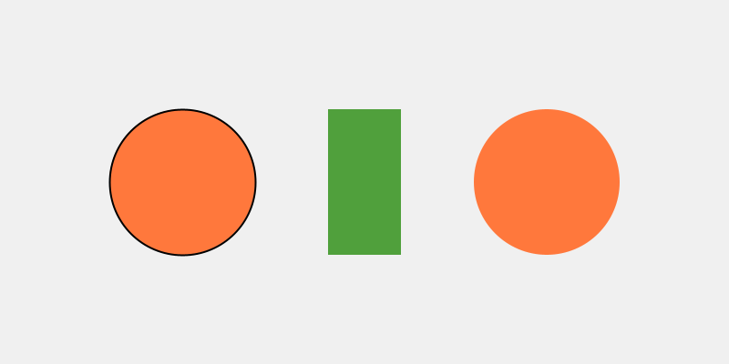
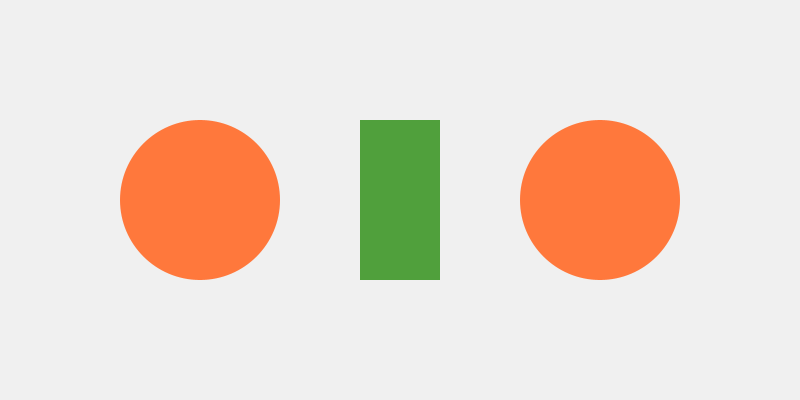

# Teacher Reference - The SpriteGame Library

*What's inside the toolbox, for the person teaching from it.*

---

This part of the book is for teachers.  The chapters treat SpriteGame as a magic
toolbox, on purpose:  Guiding Principle 5 says students *"call methods the way
they push buttons on a machine,"* and the button works.  This reference opens the
box.  It documents every class and every public member, it shows how `Sprite`
works on the inside, and it explains why the course builds every student class on
`Blob`, along with what that choice costs.

Every behavior this reference describes was run against the library as it is in
this repository, `library/SpriteGame.jar`, with Processing 4.5.2.  The checks are
in `lessons/chapters/planning/verify_api.sh`, and the messages and numbers below
are what they printed.  The generated Javadoc is in the repository too, under
`reference/`.

It does it in five parts.

| Part | What it covers |
|---|---|
| One | **The shape of the library.**  The family tree, and where the students' classes hang on it. |
| Two | **`Sprite`, the base.**  Its fields, its movement, and the vectors it hands out. |
| Three | **`Blob`, and why the course builds on it.**  What the choice buys, and what it costs. |
| Four | **The rest of the family.**  `Block`, `ImageSprite`, `CompoundSprite`, `AnimatedSprite`, `Vector2D`, `ScreenBehavior`, `Event`. |
| Five | **Known issues.**  Every rough edge found, with a suggested fix. |

---

# Part One - The shape of the library

## R.1  The family tree

```
Sprite  (abstract:  pos, vel, move(), followMouse(), keyboardControl(), distanceTo())
 |
 +-- Blob  (radius, myColor, collidesWith(Blob), a circle for drawSprite())
 |    |
 |    +-- Block  (w, h, a rectangle for drawSprite())
 |    |
 |    +-- the students' classes:  MyCharacter, Cloud, MyImageCharacter, MyCharacterFrame
 |
 +-- ImageSprite  (a picture, with a size and a rotation)
 |
 +-- CompoundSprite  (a list of child sprites, moved together)
      |
      +-- AnimatedSprite  (shows one child at a time, as a flipbook)

Helpers:  Vector2D (a pair of floats), ScreenBehavior (an enum), Event (callbacks)
```

Everything a student puts on the screen, from Chapter 1's first circle to Chapter
7's game, is a `Blob` or a subclass of one.  `ImageSprite` and `AnimatedSprite`
arrive only in Bonus A and Bonus C.  `CompoundSprite`, `Vector2D` by name, and
`Event` appear in this reference alone.

## R.2  How a student class fits

A class in a Processing tab is compiled as a nested class inside the sketch.  That
explains three things students do without knowing why.

- **Why they pass `this`.**  Library classes live in their own package, so they
  reach the sketch only through a reference to it.  Every constructor takes the
  `PApplet` and keeps it in `parent`.  The handshake in Chapter 2, `super(p, x, y, 30, color(...))`,
  passes it up.
- **Why `MyCharacter` can call `fill()` directly, and the library calls
  `parent.fill()`.**  A nested class can call the sketch's methods as its own.
  `MyImageCharacter` in Bonus A uses `parent.image(...)`, which works too.
  Both styles appear in the course, and both are correct.
- **Why `pos.x` works in a student's `drawSprite()`.**  `pos` is `protected` in
  `Sprite`, so any subclass, including a nested class in a tab, can use it.

---

# Part Two - `Sprite`, the base

## R.3  Fields

| Field | Type | Notes |
|---|---|---|
| `parent` | `PApplet` (`protected`) | the sketch.  Used for drawing, `width`, `height`, `mouseX`, `mouseY`, `keyCode`. |
| `pos` | `Vector2D` (`protected`) | the sprite's position.  For a `Blob` it's the center;  for a `Block` it's the top-left corner. |
| `vel` | `Vector2D` (`protected`) | pixels per frame.  Every constructor without a velocity starts it at `(0, 0)`. |
| `screenBehavior` | `ScreenBehavior` (`public static`) | what `move()` does at the window's edges.  One setting, shared by every sprite.  See R.12. |

## R.4  Constructors

| Constructor | Notes |
|---|---|
| `Sprite(PApplet parent, float x, float y)` | velocity `(0, 0)` |
| `Sprite(PApplet parent, float x, float y, float dx, float dy)` | with a velocity |
| `Sprite(PApplet parent, Vector2D s)` | stores `s` itself as the position, so the caller's vector and the sprite's position are the same object.  See R.7. |

`Sprite` is `abstract`, so these are only ever called through `super(...)`.

## R.5  Moving

| Method | What it does |
|---|---|
| `move()` | `pos = pos.add(vel)`, which builds a new vector every frame, and then applies `screenBehavior` to the center. |
| `moveTo(float x, float y)` | sets `pos.x` and `pos.y` **in place**. |
| `moveTo(Vector2D p)` | stores `p` itself as the position.  See R.7. |
| `setVelocity(float dx, float dy)` | sets `vel.x` and `vel.y` **in place**. |
| `setVelocity(Vector2D v)` | stores `v` itself as the velocity.  See R.7. |
| `getPosition()`, `getVelocity()` | hand back the sprite's own vectors, not copies.  See R.7. |
| `distanceTo(Sprite other)` | center to center:  `pos` to `pos`.  For a `Block`, that's its corner. |
| `drawSprite()` | `abstract`.  Every subclass supplies one. |

`move()` is the only method that looks at the window's edges.  `followMouse()`
and `moveTo()` skip them entirely, so a character steered by the mouse can be
parked anywhere, edges included, whatever `screenBehavior` says.

Wrapping is by the **center**.  When the center crosses an edge, the position
jumps by the window's width or height in one frame.  So half a character hangs off
the edge before it wraps, and then the whole character pops across.  Chapter 3
shows the stripe this makes.

## R.6  The two input methods

**`keyboardControl()`** is a `switch` on `parent.keyCode`:

| Key | Velocity |
|---|---|
| UP | `(0, -5)` |
| DOWN | `(0, 5)` |
| LEFT | `(-5, 0)` |
| RIGHT | `(5, 0)` |
| any other key | `(0, 0)` |

Three consequences, all verified, and all taught in Chapter 4.  The speed is
always 5, whatever `setVelocity()` said.  Movement is locked to one axis:  UP sets
`x` to zero.  And every key that isn't an arrow is a brake, including Shift and
the space bar.  It reads `keyCode`, so it belongs in `keyPressed()`.  Called from
`draw()`, it reapplies the last key's velocity every frame, and before any key has
been pressed `keyCode` is 0, the `default` case, so the sprite sits still.

**`followMouse()`** is the other kind of control:

```java
float speed = vel.mag();
Vector2D mLoc = new Vector2D(parent.mouseX, parent.mouseY);
Vector2D mDir = mLoc.subtract(pos);
pos = pos.add(mDir.unitVector().scale(speed));
```

It steps the **size** of the velocity straight toward the mouse, every frame, and
leaves `vel` alone.  So the velocity's direction is ignored:  `(5, 0)`, `(0, 5)`,
`(3, 4)` and `(-3, -4)` give byte-identical frames.  A zero velocity is a zero
step, which is why Chapter 4's Watch out says to set one.  Within one step of the
mouse it overshoots, and jitters back and forth by up to the speed.

It has one real bug.  When the sprite lands **exactly** on the mouse, `mDir` is
`(0, 0)`, `unitVector()` divides by zero, and the position becomes `(NaN, NaN)`.
Every later step adds to NaN and gets NaN, so the sprite is gone for good:

```
frame 49:  pos = (596.0, 300.0)
frame 50:  pos = (600.0, 300.0)
frame 51:  pos = (NaN, NaN)
```

It sounds rare, and it isn't.  The mouse's position is a whole number.  A sprite
starting at a whole-number spot, level with the mouse and a multiple of its speed
away, lands on it exactly.  This book's own screenshots hit it while being made, in
Chapter 5, with the mouse 200 pixels straight right of a player moving at 4.  The
fix is in Part Five.

Calling `followMouse()` and `move()` together doesn't jitter, whatever the Lesson 4
Canvas page says.  `followMouse()` pulls the sprite 4 toward the mouse, and `move()`
pushes it `vel`, which is still `(4, 0)`.  The two cancel where *toward the mouse*
points straight left, so the sprite parks on the mouse's row, just to its right,
and stays perfectly still.  Chapter 4 shows it.

## R.7  The vectors it hands out

`Vector2D`'s own documentation says *"Every method returns a new Vector2D rather
than changing the original."*  That's true of `Vector2D`'s methods.  It isn't true
of the sprites that have them.  `x` and `y` are public, `Sprite` changes them in
place, and it hands its own vectors out.  So two names can end up meaning one
vector, and changing it through one name changes it through the other.  Verified:

| You write | What happens |
|---|---|
| `Vector2D p = a.getPosition(); p.x = 500;` | `a` moves to `x = 500` |
| `b.setVelocity(v); c.setVelocity(v);`, then `b.keyboardControl()` with UP | `c`'s velocity is `(0, -5)` too |
| `d.moveTo(spot); e.moveTo(spot);`, then `d.moveTo(50, 60)` | `e` moves to `(50, 60)` as well |
| the same, then `d.move()` and `d.moveTo(70, 80)` | `e` stays at `(50, 60)`:  `move()` built `d` a new vector, and the sharing ended |

The chapters use only the `float` versions of `moveTo()` and `setVelocity()`, and
leave the getters alone, so the course itself steers clear of all of this.  A
curious student can find it, though, and it's the C# course's Chapter 1, aliasing,
living in this library.  The suggested fix is in Part Five.

---

# Part Three - `Blob`, and why the course builds on it

## R.8  `Blob`

| Member | Notes |
|---|---|
| `radius` | `float` (`protected`).  The collision circle.  It doesn't change the drawing of a student's class. |
| `myColor` | `int` (`protected`).  Used only by `Blob`'s own `drawSprite()`. |
| `Blob(PApplet parent, float x, float y, float r, int c)` | Chapter 1's five things |
| `Blob(PApplet parent, float x, float y, float r, float dx, float dy, int c)` | with a velocity:  Chapter 5's coin |
| `collidesWith(Blob other)` | `distanceTo(other) <= radius + other.radius`.  Circles only, and touching counts:  centers exactly 20 apart, with radii 10 and 10, is `true`, and 21 apart is `false`. |
| `drawSprite()` | `fill(myColor)`, then a circle of `2 * radius`.  It sets no stroke, so it uses whatever stroke is current.  See R.10. |

## R.9  Why `Blob`

The course's own guiding principles say it:  *"`collidesWith()` is on `Blob`, not
on the base `Sprite`.  Students' custom characters should use `class MyCharacter
extends Blob` (not `extends Sprite`) so that collision detection works
automatically against other Blobs in the world."*

So every class a student writes extends `Blob`:  the character, the cloud, a
picture character, an animation frame.  One rule, the same words every time.  The
rule has costs, and each one buys something.  Each is a trade-off, and all six are
worth knowing when you're the one in the room.

**1.  A misspelling fails silently.**  `Sprite.drawSprite()` is `abstract`, and
`Blob.drawSprite()` isn't.  So a student who writes `void drawsprite()` in a class
that extends `Blob` gets no error.  The sketch runs and draws Blob's own circle, in
the handshake's backup color.  The same misspelling in a class that extends
`Sprite` stops the sketch:

```
The type SpriteMisspelled.Thing must implement the inherited abstract method Sprite.drawSprite()
```

What it buys:  a sketch that always runs, and a picture of what's underneath.
Chapter 2 turns the silent fallback into its first discovery.  If you'd rather have
the error, `@Override` on the line above `drawSprite()` brings it back, and keeps
`Blob`:

```
The method drawsprite() of type OverrideCatch.Thing must override or implement a supertype method
```

No chapter uses `@Override`.  Adding it would put one more copied line in every
class a student writes.

**2.  Only Blobs can collide.**  `collidesWith()` lives on `Blob`, and it takes a
`Blob`.  So only Blobs can use it, from either side.  A plain `Sprite` subclass
has no `collidesWith()`, and a Blob can't collide with one either:

```
The function collidesWith(Blob) does not exist.
The method collidesWith(Blob) in the type Blob is not applicable for the arguments (BlobVsSprite.Thing)
```

`ImageSprite` and `AnimatedSprite` hit the same wall, in Bonus A and Bonus C.  The
way around it is `distanceTo()`, which lives on `Sprite` and works between any two
sprites.  What it buys:  one type for the whole world.  The character, the clouds,
the coins, and the hazards are all Blobs, so one kind of variable fits any of
them, and Bonus D's `ArrayList<Blob>` takes every one.

**3.  Collisions are circles.**  `collidesWith()` compares two radii, so every
hitbox is a circle, and a tall character or a long platform can only be
approximated.  The radius is also separate from the drawing, so a student's art
can drift far from its hitbox, which is a pitfall the Lesson 6 Canvas page names.
What it buys:  one number as the design lever.  Chapter 6 asks *"generous or
precise?"*, and the answer is the radius.  The rule fits in one sentence a sixth
grader can check.

**4.  The handshake carries two things the student doesn't use.**  `super(p, x, y,
30, color(...))` passes the sketch, which students only ever meet as `this`, and a
color, which is dead the moment `drawSprite()` is replaced.  What it buys:  they're
the same five things Chapter 1's Blob took, so Chapter 2 can say *"you've seen
these five before."*  The color is also what shows up when a misspelling falls
back to Blob's circle, which makes trade-off 1 easier to explain.

**5.  `Block` is a `Blob`.**  A rectangle isn't a circle, and `Block` inherits
anyway, to reuse `myColor` and to fit wherever a Blob fits.  So a `Block` inherits
a collision circle of radius 0 at its top-left corner.  Verified:  a Blob sitting
in the middle of a 200-by-100 `Block` is `false`, and a Blob near its corner is
`true`.  `distanceTo()` measures to the corner too.  That's why Chapter 5 calls a
`Block` scenery.  What it buys:  one more
thing that goes anywhere a `Blob` goes, at no cost in new code.

**6.  `pos` and `vel` are open to students.**  Because they're `protected`, a
student's class can change `pos` directly, skipping `moveTo()`, and the getters
hand out the live objects (R.7).  What it buys:  the belly button.  A sixth grader
writes `ellipse(pos.x - 12, pos.y - 8, 16, 16)`, with no getter and no copy, and
Chapter 2's whole Part Three rests on it.

## R.10  Style leaks from one sprite to the next

Processing keeps one set of drawing settings, `fill`, `stroke`, `strokeWeight`, and
the rest, and each one carries on until something changes it:  from shape to
shape, sprite to sprite, and frame to frame.  The library's `drawSprite()` methods mostly don't save and restore them.
`ImageSprite` is the exception:  it wraps its drawing in `pushStyle()` and
`popStyle()`.

So settings leak.  `Block.drawSprite()` calls `noStroke()`, and every shape drawn
after it loses its outline, including, from the second frame on, the shapes drawn
before it, because the setting carries into the next frame.

> **Screenshot:**  Frame 1:  a Blob, a Block, and a Blob.  The first Blob has its
> outline, and the one drawn after the Block doesn't.
>
> 

> **Screenshot:**  Frame 3:  neither Blob has an outline.  The `noStroke()` from
> frame 1 is still on.
>
> 

In the course this shows up quietly.  Chapter 1's blob has an outline, and Chapter
5's coin doesn't, because the ground is drawn first.  A student's character sets
its own fill and stroke inside `drawSprite()`, so it looks the same wherever it's
drawn, and that's the habit to teach:  a `drawSprite()` sets everything it needs.

---

# Part Four - The rest of the family

## R.11  `Block`

| Member | Notes |
|---|---|
| `w`, `h` | `float` (`protected`).  Width and height, stored as absolute values. |
| `Block(PApplet parent, float x, float y, float w, float h, int c)` | `x, y` is the **top-left corner**.  The radius is 0. |
| `drawSprite()` | `fill(myColor); noStroke(); rect(pos.x, pos.y, w, h)`.  The `noStroke()` leaks (R.10). |

A `Block` has `move()` and `setVelocity()`, and starts still.  Its collision is
R.9's trade-off 5:  a point at its corner.

## R.12  `ScreenBehavior`

An enum with four values, set through the static `Sprite.screenBehavior`, so one
line changes every sprite in the sketch, immediately, mid-game included.  It
applies only inside `move()`, and only to each sprite's center.

| Value | At an edge | Verified |
|---|---|---|
| `Wrapping` | jumps to the opposite edge.  The default. | Chapter 3 |
| `HardWalls` | stops at the edge, and zeroes the velocity on that axis | a Blob moving right at 5 from `x = 780`:  at frame 10, `x = 800`, `vx = 0` |
| `BouncyWalls` | reverses the velocity on that axis | then `vx = -5` two frames later |
| `NoWalls` | nothing:  the sprite leaves the window | `x = 830` after ten frames from 780 |

Chapter 7 offers `BouncyWalls` as a one-line extra.  Because it's static, the
clouds bounce too, and a student can't make the hazards bounce and the clouds wrap
at the same time.

## R.13  `ImageSprite`

`ImageSprite` extends `Sprite` directly.  It isn't a `Blob`, so it has no radius
and no `collidesWith()`.

| Member | Notes |
|---|---|
| `ImageSprite(PApplet parent, float x, float y, String fileName)` | 100 by 100 |
| `ImageSprite(PApplet parent, float x, float y, String fileName, float size)` | square |
| `ImageSprite(PApplet parent, float x, float y, String fileName, float w, float h)` | `x, y` is the **center** |
| `setSize(float size)`, `setSize(float w, float h)` | absolute values |
| `setRotation(float rotation)`, `rotate(float amount)`, `getRotation()` | radians, around the center |
| `drawSprite()` | `pushMatrix`, `pushStyle`, `translate`, `rotate`, `imageMode(CENTER)`, `image`, and both pops.  The one `drawSprite()` in the library that puts every setting back. |

The image loads once, in the constructor, from the sketch's `data` folder.  A
missing file prints Processing's *"is missing or inaccessible"* message and leaves
the image `null`.  The constructor carries on, and the sketch stops with
`NullPointerException` the first time `drawSprite()` passes `null` to `image()`.
A name with the wrong capitals gets Processing's own clear message instead:
*"This file is named tree.png not Tree.PNG.  Rename the file or change your
code."*

## R.14  `CompoundSprite`

A sprite made of other sprites, its **children**.  The compound's own `pos` is a
reference point.  It isn't drawn, and it needn't be anywhere near its children.
Children keep their own absolute positions and velocities.

| Member | Notes |
|---|---|
| `CompoundSprite(PApplet parent, float x, float y)`, and with `dx, dy` | |
| `addSprite(Sprite s)` | adds the compound's **current** velocity to the child's, then adds it.  Returns the compound, so calls chain. |
| `removeSprite(Sprite s)` | takes the compound's velocity back off the child |
| `getSprites()` | the live list of children |
| `setVelocity(...)` | changes the compound's velocity, and adds the same **change** to every child |
| `move()` | moves the compound, then calls `move()` on each child |
| `moveTo(...)`, `followMouse()` | move the compound, then shift every child by the same amount |
| `keyboardControl()` | sets the compound's velocity, and passes the change to every child |
| `drawSprite()` | draws every child, in the order they were added |

Two consequences.  **Each child wraps by itself**, because `move()` reaches every
child separately.  Verified with two Blobs 50 pixels apart moving right:  the
right one wraps to `x = 2` while the left is at `752`, and the compound's own point
wraps later still.  A compound that crosses an edge splits for a few frames, and
comes back together on the other side.  And **the compound's `distanceTo()`
measures from its own point**, which is wherever it was made, so for collisions
measure from a child.

No chapter uses `CompoundSprite` directly.  The library's `FractalExample` builds
its branches from it, and `AnimatedSceneExample` builds its clouds and sun from
its subclass, `AnimatedSprite`.

## R.15  `AnimatedSprite`

A `CompoundSprite` that draws one child at a time:  a flipbook.  Bonus C.

| Member | Notes |
|---|---|
| `AnimatedSprite(PApplet parent, float x, float y)`, and with `dx, dy` | starts on frame 0, at a rate of 8 |
| `FromSprite(Sprite s)`, `fromSprite(Sprite s)` | `static`.  A new `AnimatedSprite` at `s`'s position, with `s` as its first frame.  `null` throws `IllegalArgumentException`. |
| `AddFrameSprite(Sprite s)`, `addFrameSprite(Sprite s)` | adds a frame, and returns the sprite, so calls chain |
| `setFrameRate(int n)`, `getFrameRate()` | game frames per animation frame, at least 1.  Smaller is faster. |
| `setFrameNumber(int n)`, `getFrameNumber()` | jump to a frame.  Wraps around, negatives included. |
| `nextFrame()`, `previousFrame()` | turn one page, by hand |
| `getFrameSprites()`, `getFrameCount()` | the frames, and how many |
| `drawSprite()` | draws the current frame, **then** advances the clock |

Both spellings of the builder methods exist, `FromSprite` and `fromSprite`, so
either capital letter works.  The clock advances inside
`drawSprite()`, so an `AnimatedSprite` that isn't drawn doesn't animate, and one
drawn twice a frame animates twice as fast.  Each frame is a full sprite with its
own position, so frames made at different spots jump (Bonus C shows it), and every
frame under the current one still carries its own unused radius and color.

## R.16  `Vector2D`

A pair of floats, `x` and `y`, both public.  Every method returns a new vector.

| Member | Notes |
|---|---|
| `Vector2D(float x, float y)`, `FromXY(float x, float y)` | the same thing, two ways |
| `FromPolar(float r, float theta)` | `(r cos theta, r sin theta)`.  With y pointing down, positive angles turn **clockwise on the screen**. |
| `add`, `subtract`, `scale`, `inverse` | the usual |
| `mag()` | length.  For a velocity, the speed. |
| `dotProduct(Vector2D other)` | the usual |
| `unitVector()` | length 1.  `(0, 0)` gives `(NaN, NaN)`, which the documentation warns about, and which is R.6's bug. |
| `perpendicular()` | `(y, -x)`.  `(1, 0)`, right, becomes `(0, -1)`, which is **up** on the screen:  a quarter turn counter-clockwise as you see it.  The documentation says *clockwise*, which is true in math's y-up coordinates. |
| `rotate(float rads)` | the standard formula.  `(1, 0)` rotated by `HALF_PI` is `(0, 1)`, **down** on the screen:  positive angles turn clockwise as you see it.  The documentation says *counter-clockwise*, true in y-up coordinates. |
| `angleTo(Vector2D other)` | wrong for any vector pointing left.  See Part Five. |
| `theta()` | `protected`.  `atan(y / x)`. |

`angleTo()` is `other.theta() - this.theta()`, and `theta()` is `atan(y / x)`,
which can't tell left from right.  Verified:

```
right.angleTo(left) = -0.0   (PI is 3.1415927)
right.angleTo(upLeft) = 0.7853982   (the true angle is -2.3561945)
```

No chapter uses it.

## R.17  `Event`

An observer:  bind methods to an event by name, and `trigger()` calls every bound
method.  The original author is credited in the source as Stephcraft.

| Member | Notes |
|---|---|
| `Event(Class<?>... args)` | the argument types, as classes:  `new Event()`, or `new Event(Integer.class)` |
| `bind(Object listener, String name)` | finds the public method by name, with reflection, and adds it.  A wrong name or wrong types prints `[Event] could not bind ...` and carries on. |
| `unbind(Object listener, String name)`, `bound(Object listener, String name)` | the reverse, and a check |
| `trigger(Object... arguments)` | calls every bound method.  An exception inside one is printed, and the rest still run. |

Two problems, both verified, mean `Event` is hard to use from a sketch.

- **The name collides.**  Processing imports `processing.event.Event` into every
  sketch, so a bare `Event` stops the sketch with `The type Event is ambiguous`.
  It has to be written out:  `coxprogramming.processing.sprites.Event`.
- **It can't call into the sketch's own classes.**  Bound to a function on the
  sketch itself, `bind(this, "addPoint")`, it works.  Bound to a method of a class
  in a tab, even a `public` one, every `trigger()` prints
  `IllegalAccessException:  class coxprogramming.processing.sprites.Event$EventListener cannot access a member of class Events2$Counter with modifiers "public"`,
  and the method never runs.  Classes in tabs are compiled as non-public nested
  classes, and reflection from another package can't call into them.

No chapter uses `Event`.

---

# Part Five - Known issues

Everything this run found, with a suggested fix for each.  The fixes are
suggestions.  Only the first was built and run, as an override in a sketch, and
the library itself is unchanged.

| Where | The issue | Suggested fix |
|---|---|---|
| `Sprite.followMouse()` | Landing exactly on the mouse divides by zero:  the position becomes NaN, and the sprite vanishes for good.  Within one step it jitters. | Land on the mouse when it's within one step (below). |
| `Sprite.getPosition()`, `getVelocity()`, `moveTo(Vector2D)`, `setVelocity(Vector2D)`, `Sprite(PApplet, Vector2D)` | Share vectors with the caller (R.7). | Hand out and store copies:  `return new Vector2D(pos.x, pos.y);`, `pos = new Vector2D(p.x, p.y);`. |
| `ImageSprite` | A missing file stops the sketch later, at `drawSprite()`, with `NullPointerException`. | In `drawSprite()`, `if (img == null) return;`, or draw a placeholder rectangle. |
| `Block` | Inherits a collision circle of radius 0 at its corner. | Give `Block` a rectangle check of its own, or say plainly that it's scenery (the chapters do). |
| `Blob.drawSprite()`, `Block.drawSprite()` | Leave fill and stroke changed for everything after them (R.10). | Wrap each in `parent.pushStyle()` and `parent.popStyle()`, the way `ImageSprite` does.  This would also give Chapter 1's blob and Chapter 5's coin the same outline. |
| `Event` | Ambiguous by name in a sketch, and can't call methods in a sketch's classes. | Rename it, `GameEvent`, and call `method.setAccessible(true)` in `bind()`. |
| `Vector2D.theta()` | `atan(y / x)` can't tell left from right, so `angleTo()` is wrong for left-pointing vectors. | `(float) Math.atan2(y, x)`. |
| `Vector2D` documentation | *Clockwise* and *counter-clockwise* are y-up words, and the screen is y-down. | Say which way it turns on the screen. |

The `followMouse()` fix, as it was run:  overridden in a `Blob` subclass, with the
mouse at the spot that gave the library's version a NaN at frame 51.  It landed
on `(600.0, 300.0)` at frame 51 and stayed there through frame 60.

```java
public void followMouse() {
  float speed = vel.mag();
  Vector2D toMouse = new Vector2D(parent.mouseX, parent.mouseY).subtract(pos);
  float d = toMouse.mag();
  if (d <= speed) {
    pos = new Vector2D(parent.mouseX, parent.mouseY);
  } else {
    pos = pos.add(toMouse.scale(speed / d));
  }
}
```

In `CompoundSprite`, the same fix belongs in its override, which shifts the
children by however far the compound moved.
