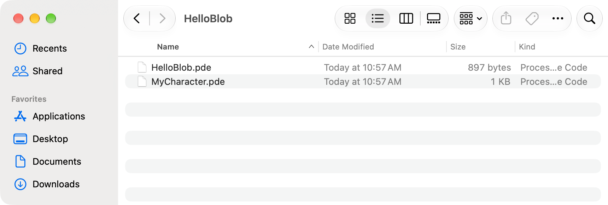
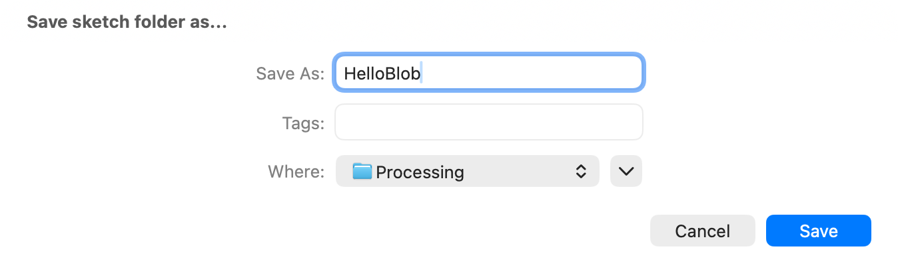
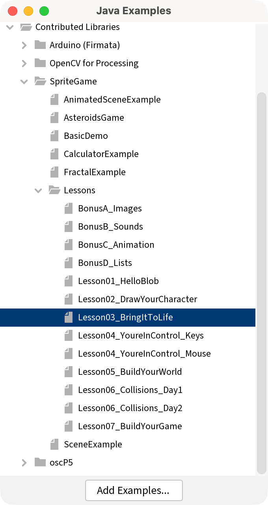
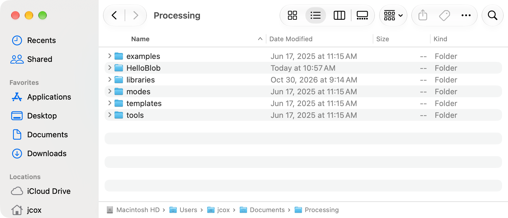
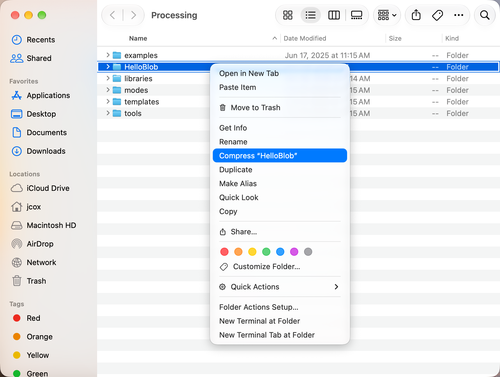

# Appendix 1 - Saving and Handing In

*Where your sketch lives, how to find it, and how it gets to Canvas.*

---

This part of the book is for you to come back to.  Every lesson ends with the
same job:  zip your sketch folder and upload it to Canvas.  That job happens on
a Mac, in an app called **Finder**, and Finder windows can look different from
one day to the next.  This appendix walks through it one click at a time, and
Part Four fixes a Finder window that looks wrong.  Part One also shows how to
open a lesson's example, which every chapter from Chapter 2 on asks you to do.

If you only need a reminder, the short version is first.

| Part | What it covers |
|---|---|
| One | **Saving, and opening.**  What a sketch is on the Mac, where Processing keeps it, how to save it so you can find it again, and how to open a lesson's example. |
| Two | **Finding it in Finder.**  Getting from Processing to your sketch's folder. |
| Three | **Zipping and handing in.**  Making a zip of your sketch folder, and uploading it to the Assignment. |
| Four | **When something looks wrong.**  The strange things Finder and Processing do, and the fix for each. |

## The short version

To hand in a sketch called `HelloBlob`:

1. In Processing, save:  **File → Save**.
2. Open the folder:  **Sketch → Show Sketch Folder**.  A Finder window opens.
3. Step out of the folder:  in Finder, **Go → Enclosing Folder**.
4. Find the `HelloBlob` folder in the list, and click it once.
5. Right-click it, and choose **Compress "HelloBlob"**.
6. A new file, `HelloBlob.zip`, appears next to the folder.  That's the one you
   hand in.
7. On Canvas, open the Assignment, click **Start Assignment**, upload
   `HelloBlob.zip`, and click **Submit Assignment**.

On a Mac, *right-click* means hold down the **Control** key and click.  On a
trackpad, you can also click with two fingers.

---

# Part One - Saving

## A1.1  A sketch is a folder

When you save a sketch called `HelloBlob`, Processing makes a **folder** called
`HelloBlob`, and puts a file called `HelloBlob.pde` inside it.  The `.pde` file
is your code.

From Chapter 2 on, your sketch has more than one tab.  Each tab is its own
`.pde` file, in the same folder:  `HelloBlob.pde` and `MyCharacter.pde` side by
side.  In Bonus A and Bonus B, your pictures and sounds go in a folder called
`data` inside the sketch's folder.

So the folder is the whole sketch.  When you hand it in, you hand in the
folder, and everything in it comes along.

> **Screenshot:**  A sketch folder open in Finder.  `HelloBlob` holds
> `HelloBlob.pde` and `MyCharacter.pde`.
>
> 

## A1.2  Where it lives:  Documents, then Processing

Processing keeps your sketches together in one folder, called your
**sketchbook**.  On the school's Macs, the sketchbook is the `Processing` folder
inside your `Documents` folder.

So `HelloBlob` lives here:

```
Documents
  Processing
    HelloBlob
      HelloBlob.pde
      MyCharacter.pde
    libraries
```

The `libraries` folder is where SpriteGame is installed.  Leave it alone.
Everything in this book needs it.

## A1.3  Saving the first time:  File → Save As

A brand-new sketch has a made-up name, like `sketch_261101a`, and Processing
keeps it in a temporary place you'd have a hard time finding.  Saving it gives
it a real name and puts it in your sketchbook.  Do it before you type anything.

1. Click **File → Save As**.  A Save box opens.
2. Next to **Save As**, type the sketch's name, like `HelloBlob`.  Use letters
   and numbers, start with a letter, and leave out spaces.
3. Look at **Where**.  It should say `Processing`.
4. Click **Save**.

If **Where** says something else, click it.  A short list of folders opens.
Choose `Processing` if it's there.  If it isn't, the box has a small arrow
button next to the name.  Click the arrow, and the box grows into a full
window, with a sidebar on the left.  Click **Documents** in the sidebar,
double-click `Processing`, and then click **Save**.

> **Screenshot:**  The Save box.  The name is `HelloBlob`, and **Where** says
> `Processing`.
>
> 

## A1.4  Saving as you go:  File → Save

After the first time, **File → Save** saves your sketch where it already is.
The keyboard shortcut is **Command-S**:  hold the **Command** key (it has a ⌘
on it), and press **S**.

Save every time something works.  It takes half a second, and then a crash, a
closed laptop, or a dead battery costs you nothing.

**Before a big change, save a copy.**  Use **File → Save As**, and add a number
to the name:  `MyGame2`.  Processing makes a new folder for the copy, and you
keep working in the copy.  The old version is still there, exactly as you left
it.

**To rename a sketch, use Save As.**  Processing needs the folder and the main
`.pde` file inside it to have the same name.  Renaming either one in Finder
breaks that match.  Save As gives both the new name at once.

## A1.5  Opening it again

Three ways, from Processing's menus:

- **File → Open Recent** lists the sketches you opened last.
- **File → Sketchbook** opens a window with every sketch in your sketchbook.
  Double-click one to open it.
- **File → Open** opens a box like Finder.  Click **Documents**, double-click
  `Processing`, double-click your sketch's folder, then double-click the `.pde`
  file with the same name as the folder.

Double-clicking a `.pde` file in Finder opens it in Processing too.

## A1.6  A lesson's example:  File → Examples

Every lesson has an **example**:  its finished code, installed on your Mac along
with SpriteGame.  From Chapter 2 on, each chapter starts by asking you to open
it.  Run it to see where the chapter is headed.  Keep it open while you work,
and when your sketch does something strange, compare the two.

1. In Processing, click **File → Examples**.  A window opens with a list of
   folders.
2. Find **Contributed Libraries** in the list, and click the small arrow next
   to it.  The folder opens, and shows the libraries on your Mac.
3. Open **SpriteGame** the same way, and then **Lessons**.
4. Double-click the lesson you want, like `Lesson03_BringItToLife`.  It opens in
   a new Processing window.
5. Click **▶ Run**.

> **Screenshot:**  The Examples window, open to **Contributed Libraries →
> SpriteGame → Lessons**, with `Lesson03_BringItToLife` highlighted.
>
> {width=1.9in}

Here is each chapter's example.

| Chapter | Example |
|---|---|
| 1 | `Lesson01_HelloBlob` |
| 2 | `Lesson02_DrawYourCharacter` |
| 3 | `Lesson03_BringItToLife` |
| 4 | `Lesson04_YoureInControl_Mouse` for Option A, and `Lesson04_YoureInControl_Keys` for Option B |
| 5 | `Lesson05_BuildYourWorld` |
| 6 | `Lesson06_Collisions_Day1` for the first meeting, and `Lesson06_Collisions_Day2` for the second |
| 7 | `Lesson07_BuildYourGame` |
| Bonus A | `BonusA_Images`, for reading.  It needs pictures in its `data` folder before it runs. |
| Bonus B | `BonusB_Sounds`, for reading.  It needs the Sound library, and sounds in its `data` folder, before it runs. |
| Bonus C | `BonusC_Animation` |
| Bonus D | `BonusD_Lists` |

**Your work goes in your own sketch.**  The example is for running, reading,
and comparing.  Its character is a plain stand-in, and the sketch you hand in
is the one with your character in it.  So before you type, look at the name on
the window's first tab.  `Lesson03_BringItToLife` is the example.  Your sketch
has the name you gave it.

**To compare,** put the two windows side by side.  Click the same tab in both,
and read the same function, line by line.  The example has more comments than
the chapter does, so look past them to the code.

**To copy a line from the example,** drag across it in the example's window to
highlight it, and click **Edit → Copy**.  Then click in your own sketch where it
goes, and click **Edit → Paste**.  The shortcuts are **Command-C** and
**Command-V**.

**If you type in the example by accident,** close its window.  Processing asks
whether to save the changes.  Click **Don't Save**, and the example goes back to
the way it was.

---

# Part Two - Finding it in Finder

## A1.7  Finder

**Finder** is the Mac's app for your files and folders.  Its icon is the blue
and white smiling face at the left end of the Dock, the row of icons along the
bottom of the screen.  Click it, and a Finder window opens.

While Finder is the app you're using, the menu bar across the top of the screen
says **Finder** next to the Apple, and its menus (**File**, **Edit**, **View**,
**Go**) are Finder's.  Every Finder fix in this appendix starts in one of those
menus.

## A1.8  The shortcut from Processing:  Sketch → Show Sketch Folder

The surest way to find your sketch is to ask Processing, because it always
knows where its own sketch is.

With your sketch open in Processing, click **Sketch → Show Sketch Folder**.
The shortcut is **Command-K**.  A Finder window opens inside your sketch's
folder.  You see `HelloBlob.pde`, and your other tabs.

## A1.9  Going up one level

To zip the sketch, you need the folder itself, and right now you're inside it.
So step out:  in Finder, click **Go → Enclosing Folder**.  The shortcut is
**Command-Up Arrow**.

Now the window shows the inside of your `Processing` folder, and `HelloBlob` is
one of the folders in the list.

**Turn on the path bar** while you're here.  Click **View → Show Path Bar**.  A
thin bar appears along the bottom of the window, and it shows where you are:
`Documents › Processing › HelloBlob`.  Double-click any folder in that bar to
jump straight to it.  You only turn it on once:  every Finder window after that
has it.

> **Screenshot:**  A Finder window with the path bar along the bottom, showing
> `Documents › Processing`.
>
> 

## A1.10  Getting there from Finder alone

When Processing isn't open, start in Finder:

1. Click **Go → Documents**.
2. Double-click `Processing`.
3. Your sketches are the folders in the list.

---

# Part Three - Zipping and handing in

## A1.11  Compress the folder

A **zip** is one file that holds a whole folder inside it.  Canvas takes one
file per upload, so the folder goes in a zip.  On a Mac, making a zip is called
**Compress**.

1. In Processing, **File → Save**.  A zip holds the sketch as it was when you
   last saved it.
2. **Sketch → Show Sketch Folder**.
3. In Finder, **Go → Enclosing Folder**.  Find your sketch's folder in the
   list.
4. Click the folder **once**, so it's the only thing highlighted.
5. Right-click the folder:  hold **Control** and click it, or click it with two
   fingers on the trackpad.  A menu opens.
6. Choose **Compress "HelloBlob"**, with your sketch's name in the quotes.
7. A new file called `HelloBlob.zip` appears next to the folder.

> **Check.**  The zip's name is your sketch's name, then `.zip`.  If it's
> called `Archive.zip`, `HelloBlob.pde.zip`, or `HelloBlob 2.zip`, something
> went a little wrong.  Part Four says what, and how to fix it.

> **Screenshot:**  The right-click menu on the `HelloBlob` folder, with
> **Compress "HelloBlob"** highlighted.
>
> 

> **Watch out.**  Leave the zip alone once it's made.  Double-clicking a zip
> opens it, and Finder unpacks a second copy of your folder and names it
> `HelloBlob 2`.  If that happens, drag `HelloBlob 2`, the one with the 2, to
> the Trash.  Then you can't end up working in the wrong copy.

## A1.12  A screenshot of your sketch

Some Assignments ask for a picture of your sketch running, too.

1. Run your sketch, so its window is open.
2. Press **Shift-Command-4**.  The pointer turns into a small cross.
3. Drag a box around the sketch window, and let go.

The picture is saved on your Desktop, named `Screenshot` with today's date and
time.  To get the whole window in one click, press **Shift-Command-4**, then the
**Space** bar, and click the window.

## A1.13  Upload it to Canvas

1. On Canvas, open the lesson's **Assignment**.
2. Click **Start Assignment**.
3. Click **Choose File**.  Some Canvas pages call it **Upload File**, or let you
   drag the zip straight onto the page.
4. A window opens that works like Finder.  Click **Documents** in its sidebar,
   double-click `Processing`, click `HelloBlob.zip`, and click **Open**.
5. If the Assignment asks for a screenshot too, click **Add Another File**, then
   **Choose File**.  This time click **Desktop** in the sidebar, and pick your
   screenshot.
6. Click **Submit Assignment**.

> **Check.**  Canvas says your work is submitted, and shows the zip's name.

## A1.14  Handing it in again

Every Assignment in this course can be handed in again, as many times as you
like.  A zip is a snapshot:  it holds the sketch the way it was when you made
the zip.  So after you change your sketch, you need a new zip.

1. Save in Processing, and open the folder that holds your sketch folder, as in
   A1.11.
2. Drag the old `HelloBlob.zip` to the Trash.  The new one can take the same
   name.
3. Compress the folder again.
4. On the Assignment, click **New Attempt** (some Canvas pages say **Re-submit
   Assignment**), and upload the new zip.

Your teacher sees the newest one.

---

# Part Four - When something looks wrong

## A1.15  When Finder looks wrong

A Finder window remembers how it was last left, and sometimes it was left
strange.  Find what you see in the left column.  Every fix starts in Finder's
menus, so click a Finder window first.

| What you see | What to do |
|---|---|
| No Finder window anywhere | Click the Finder face in the Dock.  If that only brings Finder to the front, click **File → New Finder Window**. |
| The window says **Recents**, and your folder isn't there | **Recents** shows files you used lately, and leaves folders out.  Click **Go → Documents**, then double-click `Processing`. |
| No sidebar down the left side | **View → Show Sidebar**. |
| **Documents** is missing from the sidebar | **Go → Documents** gets you there now.  To put it back in the sidebar, click **Finder → Settings**, then **Sidebar**, and tick **Documents**. |
| **Documents** is in the sidebar under **iCloud** | That's still your Documents folder.  Your Mac keeps a copy in iCloud.  Click it as usual. |
| No buttons or search box across the top of the window | **View → Show Toolbar**. |
| You can't tell which folder you're in | **View → Show Path Bar**, and read the bar along the bottom. |
| Big icons scattered around the window | **View → as List**.  A list puts everything in order, by name. |
| You see `HelloBlob.pde`, and no `HelloBlob` folder | You're inside the folder.  **Go → Enclosing Folder**. |
| The window says **Searching "This Mac"** | A search is running.  Click the small **x** in the search box, or click **Documents** in the sidebar. |
| The window fills the whole screen, and the menu bar is gone | Move the pointer to the very top of the screen, and the menu bar slides down.  Click **View → Exit Full Screen**. |
| The right-click menu has no **Compress** | You clicked the empty space, beside the folder.  Click right on the folder's name or its icon. |

## A1.16  When the zip comes out wrong

| What you got | What happened | What to do |
|---|---|---|
| `Archive.zip` | More than one thing was highlighted when you compressed. | Drag `Archive.zip` to the Trash.  Click just the one folder, and compress again. |
| `HelloBlob.pde.zip` | You compressed the file inside the folder, and left the folder behind. | Drag it to the Trash.  **Go → Enclosing Folder**, and compress the folder. |
| `HelloBlob 2.zip` | An older `HelloBlob.zip` was already there. | Drag both zips to the Trash, and compress again.  Or hand in the one with the 2:  it's the newest. |
| `Processing.zip`, and it's huge | You compressed your whole sketchbook, `libraries` and all. | Drag it to the Trash.  Double-click `Processing`, and compress just your sketch's folder. |
| A new folder, `HelloBlob 2` | You double-clicked the zip, and Finder unpacked it. | Drag `HelloBlob 2` to the Trash.  Your real sketch is the one without the 2. |

## A1.17  When Processing can't find it

| What you see | What happened | What to do |
|---|---|---|
| A folder with a name like `sketch_261101a` | That's a sketch saved with its made-up name. | Open it in Processing, and use **File → Save As** to give it one. |
| Processing says the `.pde` file has to be inside a folder with the same name | The folder or the file got renamed in Finder. | Let Processing fix it if it offers, then use **File → Save As** from now on to rename. |
| Two sketches with the same name, and you don't know which one is open | A copy got made somewhere else, maybe on the Desktop or in Downloads. | In Processing, **Sketch → Show Sketch Folder** shows the one that's open.  Hand in that one. |
| Your sketch isn't in `Processing` at all | It got saved somewhere else. | Open it with **File → Open Recent**, then **File → Save As** into `Processing`. |
| **File → Examples** has no **SpriteGame** under **Contributed Libraries** | SpriteGame isn't installed for your account on this Mac. | Show your teacher.  Every chapter needs SpriteGame, so it's the first thing to fix. |
| You did today's work in the example's window | The window's first tab has the example's name, like `Lesson03_BringItToLife`. | Keep the window open.  **File → Save As**, with your own name, into `Processing`.  Now it's a sketch of yours. |

If none of these match, there's a Sparky for this:  the **Saving and Handing In
Your Work** page on Canvas has a button for it.  Tell it what your Finder window
shows, and it walks you through the fix one step at a time.  If it's still
stuck after two tries, show your teacher.
